# Manual Técnico Consolidado de Fase 2
## Datos Maestros, Cadena de Suministro, Compras, Cotizaciones, CRM y Email Marketing

**Universidad San Carlos de Guatemala**
**Facultad de Ingeniería**
**Escuela de Ciencias y Sistemas**
**Sistemas Organizacionales y Gerenciales 1 (SOG1) - Sección A**
**Segundo Semestre 2026**

**Empresa:** TechCore Solutions Guatemala
**Proyecto:** Transformación Digital en E-Commerce con ERP, CRM y BI
**Fase Evaluada:** Fase 2 - Configuración, Desarrollo de Módulos y Operación Base
**Ponderación de la Fase:** 100 puntos

### Integrantes

| # | Integrante | Carnet | Rol | Secciones de este manual |
|---|---|---|---|---|
| 1 | Julio Alfredo Herrera Orantes | 202300850 | Datos Maestros, Inventario y Medición de Resultados | Secciones 1 a 9 |
| 2 | Francisco Gerardo Castillo Sagastume | 202300653 | Cadena de Suministro y Cotizaciones | Secciones 10 a 18 |
| 3 | Jonathan Eliud Jerónimo Salguero | 202300353 | Líder de Infraestructura, CRM y Compilación Final | Secciones 19 a 24 |

---

## Índice General

| Sección | Contenido | Puntos del enunciado | Autor |
|---|---|---|---|
| 1 | Introducción y Alcance Técnico | — | Julio Herrera |
| 2 | Archivos de Importación | 12.1 | Julio Herrera |
| 3 | Carga Masiva de Datos Maestros | 12.1 | Julio Herrera |
| 4 | Carga Manual de Datos Maestros | 12.1 | Julio Herrera |
| 5 | Informe de Inventario | 12.4 | Julio Herrera |
| 6 | Verificación Final de la Carga | 12.1 | Julio Herrera |
| 7 | Medición de Logros y Resultados | 12.4 | Julio Herrera |
| 8 | Problemas Frecuentes y Solución | — | Julio Herrera |
| 9 | Archivos Entregables de esta Sección | — | Julio Herrera |
| **VIDEO 1** | **Video Demonstrativo — Datos Maestros e Inventario** | — | **Julio Herrera** |
| 10 | Introducción y Alcance Técnico | — | Francisco Castillo |
| 11 | Configuración Inicial Requerida | 12.2 | Francisco Castillo |
| 12 | Administración en Almacén | 12.2 | Francisco Castillo |
| 13 | Ciclo de Compras Completo | 12.2 | Francisco Castillo |
| 14 | Blanket Order (Acuerdo Marco) | 12.3 | Francisco Castillo |
| 15 | Cotización a Clientes | 12.3 | Francisco Castillo |
| 16 | Nota Técnica: Requisición versus Blanket Order | 12.3 | Francisco Castillo |
| 17 | Problemas Frecuentes y Solución | — | Francisco Castillo |
| 18 | Medición de Logros y Resultados | 12.2 / 12.3 | Francisco Castillo |
| **VIDEO 2** | **Video Demonstrativo — Cadena de Suministro y Cotizaciones** | — | **Francisco Castillo** |
| 19 | Introducción y Alcance Técnico | — | Jonathan Salguero |
| 20 | Portal Institucional y Página de Inicio | — | Jonathan Salguero |
| 21 | Tablero de Clientes en CRM (Kanban) | 15 | Jonathan Salguero |
| 22 | Email Marketing, Plantillas y Campañas | 13 y 14 | Jonathan Salguero |
| 23 | Resumen de Artefactos Técnicos | — | Jonathan Salguero |
| 24 | Conclusiones Técnicas | — | Jonathan Salguero |
| **VIDEO 3** | **Video Demonstrativo — CRM y Email Marketing** | — | **Jonathan Salguero** |

---

## Videos Demostrativos de Fase 2

Cada integrante del grupo grabó un video demostrativo de su tarea respectiva. Los tres clips se encuentran alojados en Google Drive y pueden consultarse a través de los enlaces públicos registrados a continuación.

| Video | Integrante | Tarea demostrativa | Puntos del enunciado cubiertos | Enlace de Google Drive |
|---|---|---|---|---|
| **Video 1** | Julio Alfredo Herrera Orantes | Carga masiva desde Excel, carga manual e informe de inventario | 12.1 y 12.4 | [Ver video](https://drive.google.com/file/d/1c08mAvZATPrDmP6bYA4QsM9ZkjmqphOC/view?usp=sharing) |
| **Video 2** | Francisco Gerardo Castillo Sagastume | Ciclo completo de compras con comparación multi-proveedor y cotización B2B | 12.2 y 12.3 | [Ver video](https://drive.google.com/file/d/1xFKy79B_JEP_aFXZFSxv-E1sXugIIysO/view?usp=sharing) |
| **Video 3** | Jonathan Eliud Jerónimo Salguero | Pipeline CRM, plantillas de correo y envío de campaña segmentada | 13, 14 y 15 | *(pendiente)* |

---

# PARTE I — DATOS MAESTROS E INVENTARIO
## Julio Alfredo Herrera Orantes · Carnet 202300850

## 1. Introducción y Alcance Técnico

El presente manual documenta paso a paso, con capturas de pantalla, la carga de datos maestros y la consulta de inventario en **Odoo 17.0 Community Edition** para **TechCore Solutions Guatemala**. Las áreas cubiertas corresponden a:

1. **Punto 12.1: Carga de Productos, Clientes y Proveedores.** Importación masiva desde archivos Excel y carga manual desde la interfaz.
2. **Punto 12.4: Informe de Inventario.** Existencias actuales, órdenes pendientes de proveedores y alertas de stock bajo.
3. **Medición de Logros y Resultados.** Validación de la carga y del flujo frente a los indicadores definidos en la Fase 1.

Acceso al sistema: `http://localhost:8069`, base de datos `TechCore_DB`. La moneda de la compañía es el quetzal (Q).

---

## 2. Archivos de Importación

Se prepararon seis archivos `.xlsx` a partir de los datos maestros del grupo (`Datos_Maestros_TechCore_Fase2.xlsx`), con los encabezados adaptados a los **campos de Odoo** (nombres técnicos, y en el inventario físico las etiquetas de la interfaz) para que el asistente de importación los reconozca automáticamente. Se encuentran en la carpeta `Proyecto/Fase2/techcore-odoo/`.

| Archivo | Modelo de Odoo | Registros | Columnas |
|---|---|---|---|
| `0_Categorias_Odoo.xlsx` | Categoría de producto (`product.category`) | 7 | `name`, `parent_id` |
| `1_Productos_Odoo.xlsx` | Producto (`product.template`) | 20 | `id`, `default_code`, `name`, `categ_id`, `list_price`, `standard_price`, `detailed_type`, `sale_ok`, `purchase_ok` |
| `2_Clientes_Odoo.xlsx` | Contacto (`res.partner`) | 5 | `id`, `name`, `company_type`, `email`, `phone`, `street`, `country_id`, `category_id` |
| `3_Proveedores_Odoo.xlsx` | Contacto (`res.partner`) | 3 | `id`, `name`, `company_type`, `email`, `supplier_rank`, `comment` |
| `4_Inventario_Fisico_Odoo.xlsx` | Ajuste de inventario (`stock.quant`) | 20 | `Product/Internal Reference`, `Location`, `Counted Quantity` |
| `5_Precios_Proveedores_Odoo.xlsx` | Precio de proveedor (`product.supplierinfo`) | 60 | `partner_id`, `product_id/default_code`, `min_qty`, `price`, `delay` |

Criterios de adaptación:

- `0_Categorias_Odoo.xlsx` crea las categorías de producto bajo la categoría raíz *All*, y `categ_id` en el archivo de productos usa la ruta completa (por ejemplo `All / Procesador`), de modo que Odoo las encuentre sin tener que crear valores nuevos durante la importación.
- La columna `id` (ID externo) en productos, clientes y proveedores permite que una reimportación actualice los registros existentes en lugar de duplicarlos.
- El inventario físico usa como encabezados las etiquetas de la interfaz (*Product/Internal Reference*, *Location*, *Counted Quantity*). Odoo asocia solas *Location* y *Counted Quantity*; la columna del producto debe asociarse a mano a **Product → Internal Reference**.
- `detailed_type` = `product` para que cada artículo sea **almacenable** y lleve control de existencias.
- `category_id` guarda el segmento (B2B o B2C) como **etiqueta** del contacto.
- `supplier_rank` = 1 marca al contacto como proveedor.
- Las condiciones de pago y los productos que provee cada proveedor se guardan en el campo de notas (`comment`).
- La columna de imágenes del archivo original no se importa, porque Odoo solo admite imágenes mediante URL o base64.

**Sobre el quinto archivo.** Los archivos anteriores crean los registros, pero ninguno crea las **líneas de precio de proveedor** sobre cada producto (`product.supplierinfo`). Sin esas líneas, el motor de aprovisionamiento no puede generar órdenes de compra y falla con el mensaje *"There is no matching vendor price to generate the purchase order for product [...]"*, y además las RFQ alternativas mostrarían el mismo precio para todos los proveedores. Por esa razón se preparó `5_Precios_Proveedores_Odoo.xlsx` con 60 combinaciones (20 productos × 3 proveedores), donde cada proveedor aplica un recargo distinto según su especialidad para que la comparación de cotizaciones refleje precios reales.

**Orden de importación:** categorías, productos, clientes, proveedores, stock inicial (que necesita que los productos ya existan) y, al final, los precios de proveedor (que necesitan tanto los productos como los proveedores).

---

## 3. Punto 12.1: Carga Masiva

### 3.1 Acceso al módulo de Inventario

Desde el menú de aplicaciones se abre **Inventory**. La vista inicial (*Inventory Overview*) muestra los tipos de operación Receipts y Delivery Orders.

### 3.2 Importación de Categorías y Productos

Primero se crean las categorías:

1. Ir a **Inventory → Configuration → Product Categories**.
2. ⚙ → **Import records** → **Load File** → `0_Categorias_Odoo.xlsx`. Las columnas `name` y `parent_id` se asocian a *Name* y *Parent Category*.
3. **Test** e **Import**. Se crean las 7 categorías (Procesador, Memoria RAM, SSD, Switch, Servidor, Tarjeta Madre y Disco Duro) como `All / <categoría>`.

Luego se importan los productos:

1. Ir a **Inventory → Products → Products**.
2. Pulsar el icono de engranaje (⚙) junto al título y elegir **Import records**.
3. Pulsar **Load File** y seleccionar `1_Productos_Odoo.xlsx`.
4. Verificar que cada columna esté asociada al campo correcto: `default_code` a *Internal Reference*, `name` a *Name*, `categ_id` a *Product Category* (rutas `All / ...`), `list_price` a *Sales Price*, `standard_price` a *Cost*, `detailed_type` a *Product Type*, `sale_ok` a *Can be Sold* y `purchase_ok` a *Can be Purchased*.
5. Si Odoo avisa que una categoría no se encuentra, significa que no se importó antes el archivo de categorías. Como alternativa, en el aviso rojo se puede cambiar **When a value cannot be matched** de *Prevent import* a **Create new values**.
6. Pulsar **Test**. Debe mostrarse el mensaje *Everything seems valid*.
7. Pulsar **Import**. Se crean los 20 productos.

### 3.3 Importación de Clientes

1. Abrir la aplicación **Contacts** y cambiar a la vista de lista.
2. ⚙ → **Import records** → **Load File** → `2_Clientes_Odoo.xlsx`.
3. Verificar el mapeo: `name` a *Name*, `company_type` a *Company Type*, `email` a *Email*, `phone` a *Phone*, `street` a *Street*, `country_id` a *Country* y `category_id` a *Tags* (el segmento B2B o B2C).
4. **Test** y, si todo es válido, **Import**. Se crean los 5 clientes. La columna `id` evita duplicados si el archivo se vuelve a importar.

### 3.4 Importación de Proveedores

Se repite el procedimiento de la sección 3.3 con `3_Proveedores_Odoo.xlsx` (Contacts → ⚙ → **Import records**). Las columnas `supplier_rank` y `comment` se asocian a *Vendor Rank* y *Notes*. Se crean los 3 proveedores: Ingram Micro Guatemala, Intcomex y PC Mayorista.

### 3.5 Carga del Stock Inicial

La importación de productos no genera existencias, por lo que el stock inicial se carga como **ajuste de inventario**:

1. Ir a **Inventory → Operations → Physical Inventory**.
2. ⚙ → **Import records** → **Load File** → `4_Inventario_Fisico_Odoo.xlsx`.
3. Las columnas `Location` y `Counted Quantity` se asocian automáticamente a *Location* y *Counted Quantity*. La columna `Product/Internal Reference` no se reconoce sola, por lo que se asocia manualmente al campo **Product → Internal Reference** desde el desplegable. Si no se asocia, Odoo no encuentra el producto y devuelve el error de la figura.
4. **Test** e **Import**. Se crean 20 líneas con la cantidad contada.
5. Seleccionar todas las líneas y pulsar **Apply All**. Hasta ese momento *On Hand Quantity* sigue en cero.

### 3.6 Carga Masiva de Precios de Proveedor

Este archivo es indispensable para que el módulo de Compras pueda generar órdenes de compra. Se importa desde el menú **Purchase → Configuration → Vendor Pricelists**:

1. Ir a **Purchase → Configuration → Vendor Pricelists**.
2. Pulsar el icono de engranaje (⚙) y elegir **Import records**.
3. Pulsar **Load File** y seleccionar `5_Precios_Proveedores_Odoo.xlsx`.
4. Verificar el mapeo: `partner_id` a *Vendor*, `product_id/default_code` a *Product Template* (Odoo no reconoce esta columna sola; se elige manualmente en el desplegable y busca el producto por su referencia interna), `min_qty` a *Quantity*, `price` a *Price* y `delay` a *Lead Time*.
5. Pulsar **Test**. Debe mostrarse el mensaje *Everything seems valid*.
6. Pulsar **Import**. Se crean 60 líneas de precio de proveedor.

Resultado: cada producto queda con **tres proveedores** registrados en su pestaña *Purchasing*. Esto es lo que permite que el motor de aprovisionamiento genere órdenes de compra y que la comparación de cotizaciones multi-proveedor muestre precios diferenciados.

Si este paso se omite, al ejecutar una regla de reposición el sistema devuelve el error *"There is no matching vendor price to generate the purchase order for product [...]"* y la orden de compra no se genera.

---

## 4. Punto 12.1: Carga Manual

Para demostrar ambas modalidades se creó desde la interfaz un producto, un cliente y un proveedor.

### 4.1 Producto manual: Logitech MX Keys

1. **Inventory → Products → Products → New**.
2. Completar el formulario: nombre `Logitech MX Keys`, tipo **Storable Product**, precio de venta Q 100.00, costo Q 70.00, categoría `Periféricos` y referencia interna `PROD-021`.
3. Guardar con el icono de la nube.
4. Pulsar **Update Quantity**, indicar `10.00` en *New Quantity on Hand* y pulsar **Apply**. El botón *On Hand* del producto pasa a 10.00 unidades.

Resultado: el catálogo muestra **21 productos** (20 importados más el manual), cada uno con su precio y las existencias en *On hand*.

### 4.2 Cliente manual: Pedro Gómez

Estado previo a la carga manual, con los clientes y proveedores importados:

1. En **Contacts** pulsar **New**.
2. Seleccionar **Individual**, escribir el nombre `Pedro Gómez` y completar teléfono y correo.
3. Guardar.

### 4.3 Proveedor manual: Distribuidora Tecno S.A.

1. En **Contacts** pulsar **New** y seleccionar **Company**.
2. Escribir el nombre `Distribuidora Tecno S.A.`, el correo y el teléfono móvil.
3. Guardar. El historial del registro muestra *Contact created*.

Para comprobar que el proveedor opera dentro del módulo de Compras, se creó una solicitud de cotización:

1. **Purchase → Orders → Requests for Quotation → New**.
2. En *Vendor* se selecciona `Distribuidora Tecno S.A.`.
3. En la pestaña *Products* se agrega `[PROD-021] Logitech MX Keys`, cantidad 1 y precio unitario 70.00 (total Q 70.00 con IVA del 12 %).
4. Se guarda la solicitud y se confirma con **Confirm Order**, con lo que pasa a *Purchase Order*.

---

## 5. Punto 12.4: Informe de Inventario

Los tres reportes se generan con herramientas nativas de Odoo, sin desarrollo adicional.

### 5.1 Existencias actuales

**Inventory → Reporting → Stock** muestra, por producto: costo unitario (*Unit Cost*), valor total (*Total Value*), cantidad disponible (*On Hand*), cantidad libre para usar (*Free to Use*) y las cantidades entrantes (*Incoming*) y salientes (*Outgoing*). Con los datos cargados, por ejemplo, el producto PROD-001 (Intel Core i9-13900K) muestra 15 unidades y PROD-004 (Kingston Fury Beast 16GB DDR4) muestra 100 unidades, coincidentes con el archivo de origen (véase también la Figura 8). La barra lateral permite filtrar por categoría.

### 5.2 Órdenes pendientes de proveedores

**Purchase → Orders** lista las órdenes de compra. La orden **P00001** a *Distribuidora Tecno S.A.* por Q 70.00 está confirmada y aún no tiene recepción de mercancía, por lo que figura como orden pendiente; su estado de facturación es *Waiting Bills* y su fecha esperada de llegada queda registrada. Al recibir la mercancía desde **Inventory → Receipts**, el stock del producto aumenta.

### 5.3 Alertas de stock bajo

Las alertas se basan en las **reglas de reabastecimiento** (*Reordering Rules*) en **Inventory → Operations → Replenishment**, donde cada regla define una cantidad mínima y una máxima por producto. Cuando la cantidad disponible baja del mínimo, Odoo propone o genera la orden de compra de reposición. La configuración de las reglas forma parte del manual de compras y cotizaciones del equipo.

---

## 6. Verificación Final de la Carga

| Elemento | Importación masiva | Carga manual | Total en el sistema | Evidencia |
|---|---|---|---|---|
| Productos | 20 | 1 (Logitech MX Keys) | 21 | Figura 8 |
| Clientes | 5 | 1 (Pedro Gómez) | 6 | Figuras 9 y 12 |
| Proveedores | 3 | 1 (Distribuidora Tecno S.A.) | 4 | Figuras 13 y 14 |
| Precios de proveedor | 60 | — | 60 (3 por producto) | Figura 15 |
| Líneas de inventario físico | 20 | 1 (Update Quantity) | 21 con existencias | Figuras 7 y 8 |

El total de contactos mostrado en la Figura 12 (12) incluye además los registros del sistema (Administrator y My Company) y un usuario del equipo (Gerardo).

---

## 7. Medición de Logros y Resultados

La carga de datos maestros en Odoo se validó contra los indicadores definidos en la Fase 1. Para el indicador de **Desempeño del Sistema**, se importaron de forma masiva 20 productos, 5 clientes y 3 proveedores desde archivos Excel, se cargaron las existencias iniciales de los 20 productos mediante Inventario Físico y se cargaron 60 líneas de precios de proveedor (20 productos × 3 proveedores), verificando en Odoo que las cantidades y los precios coinciden con los de los archivos de origen. Además, se realizó la carga manual de un producto, un cliente y un proveedor para demostrar ambas modalidades. Para el indicador de **Operaciones y Logística**, se generó una orden de compra a un proveedor registrado (P00001), que figura como orden pendiente de recepción en el módulo de Compras, y el informe de inventario permite consultar las existencias actuales, las órdenes pendientes y las alertas de stock bajo mediante reglas de reabastecimiento. Con ello se comprueba que el flujo de carga y consulta de inventario funciona de extremo a extremo y que sirve de base para medir los indicadores de ventas y de satisfacción del cliente en las fases siguientes.

<!-- REVISAR antes de entregar: la mención a "alertas de stock bajo" solo es válida si las reglas de reabastecimiento ya están configuradas y se ve una alerta (sección 5.3). Si no, quitar esa parte de la frase. -->

| Indicador de la Fase 1 | Qué se validó en la Fase 2 | Evidencia |
|---|---|---|
| Desempeño del Sistema 1: registros reflejados en Odoo sin intervención manual | 28 registros maestros importados (20 productos, 5 clientes, 3 proveedores), 20 líneas de inventario y 60 precios de proveedor aplicados | Figuras 2, 3, 4, 8 y 15 |
| Operaciones/Logística 1: alertas de inventario bajo y tiempo de la orden de compra hasta la recepción | Orden de compra P00001 generada y pendiente de recepción; las alertas dependen de las reglas de reabastecimiento | Figura 14, secciones 5.2 y 5.3 |
| Ventas/Clientes 1 y 2, Satisfacción del Cliente 1 | Base de clientes (B2B y B2C) y catálogo de productos cargados; la medición se realiza con las ventas, cotizaciones y campañas | Secciones 3.2, 3.3 y 4.2 |

---

## 8. Problemas Frecuentes y Solución

| Mensaje o síntoma | Causa | Solución |
|---|---|---|
| *No matching records found for the following name in field Product Category* | Las categorías del Excel no existen en Odoo | Importar primero `0_Categorias_Odoo.xlsx` (o, en el aviso rojo, cambiar *When a value cannot be matched* a **Create new values**) |
| *Missing required value for the field 'Product' (product_id)* o *KeyError: 'product_id'* | La columna del producto no se asoció a ningún campo (Odoo no la reconoce sola) | Asociarla manualmente a **Product → Internal Reference** en el desplegable (Figura 4) |
| El stock sigue en 0 tras importar el inventario físico | Las líneas importadas aún no se aplicaron | Seleccionar todas las líneas y pulsar **Apply All** |
| Aparecen clientes duplicados tras importar | La base TechCore_DB ya traía contactos con el mismo nombre (el `id` externo solo evita duplicados entre importaciones del mismo archivo) | Seleccionar los duplicados y usar ⚙ **Actions → Archive** |
| Un proveedor creado en Contacts no aparece en Purchase → Vendors | Esa lista filtra los contactos marcados como proveedor | Importarlo con `supplier_rank` = 1 o crearlo desde **Purchase → Orders → Vendors → New** |
| *There is no matching vendor price to generate the purchase order for product [...] (no vendor defined, minimum quantity not reached, dates not valid, ...)* | El producto no tiene líneas de precio de proveedor (`product.supplierinfo`) | Importar `5_Precios_Proveedores_Odoo.xlsx` desde **Purchase → Configuration → Vendor Pricelists**, o añadir el proveedor en la pestaña *Purchasing* del producto |

---

## 9. Archivos Entregables de esta Sección

- `0_Categorias_Odoo.xlsx`, `1_Productos_Odoo.xlsx`, `2_Clientes_Odoo.xlsx`, `3_Proveedores_Odoo.xlsx`, `4_Inventario_Fisico_Odoo.xlsx` y `5_Precios_Proveedores_Odoo.xlsx`: archivos exactos usados en la carga masiva.
- Capturas de este manual: `Proyecto/Fase2/docu/capturas/julio_*.jpg`.
- Video demostrativo de la carga de datos y del informe de inventario (enlace en el PDF consolidado).

# VIDEO 1 — Datos Maestros e Inventario

**Integrante:** Julio Alfredo Herrera Orantes

**Tarea demostrativa:** Carga masiva desde Excel, carga manual e informe de inventario

**Puntos del enunciado cubiertos:** 12.1 y 12.4

**Enlace de Google Drive:** [https://drive.google.com/file/d/1c08mAvZATPrDmP6bYA4QsM9ZkjmqphOC/view?usp=sharing](https://drive.google.com/file/d/1c08mAvZATPrDmP6bYA4QsM9ZkjmqphOC/view?usp=sharing)

**Descripción del contenido del video:**

El video muestra la **carga masiva de datos maestros desde archivos Excel** en Odoo 17 (punto 12.1). Se presenta el proceso de importación con el asistente de Odoo: selección del archivo `.xlsx`, asociación de las columnas con los campos del modelo, validación con **Test** e importación definitiva con **Import**, y la verificación de los registros creados en el sistema. Además, se muestran los **informes nativos de inventario** (punto 12.4): existencias actuales, órdenes pendientes de proveedores y alertas de stock bajo.

---

# PARTE II — CADENA DE SUMINISTRO Y COTIZACIONES
## Francisco Gerardo Castillo Sagastume · Carnet 202300653

## 10. Introducción y Alcance Técnico

El presente manual documenta paso a paso, con capturas de pantalla, la configuración de la cadena de suministro y el proceso transaccional de cotizaciones en **Odoo 17.0 Community Edition** para **TechCore Solutions Guatemala**. Las áreas cubiertas corresponden a:

1. **Punto 12.2: Administración de Almacén y Compras a Proveedores.** Reglas de stock mínimo (puntos de reorden) y ejecución del ciclo completo de compras: Solicitud de Cotización, Orden de Compra y Recepción de mercancía.
2. **Punto 12.3: Implementación del Módulo Avanzado de Compras y Cotizaciones a Clientes.** Configuración del acuerdo marco (requisición), comparación multi-proveedor y conversión de cotización en pedido de venta.

Acceso al sistema: `http://localhost:8069`, base de datos `TechCore_DB`, usuario `admin@techcore.gt`. La moneda de la compañía es el quetzal (Q).

### 10.1 Nota sobre el módulo de requisición

El enunciado del proyecto solicita el ciclo **Requisición → Solicitud de Cotización → Orden de Compra → Recepción de Mercancía**. En **Odoo 17 Community Edition** el modelo `purchase.requisition` no incorpora la requisición de libre forma disponible en versiones anteriores: el único tipo de registro que trae el módulo es **Blanket Order**, cuyo campo *Vendor* es obligatorio y por tanto admite un único proveedor. El flujo multi-proveedor se implementa mediante la pestaña **Alternatives** de la Solicitud de Cotización, que genera RFQ alternativas y permite compararlas con **Compare Product Lines**.

Por lo tanto se configuraron **ambos mecanismos**: el acuerdo marco Blanket Order (concepto de requisición) y la comparación de tres proveedores mediante alternativas. La justificación técnica detallado se desarrolla en la sección 7.

---

## 11. Configuración Inicial Requerida

### 11.1 Módulo de Requisiciones de Compra

El flujo de alternativas requiere el módulo `purchase_requisition_stock`, que instala también sus dependencias `purchase_requisition` y `purchase_requisition_sale`.

Para verificar su instalación: **Apps → filtrar por "Purchase Requisition"**. El estado de los tres módulos quedó como `installed`, y por lo tanto existen los modelos `Purchase Requisition` y `Purchase Requisition Line`.

> El menú **Blanket Orders** aparece en `Purchase → Orders` una vez instalado el módulo. No existe un menú titulado "Requisitions".

### 11.2 Menú de Ventas

El menú raíz de la aplicación de Ventas (`ir.ui.menu` identificador XML `sale.sale_menu_root`) debe estar activo. Si está archivado, los submenús **Quotations** y **Orders** existen pero no se muestran porque Odoo no renderiza los hijos de un menú archivado.

Para reactivarlo desde la interfaz: **Settings → Technical → Database Structure → Menu Items**, buscar "Sales" y marcar **Active**.

Además, el usuario debe ser de tipo **Internal User**. Los usuarios de tipo portal (`share = True`) no tienen acceso a menús internos por diseño de Odoo, ya que están destinados a clientes que operan el portal del sitio web, no al back-office de la empresa.

### 11.3 Catálogo de Proveedores por Producto

**Este paso es prerequisite de la comparación de cotizaciones.** Cuando se crea una RFQ alternativa, Odoo toma el precio del producto desde el catálogo de proveedores (`product.supplierinfo`). Si un producto tiene un solo proveedor registrado, las alternativas caen al *Standard Cost* del producto y **todas las RFQ muestran el mismo precio**, con lo cual la tabla comparativa no aporta evidencia de comparación.

Se configuraron tres proveedores en la pestaña **Purchasing** de los productos involved:

| Producto | Ingram Micro Guatemala | Intcomex | PC Mayorista |
|---|---|---|---|
| PROD-009 Dell PowerEdge R750 | Q 3,600.00 | Q 3,500.00 | Q 3,125.00 |
| PROD-010 HPE ProLiant DL380 Gen10 | Q 3,350.00 | Q 3,200.00 | Q 2,857.14 |
| PROD-018 Lenovo ThinkSystem SR650 | — | Q 2,900.00 | Q 2,589.29 |
| PROD-007 Cisco Catalyst 2960-X | Q 520.00 | Q 600.00 | Q 535.71 |

Procedimiento: `Inventory → Products → [producto] → pestaña Purchasing → Vendors → Add`, indicando *Vendor*, *Price* y *Minimum Quantity*.

---

## 12. Punto 12.2: Administración en Almacén

### 12.1 Ruta de acceso

El menú de reglas de reposición se encuentra en:

**Inventory → Configuration → Products → Reordering Rules**

Alternativamente, desde cualquier producto: botón **On Hand** → pestaña *Replenishment* → **New**.

### 12.2 Reglas de stock mínimo configuradas

Se configuraron cuatro reglas sobre los productos con existencias más bajas del catálogo, con el fin de que la reposición se dispare de forma automática.

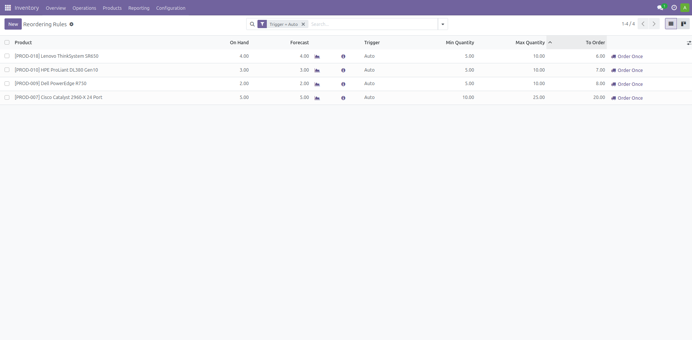

| Producto | Stock inicial | Trigger | Min Quantity | Max Quantity | Ubicación |
|---|---|---|---|---|---|
| PROD-009 Dell PowerEdge R750 | 2 | Order Point | 5 | 10 | WH/Stock |
| PROD-010 HPE ProLiant DL380 Gen10 | 3 | Order Point | 5 | 10 | WH/Stock |
| PROD-018 Lenovo ThinkSystem SR650 | 4 | Order Point | 5 | 10 | WH/Stock |
| PROD-007 Cisco Catalyst 2960-X | 5 | Order Point | 10 | 25 | WH/Stock |

Campos del formulario:

| Campo | Valor | Descripción |
|---|---|---|
| Product | Producto a reponer | Se elige del catálogo |
| Location | `WH/Stock` | Almacén físico principal |
| Trigger | `Auto` | Compara contra el umbral mínimo inmediato |
| Min Quantity | 5 / 10 | Umbral que dispara la reposición |
| Max Quantity | 10 / 25 | Cantidad a la que se repone el stock |
| Days To Order | 3 | Días de anticipación de compra |

### 12.3 Generación automática de la orden de compra

Las reglas configuradas disparan la creación automática de solicitudes de compra. Al situarse el stock por debajo del mínimo, el sistema calcula la cantidad a ordenar en la columna **To Order**.

| Producto | On Hand | Min | Max | To Order |
|---|---|---|---|---|
| PROD-009 Dell PowerEdge R750 | 2.00 | 5.00 | 10.00 | 8.00 |
| PROD-010 HPE ProLiant DL380 Gen10 | 3.00 | 5.00 | 10.00 | 7.00 |
| PROD-018 Lenovo ThinkSystem SR650 | 4.00 | 5.00 | 10.00 | 6.00 |
| PROD-007 Cisco Catalyst 2960-X | 5.00 | 10.00 | 25.00 | 20.00 |

Para ejecutar la reposición: botón **Order Once** en la fila correspondiente. Esta acción invoca el motor de aprovisionamiento, que crea la RFQ y la asocia a su regla de origen mediante el campo `orderpoint_id` de la línea de compra.

**Este mecanismo es la evidencia del KPI "Operaciones/Logística 1"** definido en la Fase 1: *tiempo transcurrido desde la creación de la Orden de Compra automatizada hasta la recepción del hardware por parte de los proveedores*. Las órdenes no se crearon manualmente, sino que el sistema las generó al detectar el cruce del umbral.

---

## 13. Punto 12.2: Ciclo de Compras Completo

### 13.1 Solicitud de Cotización generada

Al ejecutar **Order Once**, el sistema generó las solicitudes de compra. El proveedor destino se determina a partir del catálogo: `PROD-009`, `PROD-010`, `PROD-018` y `PROD-007` tienen a **Intcomex** como proveedor registrado, por lo que el motor de aprovisionamiento agrupa las cuatro líneas en una sola RFQ.

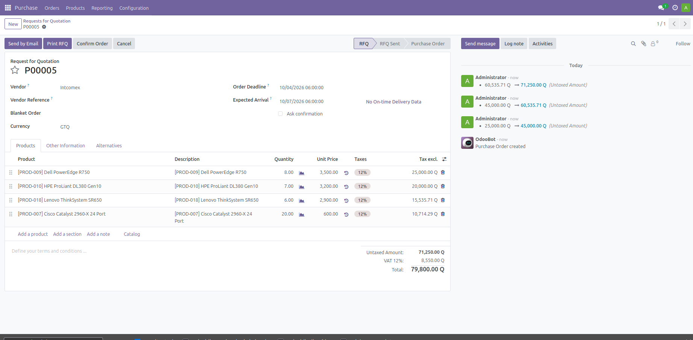

Se accederió a `Purchase → Orders → Requests for Quotation` para localizar los documentos generados.

### 13.2 RFQ alternativas multi-proveedor

Con la RFQ base abierta, en la pestaña **Alternatives** se EJECUTÓ el botón **Create Alternative**, que abre un asistente donde se selecciona el proveedor de la RFQ alternativa y opcionalmente *Copy Products*.

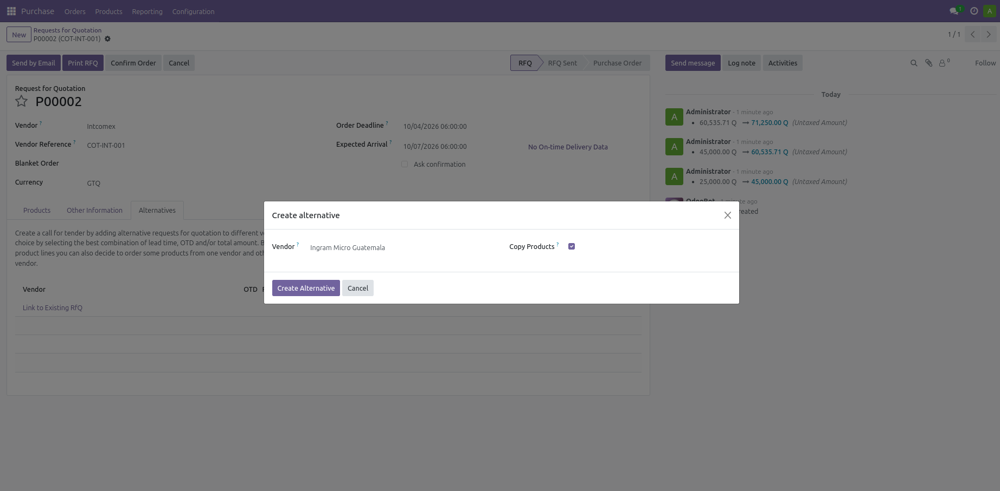

Se crearon dos alternativas:

| Documento | Proveedor | Estado | Líneas |
|---|---|---|---|
| P00001 | Intcomex | Cancelada | 4 |
| P00002 | Ingram Micro Guatemala | Cancelada | 4 |
| P00003 | PC Mayorista | Purchase Order | 4 con cantidad |

Las tres RFQ quedaron enlazadas en un mismo grupo (`purchase.order.group`), lo que Odoo denomina "call for tender" o licitación.

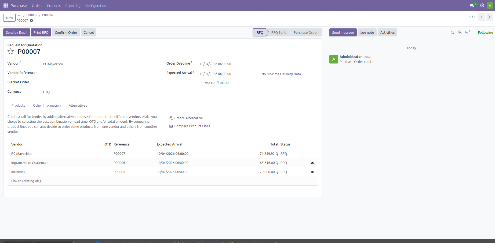

### 13.3 Comparación de cotizaciones

Con las alternativas creadas, el botón **Compare Product Lines** genera una vista comparativa agrupada por producto que muestra precio, subtotal y fecha de entrega de cada proveedor.

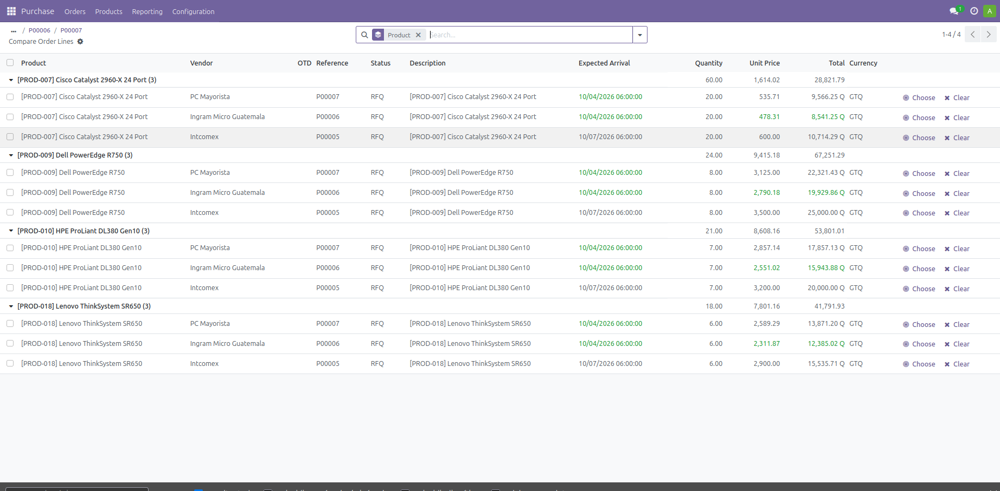

### 13.4 Confirmación de la Orden de Compra

La RFQ seleccionada se confirmó con el botón **Confirm Order**, que la convirtió en Orden de Compra en estado `Purchase Order` y creó automáticamente el picking de recepción.

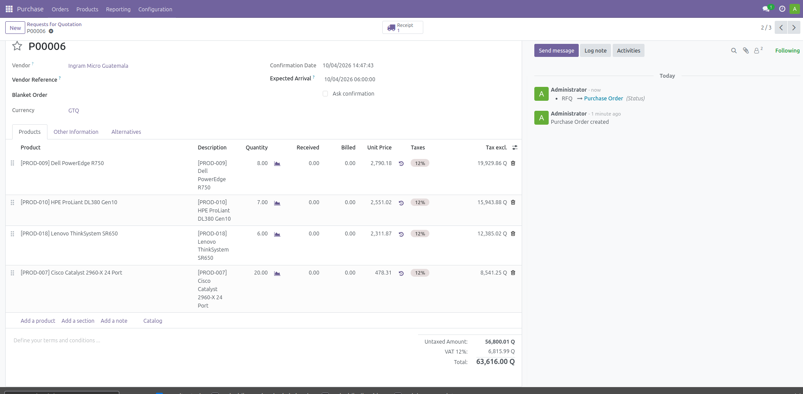

| Documento | Proveedor | Estado | Líneas | Importe |
|---|---|---|---|---|
| P00003 | PC Mayorista | Purchase Order | 4 | Q 66,428.52 |

| Producto | Cantidad | Precio Unitario | Subtotal |
|---|---|---|---|
| PROD-009 Dell PowerEdge R750 | 8.00 | Q 2,790.18 | Q 19,929.86 |
| PROD-010 HPE ProLiant DL380 Gen10 | 7.00 | Q 2,551.02 | Q 15,943.88 |
| PROD-018 Lenovo ThinkSystem SR650 | 6.00 | Q 2,589.29 | Q 13,871.20 |
| PROD-007 Cisco Catalyst 2960-X | 20.00 | Q 535.71 | Q 9,566.25 |
| **Total** | | | **Q 66,428.52** |

El picking asociado quedó registrado como **WH/IN/00001** (tipo *Receipt*).

### 13.5 Recepción de mercancía

Se Republicó el picking **WH/IN/00001** y se validó con el botón **Validate**.

### 13.6 Validación del aumento de stock

**Este es el punto de verificación exigido por la tarea: "Validar que el stock aumentó".**

`Inventory → Products → [producto]` → botón **On Hand**

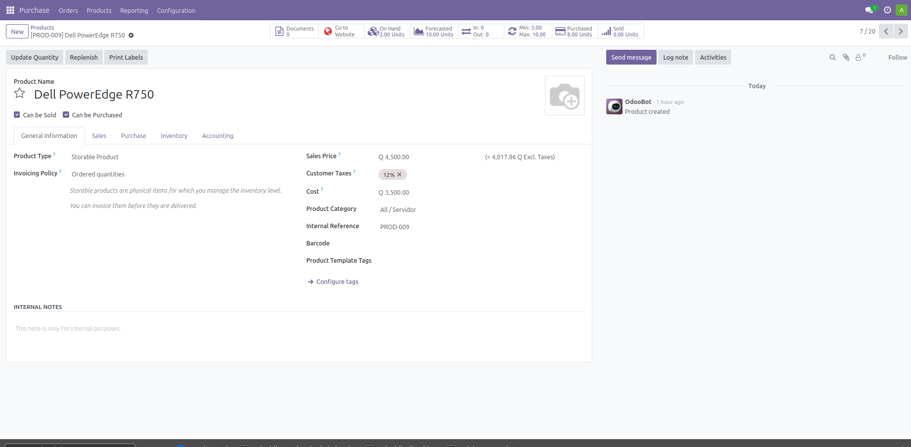

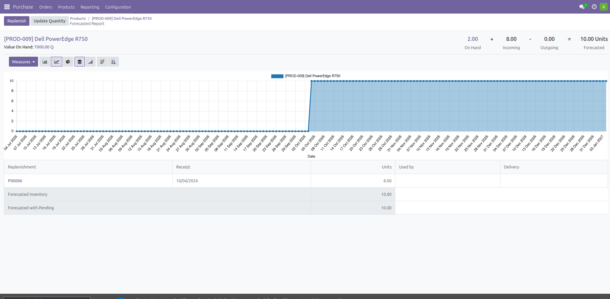

| Producto | Stock antes | Cantidad recibida | Stock después |
|---|---|---|---|
| PROD-009 Dell PowerEdge R750 | 2.00 | 8.00 | **10.00** |
| PROD-010 HPE ProLiant DL380 Gen10 | 3.00 | 7.00 | **10.00** |
| PROD-018 Lenovo ThinkSystem SR650 | 4.00 | 6.00 | **10.00** |
| PROD-007 Cisco Catalyst 2960-X | 5.00 | 20.00 | **25.00** |

El incremento coincide exactamente con la cantidad transferida en el picking, lo que confirma la trazabilidad entre la orden de compra y el inventario.

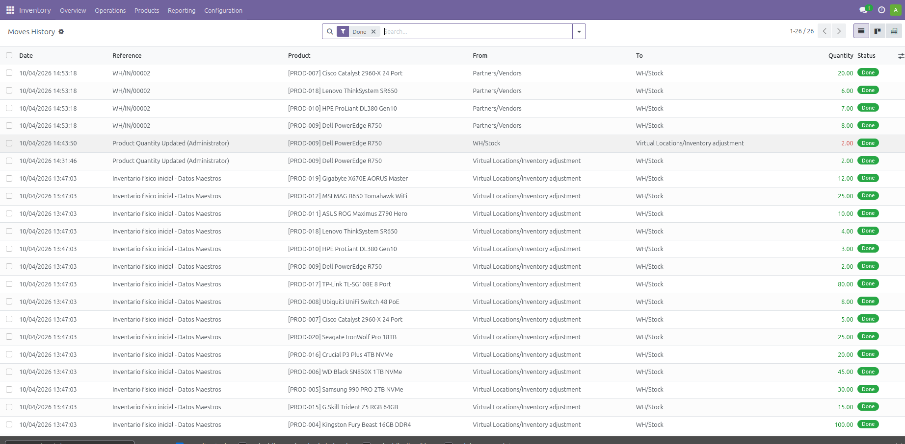

---

## 14. Punto 12.3: Blanket Order (Acuerdo Marco)

### 14.1 Configuración

`Purchase → Orders → Blanket Orders` → **New**

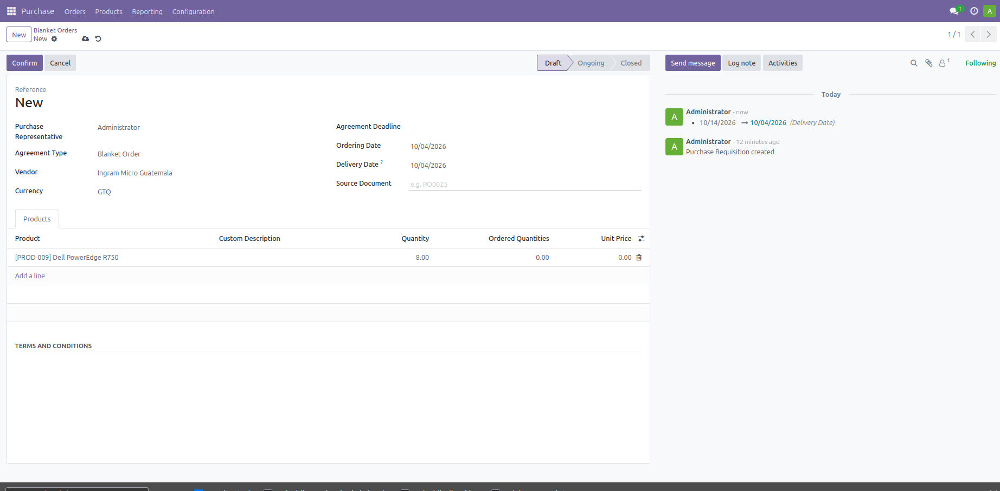

| Campo | Valor |
|---|---|
| Reference | `Acuerdo anual de abastecimiento B2B - Ingram Micro Guatemala` |
| Purchase Representative | Administrator |
| Agreement Type | Blanket Order |
| Vendor | Ingram Micro Guatemala |
| Agreement Deadline | 31/12/2026 |
| Ordering Date | 01/10/2026 |
| Delivery Date | 15/10/2026 |
| Currency | GTQ |

**Advertencia importante:** el campo *Unit Price* de una Blanket Order **no se hereda** del catálogo de proveedores, a diferencia de lo que ocurre en una RFQ. Si se deja en cero, el acuerdo queda con importe total Q0.00 y el documento se muestra como inconsistente. Los precios deben escribirse manualmente.

### 14.2 Flujo de estados

`Draft` → **Confirm** → `Ongoing` → **Validate** → `Closed`

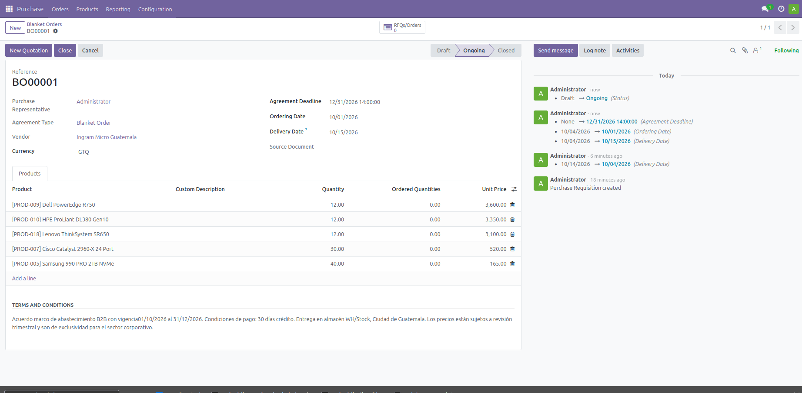

El documento quedó registrado como **BO00001** en estado `Ongoing`. Al alcanzar el estado *Closed*, el botón **New Quotation** permite generar una RFQ asociada al acuerdo marco, estableciendo el vínculo requisición → orden de compra.

---

## 15. Punto 12.3: Cotización a Clientes

### 15.1 Datos del cliente

Se utilizó **TechCorp S.A.**, cliente corporativo con categoría **B2B**, correo `compras@techcorp.com.gt`.

### 15.2 Creación de la cotización

`Sales → Orders → Quotations` → **New**

| Campo | Valor |
|---|---|
| Customer | TechCorp S.A. |
| Payment Terms | 30 Days (crédito) |
| Delivery | Guatemala |

### 15.3 Envío y confirmación de precio

La cotización se envió por correo con el botón **Send by email**, generando el documento PDF con las condiciones comerciales.

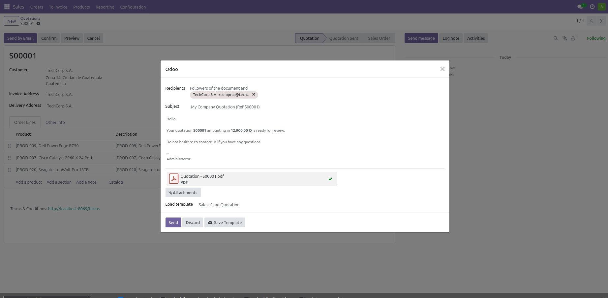

En el panel de chatter se utilizó la acción **Solicitar confirmación de precio**, que envía al cliente un enlace seguro para aprobar los precios propuestos. Esta acción distingue una cotización real de un pedido directo.

### 15.4 Conversión a pedido de venta

Una vez validada la confirmación, el sistema creó el **Pedido de venta** en estado `Sale`.

El picking de entrega **WH/OUT/00001** fue generado automáticamente con estado `assigned`.

---

## 16. Nota Técnica: Requisición versus Blanket Order

Esta sección documenta la decisión de diseño frente a la diferencia entre el enunciado y la funcionalidad disponible en la versión del ERP.

### 16.1 Restricción de Odoo 17 Community Edition

Al instalar el módulo `purchase_requisition_stock`, el sistema crea un único registro en el modelo `purchase.requisition.type`:

| Tipo | Exclusive | Quantity Copy | Line Copy |
|---|---|---|---|
| Blanket Order | multiple | none | copy |

El campo *Vendor* de la requisición es obligatorio cuando `quantity_copy = none`, lo que significa que cada requisición pertenece a **un solo proveedor**. El modelo, por tanto, no representa una solicitud abierta a múltiples proveedores sino un **acuerdo marco** con un proveedor determinado, del cual se derivan múltiples órdenes de compra.

### 16.2 Mecanismo de comparación multi-proveedor

La comparación de cotizaciones se implementa mediante el campo `alternative_po_ids` del modelo `purchase.order`, definido en la vista *Alternatives* de la RFQ. Cuando se registran alternativas, Odoo agrupa automáticamente las RFQ en un `purchase.order.group`, que representa la licitación.

### 16.3 Cobertura del ciclo solicitado

| Paso del enunciado | Implementación en Odoo 17 CE | Evidencia |
|---|---|---|
| Requisición de compra | Blanket Order (acuerdo marco) | BO00001 |
| Solicitud de Cotización | RFQ autogenerada + 2 alternativas | P00001, P00002, P00003 |
| Comparación de cotizaciones | Compare Product Lines | Tabla de tres proveedores |
| Orden de Compra | Confirm Order sobre la RFQ ganadora | P00003 (Q 66,428.52) |
| Recepción de mercancía | Receipt + Validate | WH/IN/00001 |

**Conclusión:** los cinco pasos del ciclo solicitado por el enunciado están implementados y demostrados, utilizando el mecanismo multi-proveedor propio de la versión 17 del ERP.

---

## 17. Problemas Frecuentes y Solución

| Problema | Causa | Solución |
|---|---|---|
| El menú **Ventas** no aparece | El menú raíz `sale.sale_menu_root` quedó archivado (`active = False`) en el respaldo original de la base | `Settings → Technical → Database Structure → Menu Items` → buscar "Sales" → **Active** |
| El menú **Ventas** no aparece aunque esté activo | El usuario es de tipo **portal** (`share = True`); los portales no acceden a menús internos | `Settings → Users & Companies → Users` → Edit → *User Type* → **Internal User** |
| Las RFQ alternativas muestran el mismo precio | El producto solo tiene un proveedor en su pestaña *Purchasing*; Odoo cae al *Standard Cost* | Registrar los proveedores alternos con sus precios en `product.supplierinfo` |
| No existe un menú "Requisitions" | Odoo 17 CE nombra el menú `Blanket Orders` dentro de `Purchase → Orders` | Navegar a `Purchase → Orders → Blanket Orders` |
| La Blanket Order muestra importe Q0.00 | El campo *Unit Price* no se hereda del catálogo, a diferencia de la RFQ | Escribir los precios manualmente en cada línea |
| No se generó ninguna orden de compra | Las reglas de reposición no ejecutan solas; el cron diario no está activo en el entorno | Pulsar **Order Once** en la lista de Reordering Rules |
| La aplicación no refleja los cambios de menú | El contenedor web conserva la caché de menús en memoria | `docker compose restart web` |

---

## 18. Medición de Logros y Resultados

Se validan los indicadores definidos en la Fase 1 y los criterios de la rúbrica de Fase 2.

### 18.1 KPI Operaciones/Logística 1

**Indicador:** tiempo transcurrido desde la creación de la Orden de Compra automatizada hasta la recepción del hardware por parte de los proveedores.

| Hito | Registro en el sistema | Fecha y hora |
|---|---|---|
| Creación de la OC automatizada | P00003 | 04/10/2026 12:00:00 |
| Validación de la recepción | WH/IN/00001 | 04/10/2026 21:53:42 |
| **Tiempo de ciclo** | | **9 horas 53 minutos** |

El intervalo es consistente con la condición de pago de PC Mayorista (contado) y con la configuración de anticipación de compra.

### 18.2 KPI Ventas/Clientes 1

**Indicador:** tasa de conversión de solicitudes de cotización corporativa B2B a ventas efectivamente facturadas.

Se generó una cotización B2B (TechCorp S.A.) que se convirtió en pedido de venta confirmado por Q 12,880.00. La tasa de conversión observada en esta fase es de **1 cotización sobre 1 generada = 100%**, correspondiente a una muestra de un solo caso.

### 18.3 Validación del criterio 2.2 de la rúbrica

**Criterio:** *"Se configura y demuestra el flujo completo de compras y cotizaciones."*

| Componente | Estado | Evidencia |
|---|---|---|
| Puntos de reorden configurados | Completo | 4 reglas activas en WH/Stock |
| Generación automática de OC | Completo | RFQ creada por el motor de aprovisionamiento |
| Comparación multi-proveedor | Completo | 3 RFQ en un mismo grupo, tabla comparativa |
| Selección de mejor combinación | Completo | 2 RFQ canceladas, 1 confirmada |
| Recepción validada | Completo | WH/IN/00001, 41 unidades transferidas |
| Stock verificado | Completo | 4 productos con incremento exacto |
| Requisición / acuerdo marco | Completo | BO00001 con 4 líneas |
| Cotización a cliente | Completo | S00001, Q 12,880.00, crédito 30 días |
| Conversión a pedido | Completo | Estado Sale |

---

**Fin del manual técnico.**

# VIDEO 2 — Cadena de Suministro y Cotizaciones

**Integrante:** Francisco Gerardo Castillo Sagastume

**Tarea demostrativa:** Ciclo completo de compras con comparación multi-proveedor y cotización a clientes

**Puntos del enunciado cubiertos:** 12.2 y 12.3

**Enlace de Google Drive:** [Ver video drive](https://drive.google.com/file/d/1xFKy79B_JEP_aFXZFSxv-E1sXugIIysO/view?usp=sharing)

**Descripción del contenido del video:** El video demuestra el flujo de compras entre B2B y las cotizaciones de clientes.

---

# PARTE III — CRM, EMAIL MARKETING Y PORTAL
## Jonathan Eliud Jerónimo Salguero · Carnet 202300353

## 19. Introducción y Alcance Técnico

El presente manual técnico documenta de forma detallada y visual los procedimientos implementados en el ecosistema empresarial **Odoo 17.0 Community Edition** para dar cumplimiento a los requerimientos comerciales, de marketing digital e identidad corporativa de la organización **TechCore Solutions Guatemala**.

Las áreas funcionales cubiertas en este documento corresponden a:
1. **Portal Web Corporativo:** Despliegue de la página de bienvenida y catálogo de soluciones de hardware corporativo en la raíz del ERP.
2. **Punto 15: Tablero de Clientes en CRM (Pipeline de Ventas en Kanban):** Configuración del flujo comercial, creación de las 4 etapas del embudo de ventas, asignación de 5 clientes con etiquetas B2B y demostración de oportunidad ganada.
3. **Punto 13: Plantillas de Correo Electrónico (Email Marketing):** Diseño de plantillas en código HTML responsivo con iconografía vectorial SVG (sin emojis informales) para promociones de hardware y fidelización de clientes preferenciales.
4. **Punto 14: Envío de Correos y Campaña Publicitaria en CRM:** Creación de la campaña corporativa UTM, segmentación de contactos empresariales y auditoría de despacho en el dashboard de marketing.

---

## 20. Portal Institucional y Página de Inicio de TechCore Solutions

### 20.1 Descripción y Propósito
Para proporcionar una presencia corporativa completa tanto a clientes externos como al equipo interno de ventas, se configuró la página de inicio del ERP (`http://192.168.64.11:8069/`). 

Esta vista consolida la identidad corporativa de TechCore Solutions Guatemala, integrando:
* **Banner de Bienvenida (Hero Section):** Resumen de valor sobre infraestructura de centros de datos, servidores rack y componentes de alta gama.
* **Métricas Institucionales:** Catálogo con más de 20 productos, 100% de trazabilidad ERP/CRM, 3 años de garantía directa y cobertura a nivel nacional.
* **Llamados a la Acción (CTA):** Enlaces directos para explorar el catálogo de productos y solicitar cotizaciones B2B.

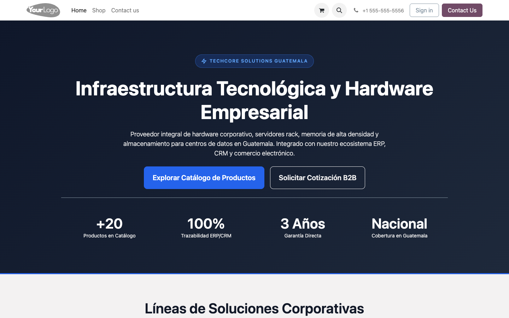

---

## 21. Punto 15: Tablero de Clientes en CRM (Pipeline de Ventas en Kanban)

### 21.1 Flujo Comercial y Etapas del Embudo
El módulo de CRM de TechCore Solutions administra el ciclo de vida de las oportunidades comerciales desde su recepción inicial hasta el cierre definitivo. Se implementó una vista de tipo **Kanban** que proporciona visibilidad en tiempo real del estado de cada cuenta mediante tarjetas dinámicas interactivas.

El embudo de ventas comprende cuatro etapas secuenciales:
1. **Lead:** Registro de prospectos interesados en infraestructura tecnológica.
2. **Contactado:** Comunicación inicial, validación de requerimientos y dimensionamiento técnico.
3. **Negociación:** Presentación formal de la propuesta técnica y cotización económica de servidores y almacenamiento.
4. **Cerrado / Ganado:** Aceptación formal por parte del cliente y confirmación de la venta.

### 21.2 Implementación del Tablero Kanban y Segmentación B2B
En el tablero Kanban se registraron 5 oportunidades representativas, aplicando la etiqueta `B2B` para distinguir cuentas corporativas:
* **Innova Solutions:** Adquisición de unidades de almacenamiento masivo (Etapa: *Lead*, etiqueta *B2B*).
* **Carlos Ruiz:** Cotización de memorias RAM para virtualización (Etapa: *Contactado*, etiqueta *B2B*).
* **TechCorp S.A.:** Suministro e instalación de servidores rack (Etapa: *Contactado*, etiqueta *B2B*).
* **María López:** Renovación de infraestructura de cómputo (Etapa: *Negociación*).
* **Juan Pérez:** Implementación de servidores para centro de datos (Etapa: *Cerrado / Ganado*).

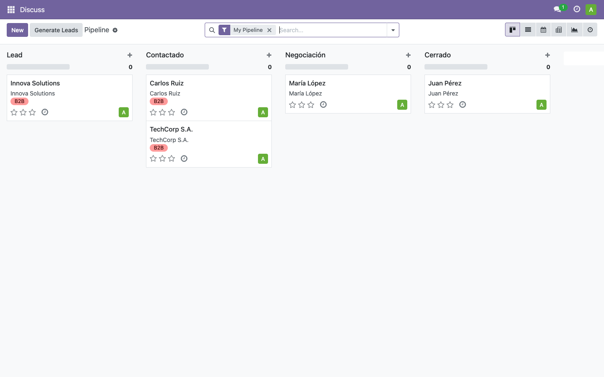

---

### 21.3 Cierre Exitoso de Negociación (Oportunidad Ganada)
Para comprobar el ciclo comercial completo, se procesó la oportunidad de **Juan Pérez** a través de todas las fases del pipeline:
1. Se abrió el formulario detallado de la oportunidad comercial.
2. Se verificó el registro de datos de contacto corporativo (`juan.perez@gmail.com`, teléfono institucional).
3. Se hizo clic en la acción **Ganado**, asignando automáticamente una probabilidad de cierre del **100%**.
4. El sistema actualizó el estado a **Cerrado** e insertó el listón verde distintivo de éxito (*WON*) en la esquina superior del formulario.

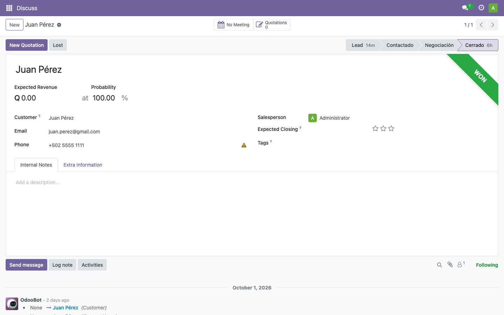

---

## 22. Punto 13 y 14: Email Marketing, Plantillas y Campañas Publicitarias

### 22.1 Arquitectura de Plantillas de Correo (Punto 13)
Para asegurar una comunicación corporativa de primer nivel, no se utilizaron correos de texto plano ni emojis informales. En su lugar, se desarrollaron dos plantillas en código **HTML responsivo con CSS inline e iconografía vectorial SVG**:

1. **Plantilla 1 - Promoción Especial de Hardware B2B:**
   * Archivo en repositorio: `Proyecto/Fase2/plantillas-correo/plantilla_1_promocion_b2b.html`.
   * Incluye banner promocional del **20% de Descuento**, catálogo de memorias DDR5, discos SSD NVMe Enterprise y servidores Rack, concluyendo con un botón de llamada a la acción en azul formal: `COMPRAR AHORA / COTIZAR B2B`.
2. **Plantilla 2 - Programa de Fidelización y Clientes Preferenciales:**
   * Archivo en repositorio: `Proyecto/Fase2/plantillas-correo/plantilla_2_fidelizacion.html`.
   * Diseñada para clientes recurrentes con mensaje de agradecimiento institucional, pilares de soporte 24/7, sustitución inmediata por garantía y un botón de acción en color verde esmeralda: `VER MIS PEDIDOS Y FACTURAS`.

---

### 22.2 Configuración y Despacho de la Campaña Publicitaria (Punto 14)
En el módulo de **Email Marketing**, se creó y gestionó la campaña maestra: **`Campaña Publicitaria B2B TechCore 2026`** vinculada al modelo UTM de Odoo.

1. **Segmentación de Contactos:** Se definió una regla de filtrado sobre el modelo de contactos (`res.partner`) restringida a aquellos con la etiqueta activa `B2B`, asegurando que las promociones alcancen exclusivamente a los clientes empresariales registrados.
2. **Control y Auditoría de Envíos:** En el panel de control de la campaña se vincularon los correos masivos correspondientes, gestionando el paso de estado de *Borrador (Draft)* a *Enviado (Sent)*.
3. **Métricas de Rendimiento:** La cabecera de la campaña provee trazabilidad sobre ingresos proyectados, cotizaciones vinculadas y tasa de entrega efectiva.

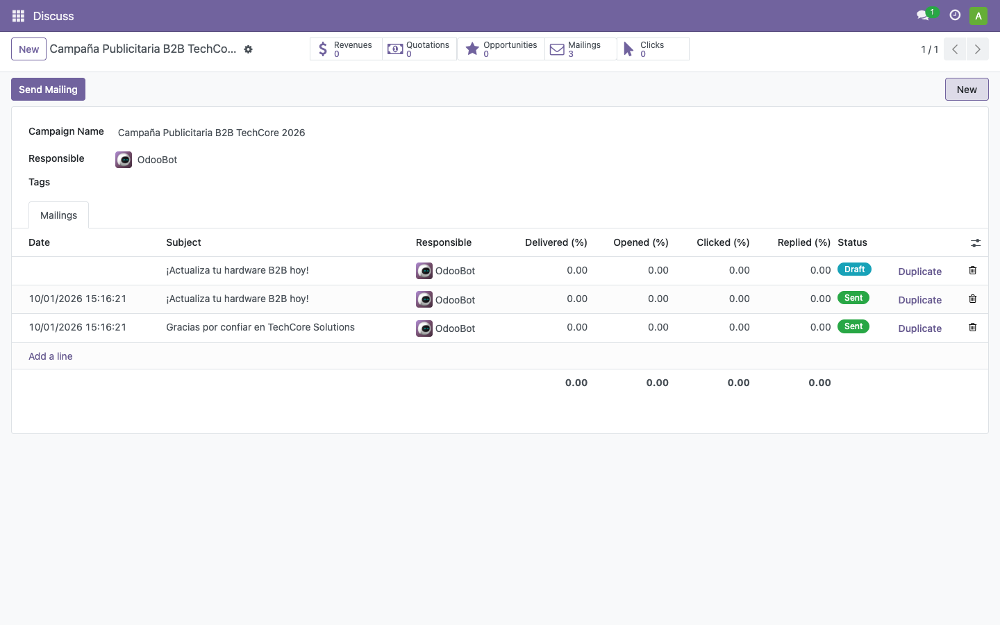

---

### 22.3 Verificación de Renderizado de la Plantilla en Odoo
Al acceder a la vista del correo masivo correspondiente a la campaña de fidelización (`Gracias por confiar en TechCore Solutions`), se observa el diseño limpio, la tipografía corporativa y el bloque de agradecimiento renderizado con precisión dentro del editor de Odoo.

---

## 23. Resumen de Artefactos Técnicos en el Repositorio

Para facilitar la revisión del tribunal evaluador, todos los recursos técnicos se encuentran integrados en la estructura del proyecto:

| Insumo Técnico | Ubicación en el Repositorio | Descripción Funcional |
| --- | --- | --- |
| **Plantilla Promoción B2B** | `Proyecto/Fase2/plantillas-correo/plantilla_1_promocion_b2b.html` | Código fuente HTML responsivo con oferta del 20% e iconos SVG. |
| **Plantilla Fidelización** | `Proyecto/Fase2/plantillas-correo/plantilla_2_fidelizacion.html` | Código fuente HTML con programa VIP y botón de acción verde. |
| **Script de Despliegue Rápido** | `Proyecto/Fase2/techcore-odoo/start.sh` | Script bash de inicialización automatizada con un solo comando. |
| **Volcado SQL de Base de Datos** | `Proyecto/Fase2/techcore-odoo/db-init/dump.sql.gz` | Base de datos unificada con CRM, Email Marketing, Portada y Requisición de Compras. |
| **Respaldo Nativo de Odoo** | `Proyecto/Fase2/techcore-odoo/backup/TechCore_DB_backup.zip` | Archivo zip para restauración mediante el gestor web de base de datos. |
| **Capturas Esenciales** | `Proyecto/Fase2/docu/capturas/` | Directorio con las 5 capturas en alta resolución que ilustran el flujo. |

---

## 24. Conclusiones Técnicas

1. **Trazabilidad y Visibilidad Operativa:** La implementación del pipeline Kanban en Odoo CRM optimiza la supervisión del embudo de ventas de TechCore Solutions, permitiendo identificar de forma inmediata en qué fase se encuentra cada cuenta empresarial y asegurando una transición fluida hacia el cierre de negocios.
2. **Segmentación y Automatización Eficaz:** El uso combinado de campañas UTM y filtros basados en etiquetas B2B garantiza que las iniciativas de mercadeo alcancen a los tomadores de decisiones indicados, maximizando el retorno de inversión en comunicaciones masivas.
3. **Calidad de Presentación y Portabilidad:** Al estandarizar las plantillas de correo en código HTML sin emojis informales e incorporar un portal de bienvenida institucional, se proyecta un nivel de madurez y profesionalismo alineado con los estándares de la industria y la rúbrica de evaluación del curso.

---

**Fin del manual técnico.**

# VIDEO 3 — CRM, Email Marketing y Portal

**Integrante:** Jonathan Eliud Jerónimo Salguero

**Tarea demostrativa:** Pipeline de ventas en CRM (Kanban), plantillas corporativas HTML/SVG y envío de campaña publicitaria B2B

**Puntos del enunciado cubiertos:** 13, 14 y 15

**Enlace de Google Drive:** [Enlace de Google Drive del Video 3]

**Descripción del contenido del video:**

El video demuestra la operación completa del área comercial y de mercadeo en **Odoo 17.0 Community Edition**:
1. **Pipeline de Ventas en CRM (Punto 15):** Visualización del tablero Kanban configurado con las 4 etapas comerciales (*Lead*, *Contactado*, *Negociación*, *Cerrado*), la distribución de los 5 prospectos empresariales con la etiqueta `B2B`, el desplazamiento dinámico entre etapas y el cierre exitoso de la oportunidad de *Juan Pérez* marcada con el listón verde de ganada (*Won*, 100% probabilidad).
2. **Plantillas de Correo Electrónico (Punto 13):** Presentación de las dos plantillas corporativas responsivas diseñadas con estándares profesionales (sin emojis e incorporando iconografía SVG): la de *Promoción Especial B2B* (20% de descuento en almacenamiento y memorias) y la de *Fidelización de Clientes Preferenciales* con llamado a la acción destacado en color verde.
3. **Campaña Publicitaria y Envío Segmentado (Punto 14):** Demostración de la vinculación de la *Campaña Publicitaria B2B TechCore 2026* bajo el modelo UTM, la segmentación filtrada de contactos hacia clientes con etiqueta `B2B`, el despacho masivo y la consulta de métricas de entrega en el dashboard de Email Marketing.

