# Manual Técnico de Datos Maestros, Inventario y Medición de Resultados

**Universidad de San Carlos de Guatemala**  
**Facultad de Ingeniería**  
**Escuela de Ciencias y Sistemas**  
**Sistemas Organizacionales y Gerenciales 1 (SOG1) - Sección A**  
**Segundo Semestre 2026**  

**Empresa:** TechCore Solutions Guatemala  
**Integrante:** Julio Alfredo Herrera Orantes  
**Carnet:** 202300850  
**Rol:** Datos Maestros, Inventario y Medición de Resultados  
**Fase Evaluada:** Fase 2 - Configuración, Desarrollo de Módulos y Operación Base  

---

## 1. Introducción y Alcance Técnico

El presente manual documenta paso a paso, con capturas de pantalla, la carga de datos maestros y la consulta de inventario en **Odoo 17.0 Community Edition** para **TechCore Solutions Guatemala**. Las áreas cubiertas corresponden a:

1. **Punto 12.1: Carga de Productos, Clientes y Proveedores.** Importación masiva desde archivos Excel y carga manual desde la interfaz.
2. **Punto 12.4: Informe de Inventario.** Existencias actuales, órdenes pendientes de proveedores y alertas de stock bajo.
3. **Medición de Logros y Resultados.** Validación de la carga y del flujo frente a los indicadores definidos en la Fase 1.

Acceso al sistema: `http://localhost:8069`, base de datos `TechCore_DB`. La moneda de la compañía es el quetzal (Q).

---

## 2. Archivos de Importación

Se prepararon cuatro archivos `.xlsx` a partir de los datos maestros del grupo (`Datos_Maestros_TechCore_Fase2.xlsx`), con los encabezados adaptados a los **nombres técnicos de los campos de Odoo** para que el asistente de importación los reconozca automáticamente. Se encuentran en la carpeta `Proyecto/Fase2/techcore-odoo/`.

| Archivo | Modelo de Odoo | Registros | Columnas |
|---|---|---|---|
| `1_Productos_Odoo.xlsx` | Producto (`product.template`) | 20 | `default_code`, `name`, `categ_id`, `list_price`, `standard_price`, `detailed_type`, `sale_ok`, `purchase_ok` |
| `2_Clientes_Odoo.xlsx` | Contacto (`res.partner`) | 5 | `name`, `company_type`, `email`, `phone`, `street`, `country_id`, `category_id` |
| `3_Proveedores_Odoo.xlsx` | Contacto (`res.partner`) | 3 | `name`, `company_type`, `email`, `supplier_rank`, `comment` |
| `4_Inventario_Fisico_Odoo.xlsx` | Ajuste de inventario (`stock.quant`) | 20 | `product_id/default_code`, `location_id`, `inventory_quantity` |

Criterios de adaptación:

- `detailed_type` = `product` para que cada artículo sea **almacenable** y lleve control de existencias.
- `category_id` guarda el segmento (B2B o B2C) como **etiqueta** del contacto.
- `supplier_rank` = 1 marca al contacto como proveedor.
- Las condiciones de pago y los productos que provee cada proveedor se guardan en el campo de notas (`comment`).
- La columna de imágenes del archivo original no se importa, porque Odoo solo admite imágenes mediante URL o base64.

**Orden de importación:** productos, clientes, proveedores y, al final, el stock inicial (que necesita que los productos ya existan).

---

## 3. Punto 12.1: Carga Masiva

### 3.1 Acceso al módulo de Inventario

Desde el menú de aplicaciones se abre **Inventory**. La vista inicial (*Inventory Overview*) muestra los tipos de operación Receipts y Delivery Orders.

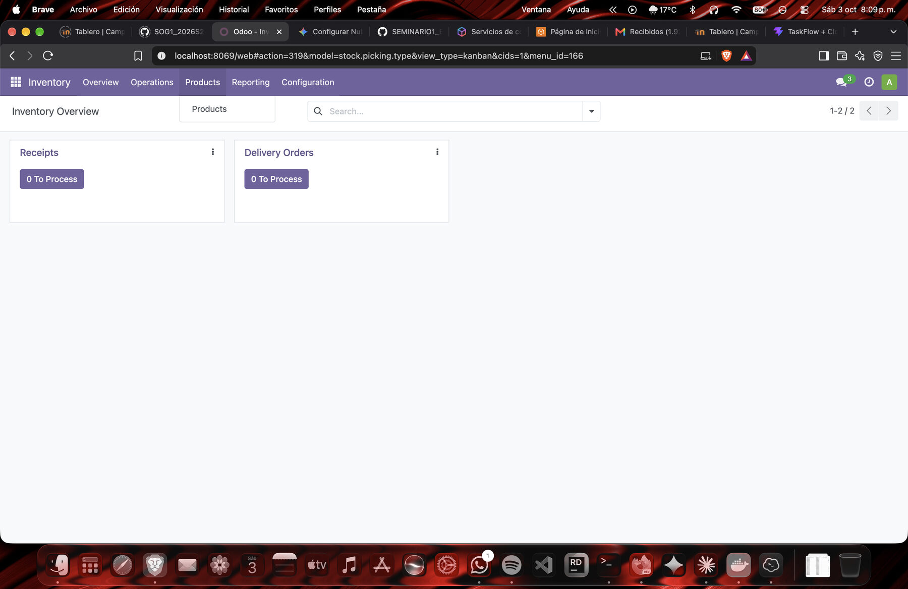

### 3.2 Importación de Productos

1. Ir a **Inventory → Products → Products**.
2. Pulsar el icono de engranaje (⚙) junto al título y elegir **Import records**.
3. Pulsar **Load File** y seleccionar `1_Productos_Odoo.xlsx`.
4. Verificar que cada columna esté asociada al campo correcto: `default_code` a *Internal Reference*, `name` a *Name*, `categ_id` a *Product Category*, `list_price` a *Sales Price*, `standard_price` a *Cost*, `detailed_type` a *Product Type*, `sale_ok` a *Can be Sold* y `purchase_ok` a *Can be Purchased*.
5. Las categorías (Procesador, Memoria RAM, SSD, Switch, Servidor, Tarjeta Madre y Disco Duro) no existían aún. En el aviso rojo se cambia **When a value cannot be matched** de *Prevent import* a **Create new values**.
6. Pulsar **Test**. Debe mostrarse el mensaje *Everything seems valid*.
7. Pulsar **Import**. Se crean los 20 productos.

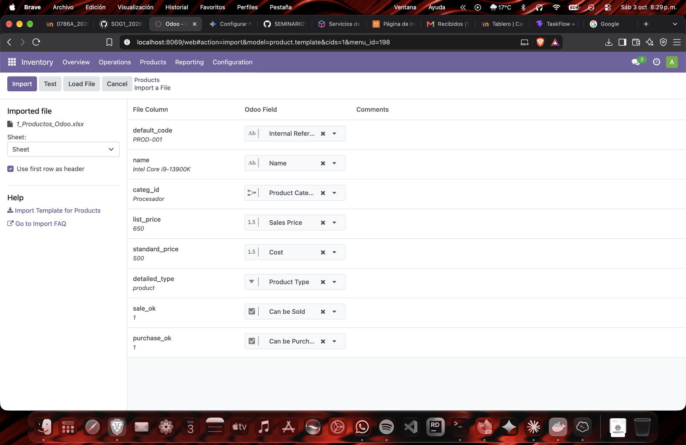

### 3.3 Importación de Clientes

1. Abrir la aplicación **Contacts** y cambiar a la vista de lista.
2. ⚙ → **Import records** → **Load File** → `2_Clientes_Odoo.xlsx`.
3. Verificar el mapeo: `name` a *Name*, `company_type` a *Company Type*, `email` a *Email*, `phone` a *Phone*, `street` a *Street*, `country_id` a *Country* y `category_id` a *Tags* (el segmento B2B o B2C).
4. **Test** y, si todo es válido, **Import**. Se crean los 5 clientes.

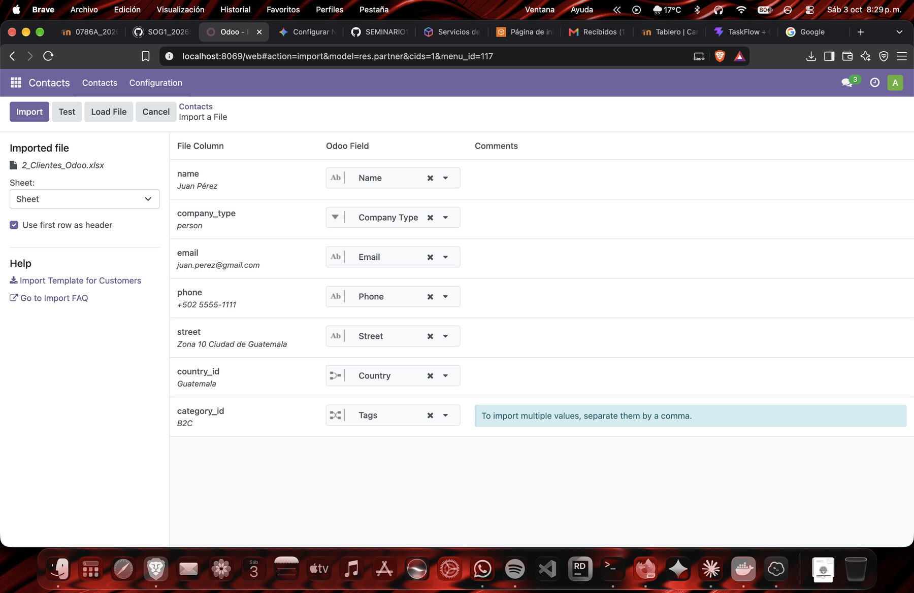

### 3.4 Importación de Proveedores

Se repite el procedimiento de la sección 3.3 con `3_Proveedores_Odoo.xlsx` (Contacts → ⚙ → **Import records**). Las columnas `supplier_rank` y `comment` se asocian a *Vendor Rank* y *Notes*. Se crean los 3 proveedores: Ingram Micro Guatemala, Intcomex y PC Mayorista.

### 3.5 Carga del Stock Inicial

La importación de productos no genera existencias, por lo que el stock inicial se carga como **ajuste de inventario**:

1. Ir a **Inventory → Operations → Physical Inventory**.
2. ⚙ → **Import records** → **Load File** → `4_Inventario_Fisico_Odoo.xlsx`.
3. Asociar manualmente la columna `product_id/default_code` al campo **Product → Internal Reference**. Si no se asocia, Odoo no reconoce el producto y la columna queda sin campo, como se muestra en la figura. La columna `inventory_quantity` se asocia a *Counted Quantity*.
4. **Test** e **Import**. Se crean 20 líneas con la cantidad contada.
5. Seleccionar todas las líneas y pulsar **Apply All**. Hasta ese momento *On Hand Quantity* sigue en cero.

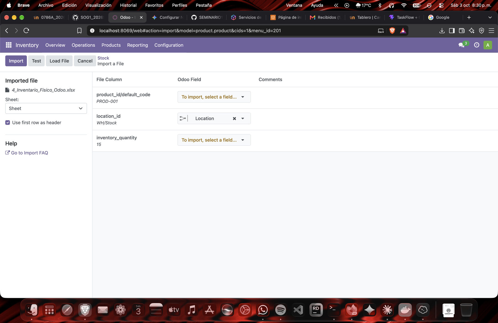

---

## 4. Punto 12.1: Carga Manual

Para demostrar ambas modalidades se creó desde la interfaz un producto, un cliente y un proveedor.

### 4.1 Producto manual: Logitech MX Keys

1. **Inventory → Products → Products → New**.
2. Completar el formulario: nombre `Logitech MX Keys`, tipo **Storable Product**, precio de venta Q 100.00, costo Q 70.00, categoría `Periféricos` y referencia interna `PROD-021`.
3. Guardar con el icono de la nube.
4. Pulsar **Update Quantity**, indicar `10.00` en *New Quantity on Hand* y pulsar **Apply**. El botón *On Hand* del producto pasa a 10.00 unidades.

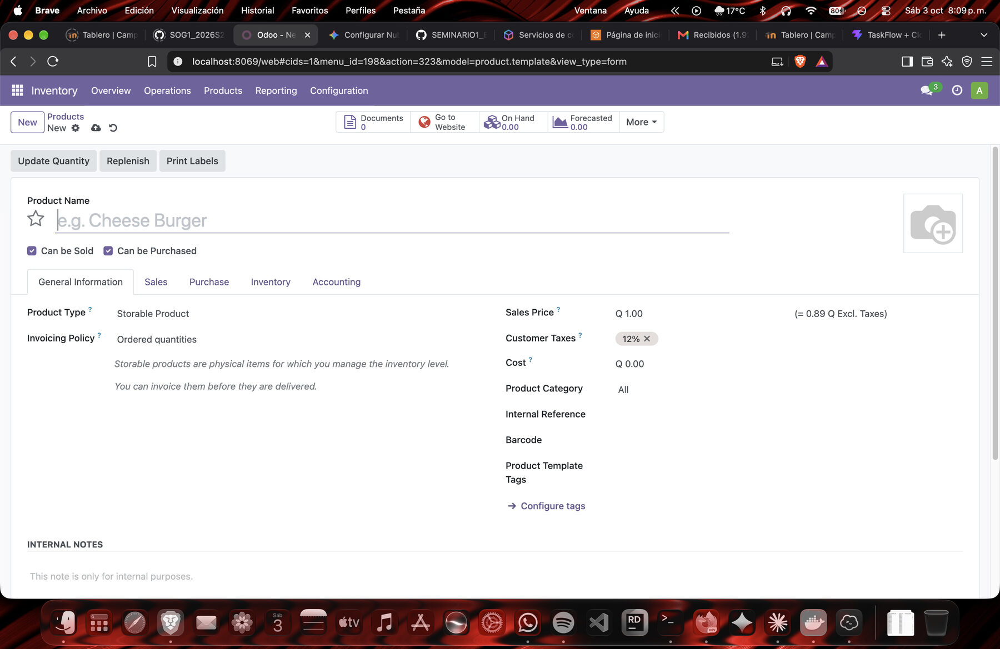

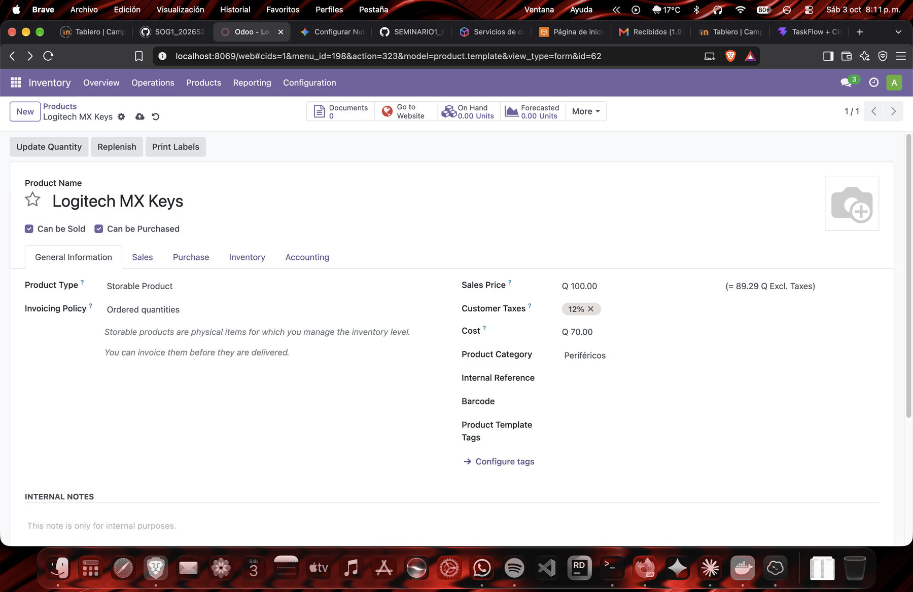

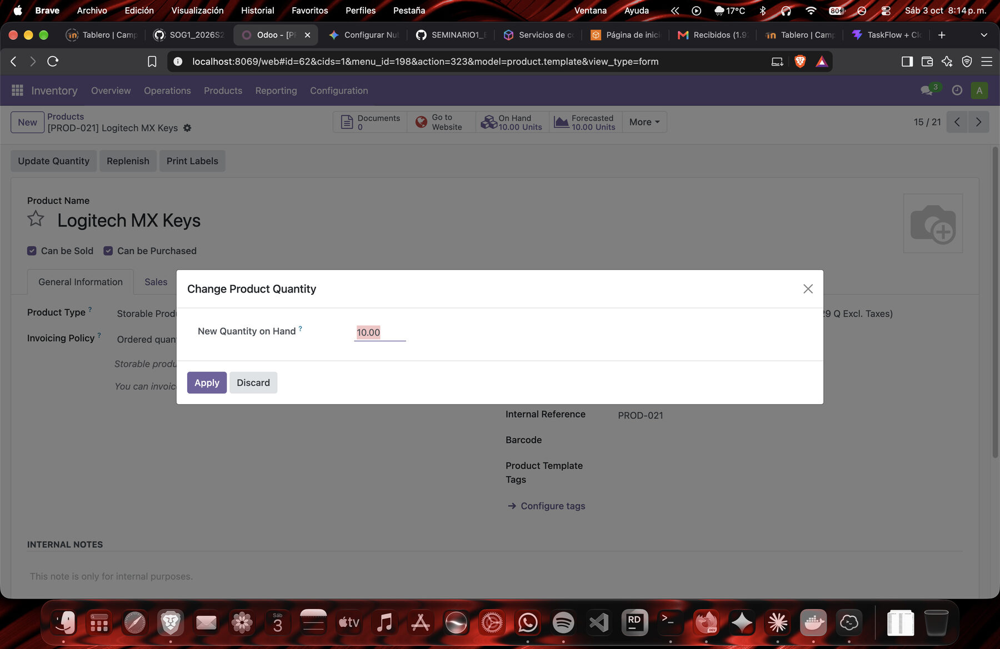

Resultado: el catálogo muestra **21 productos** (20 importados más el manual), cada uno con su precio y las existencias en *On hand*.

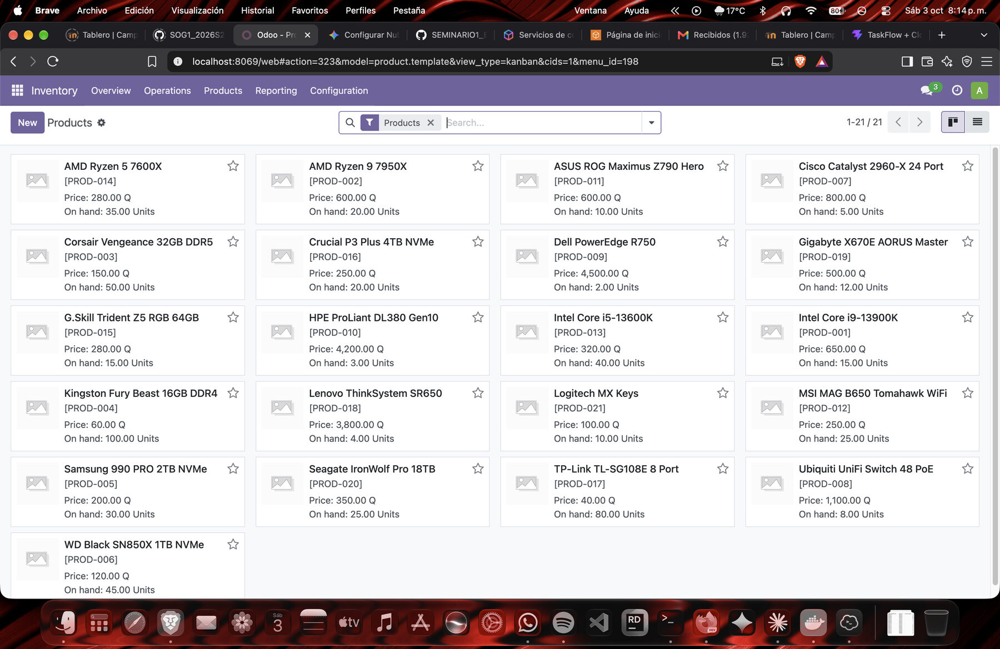

### 4.2 Cliente manual: Pedro Gómez

Estado previo a la carga manual, con los clientes y proveedores importados:

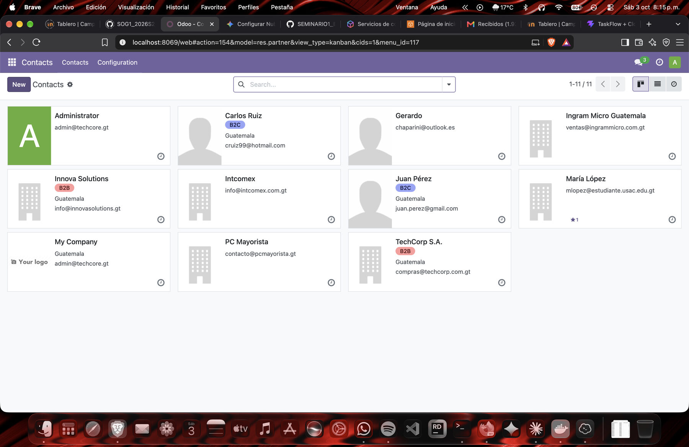

1. En **Contacts** pulsar **New**.
2. Seleccionar **Individual**, escribir el nombre `Pedro Gómez` y completar teléfono y correo.
3. Guardar.

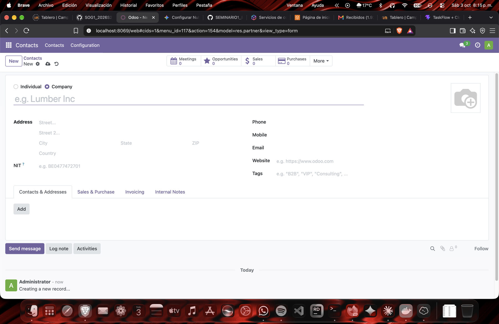

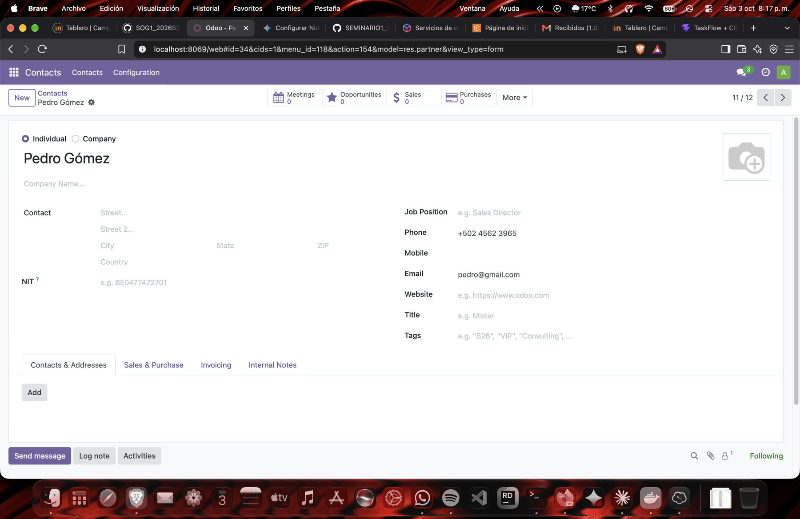

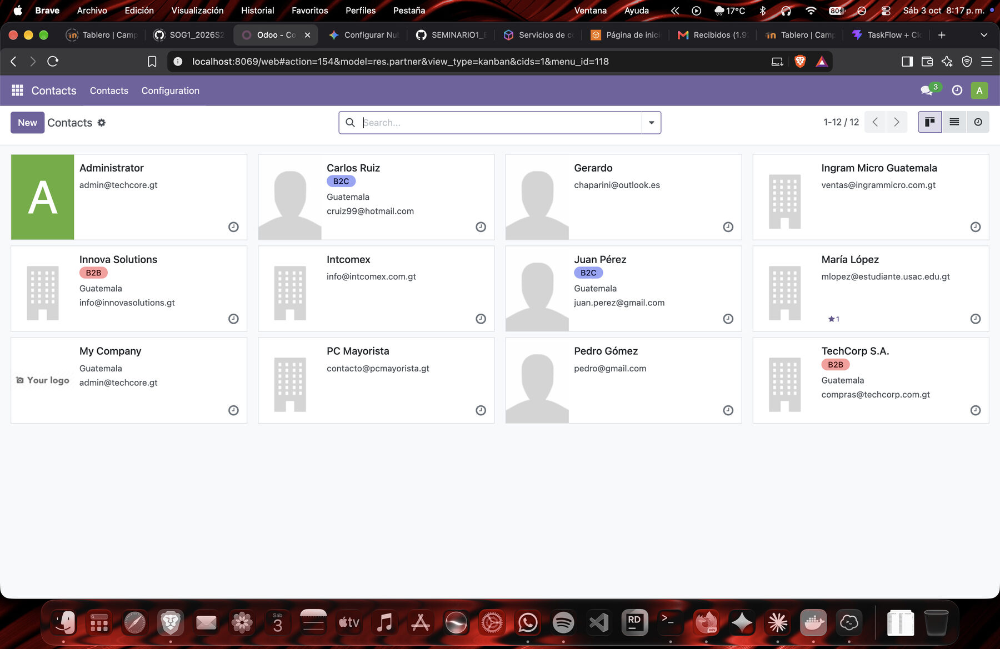

### 4.3 Proveedor manual: Distribuidora Tecno S.A.

1. En **Contacts** pulsar **New** y seleccionar **Company**.
2. Escribir el nombre `Distribuidora Tecno S.A.`, el correo y el teléfono móvil.
3. Guardar. El historial del registro muestra *Contact created*.

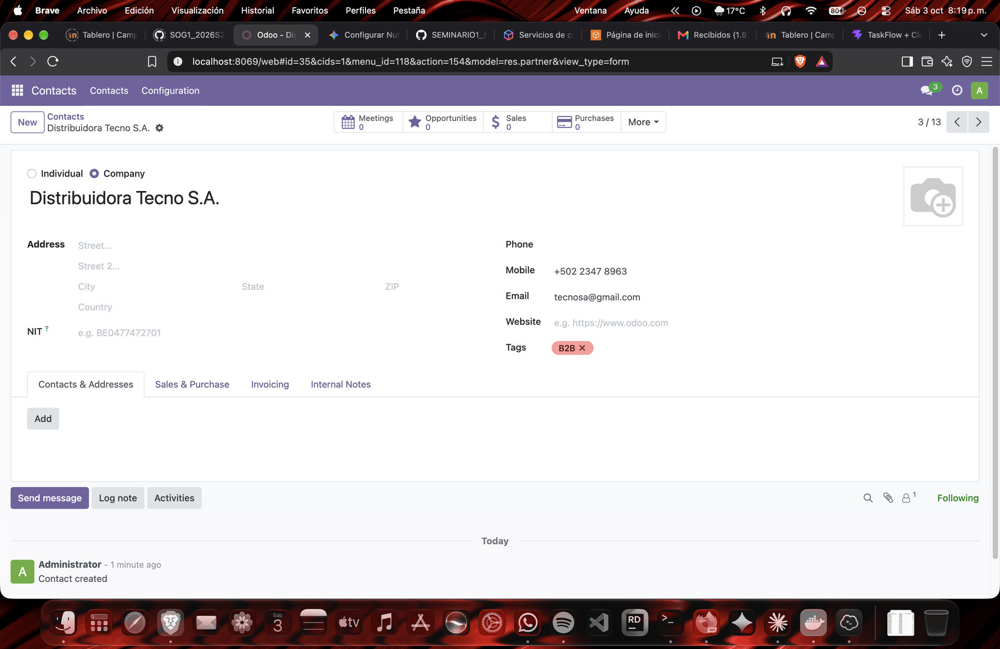

Para comprobar que el proveedor opera dentro del módulo de Compras, se creó una solicitud de cotización:

1. **Purchase → Orders → Requests for Quotation → New**.
2. En *Vendor* se selecciona `Distribuidora Tecno S.A.`.
3. En la pestaña *Products* se agrega `[PROD-021] Logitech MX Keys`, cantidad 1 y precio unitario 70.00 (total Q 70.00 con IVA del 12 %).
4. Se guarda la solicitud y se confirma con **Confirm Order**, con lo que pasa a *Purchase Order*.

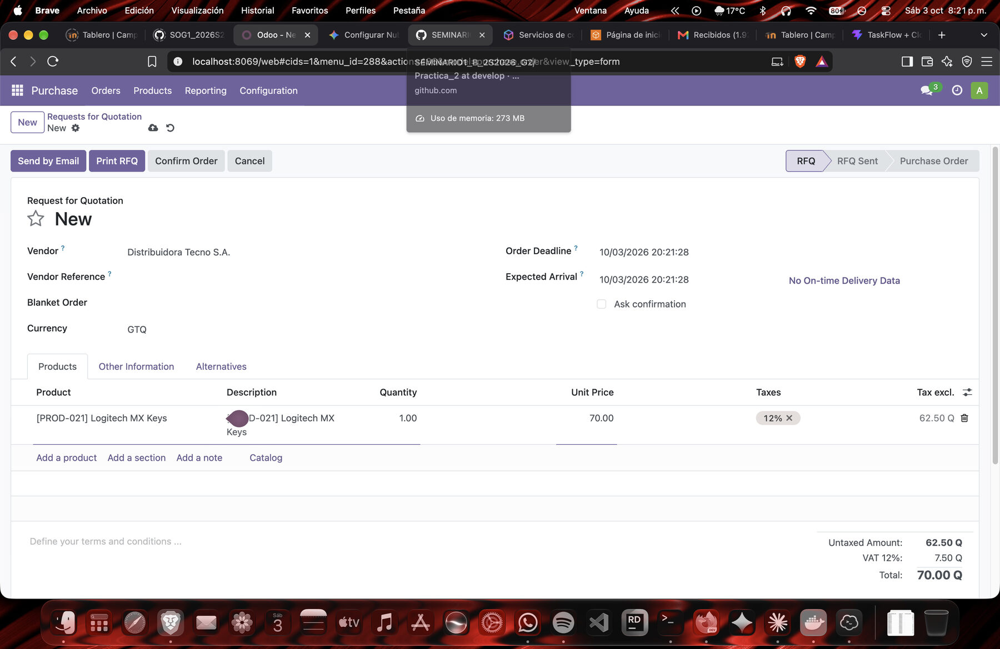

---

## 5. Punto 12.4: Informe de Inventario

Los tres reportes se generan con herramientas nativas de Odoo, sin desarrollo adicional.

### 5.1 Existencias actuales

**Inventory → Reporting → Stock** muestra, por producto: costo unitario (*Unit Cost*), valor total (*Total Value*), cantidad disponible (*On Hand*), cantidad libre para usar (*Free to Use*) y las cantidades entrantes (*Incoming*) y salientes (*Outgoing*). Con los datos cargados, por ejemplo, el producto PROD-001 (Intel Core i9-13900K) muestra 15 unidades y PROD-004 (Kingston Fury Beast 16GB DDR4) muestra 100 unidades, coincidentes con el archivo de origen (véase también la Figura 8). La barra lateral permite filtrar por categoría.

### 5.2 Órdenes pendientes de proveedores

**Purchase → Orders** lista las órdenes de compra. La orden **P00001** a *Distribuidora Tecno S.A.* por Q 70.00 está confirmada y aún no tiene recepción de mercancía, por lo que figura como orden pendiente; su estado de facturación es *Waiting Bills* y su fecha esperada de llegada queda registrada. Al recibir la mercancía desde **Inventory → Receipts**, el stock del producto aumenta.

### 5.3 Alertas de stock bajo

Las alertas se basan en las **reglas de reabastecimiento** (*Reordering Rules*) en **Inventory → Operations → Replenishment**, donde cada regla define una cantidad mínima y una máxima por producto. Cuando la cantidad disponible baja del mínimo, Odoo propone o genera la orden de compra de reposición. La configuración de las reglas forma parte del manual de compras y cotizaciones del equipo.

---

## 6. Verificación Final de la Carga

| Elemento | Importación masiva | Carga manual | Total en el sistema | Evidencia |
|---|---|---|---|---|
| Productos | 20 | 1 (Logitech MX Keys) | 21 | Figura 8 |
| Clientes | 5 | 1 (Pedro Gómez) | 6 | Figuras 9 y 12 |
| Proveedores | 3 | 1 (Distribuidora Tecno S.A.) | 4 | Figuras 13 y 14 |
| Líneas de inventario físico | 20 | 1 (Update Quantity) | 21 con existencias | Figuras 7 y 8 |

El total de contactos mostrado en la Figura 12 (12) incluye además los registros del sistema (Administrator y My Company) y un usuario del equipo (Gerardo).

---

## 7. Medición de Logros y Resultados

La carga de datos maestros en Odoo se validó contra los indicadores definidos en la Fase 1. Para el indicador de **Desempeño del Sistema**, se importaron de forma masiva 20 productos, 5 clientes y 3 proveedores desde archivos Excel y se cargaron las existencias iniciales de los 20 productos mediante Inventario Físico, verificando en Odoo que las cantidades coinciden con las del archivo de origen. Además, se realizó la carga manual de un producto, un cliente y un proveedor para demostrar ambas modalidades. Para el indicador de **Operaciones y Logística**, se generó una orden de compra a un proveedor registrado (P00001), que figura como orden pendiente de recepción en el módulo de Compras, y el informe de inventario permite consultar las existencias actuales, las órdenes pendientes y las alertas de stock bajo mediante reglas de reabastecimiento. Con ello se comprueba que el flujo de carga y consulta de inventario funciona de extremo a extremo y que sirve de base para medir los indicadores de ventas y de satisfacción del cliente en las fases siguientes.

<!-- REVISAR antes de entregar: la mención a "alertas de stock bajo" solo es válida si las reglas de reabastecimiento ya están configuradas y se ve una alerta (sección 5.3). Si no, quitar esa parte de la frase. -->

| Indicador de la Fase 1 | Qué se validó en la Fase 2 | Evidencia |
|---|---|---|
| Desempeño del Sistema 1: registros reflejados en Odoo sin intervención manual | 28 registros maestros importados (20 productos, 5 clientes, 3 proveedores) y 20 líneas de inventario aplicadas | Figuras 2, 3, 4 y 8 |
| Operaciones/Logística 1: alertas de inventario bajo y tiempo de la orden de compra hasta la recepción | Orden de compra P00001 generada y pendiente de recepción; las alertas dependen de las reglas de reabastecimiento | Figura 14, secciones 5.2 y 5.3 |
| Ventas/Clientes 1 y 2, Satisfacción del Cliente 1 | Base de clientes (B2B y B2C) y catálogo de productos cargados; la medición se realiza con las ventas, cotizaciones y campañas | Secciones 3.2, 3.3 y 4.2 |

---

## 8. Problemas Frecuentes y Solución

| Mensaje o síntoma | Causa | Solución |
|---|---|---|
| *No matching records found for the following name in field Product Category* | Las categorías del Excel no existen en Odoo | En el aviso rojo, cambiar *When a value cannot be matched* a **Create new values** |
| *Missing required value for the field 'Product' (product_id)* o *KeyError: 'product_id'* | La columna `product_id/default_code` no se asoció a ningún campo | Asociarla manualmente a **Product → Internal Reference** (Figura 4) |
| El stock sigue en 0 tras importar el inventario físico | Las líneas importadas aún no se aplicaron | Seleccionar todas las líneas y pulsar **Apply All** |
| Aparecen clientes duplicados tras importar | La base TechCore_DB ya traía contactos con el mismo nombre | Seleccionar los duplicados y usar ⚙ **Actions → Archive** |
| Un proveedor creado en Contacts no aparece en Purchase → Vendors | Esa lista filtra los contactos marcados como proveedor | Importarlo con `supplier_rank` = 1 o crearlo desde **Purchase → Orders → Vendors → New** |

---

## 9. Archivos Entregables de esta Sección

- `1_Productos_Odoo.xlsx`, `2_Clientes_Odoo.xlsx`, `3_Proveedores_Odoo.xlsx` y `4_Inventario_Fisico_Odoo.xlsx`: archivos exactos usados en la carga masiva.
- Capturas de este manual: `Proyecto/Fase2/docu/capturas/julio_*.jpg`.
- Video demostrativo de la carga de datos y del informe de inventario (enlace en el PDF consolidado).
