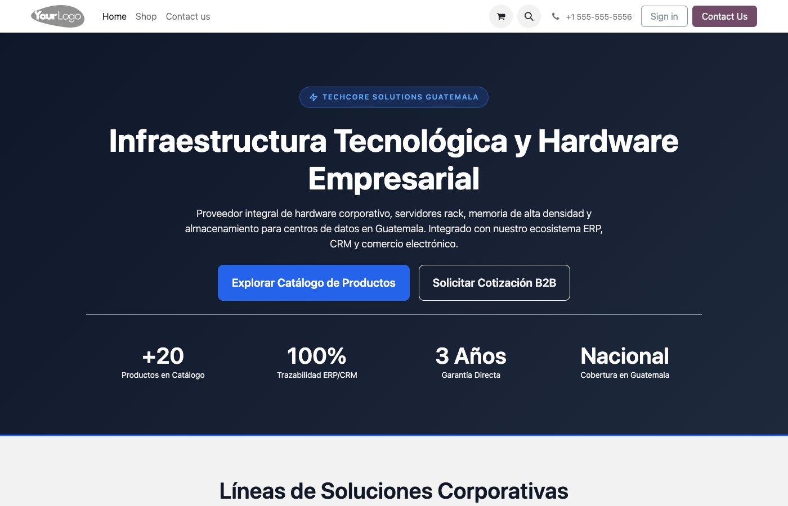
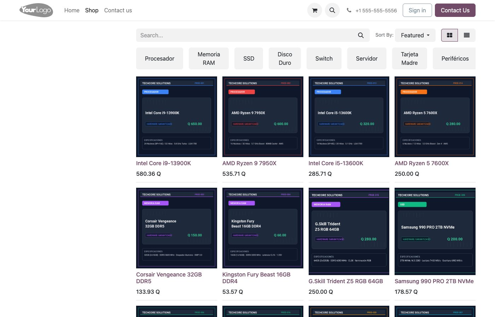
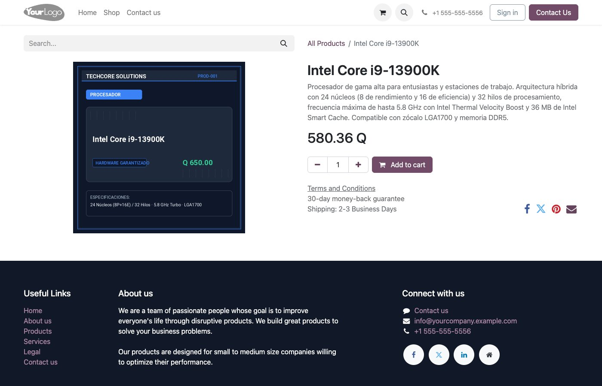
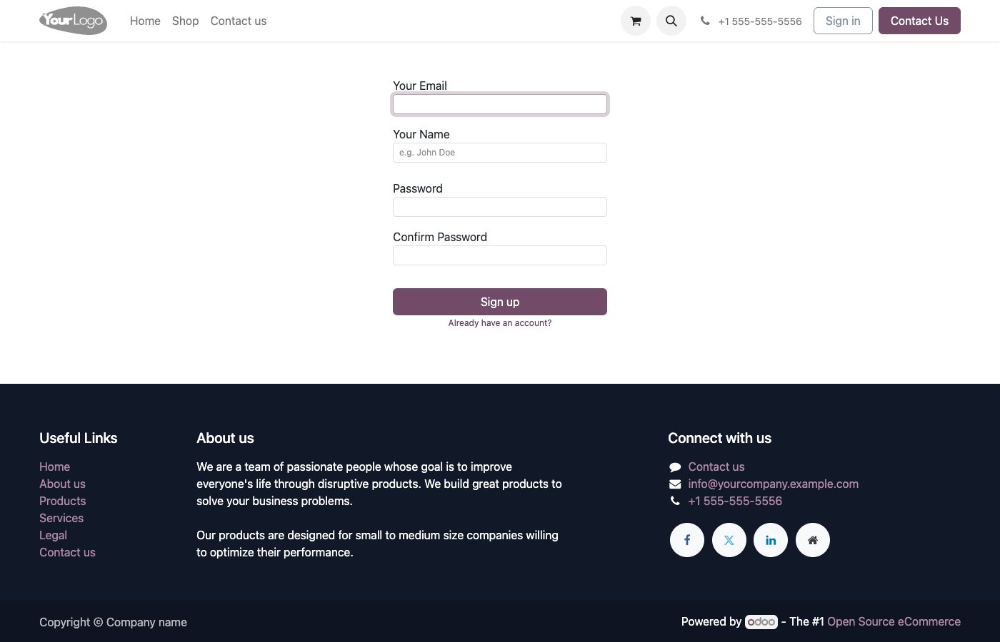
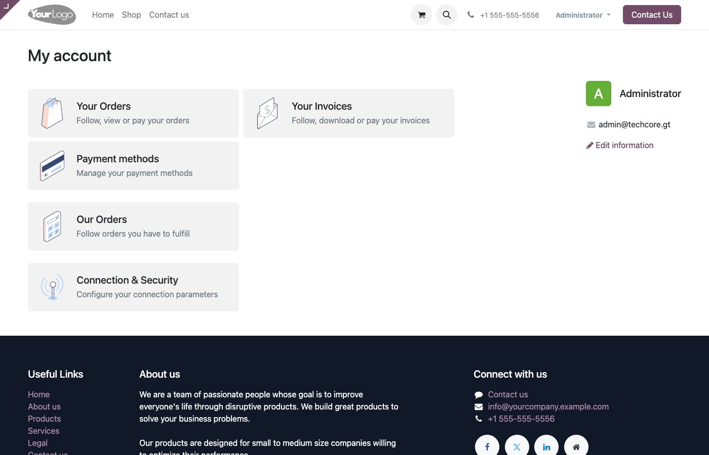
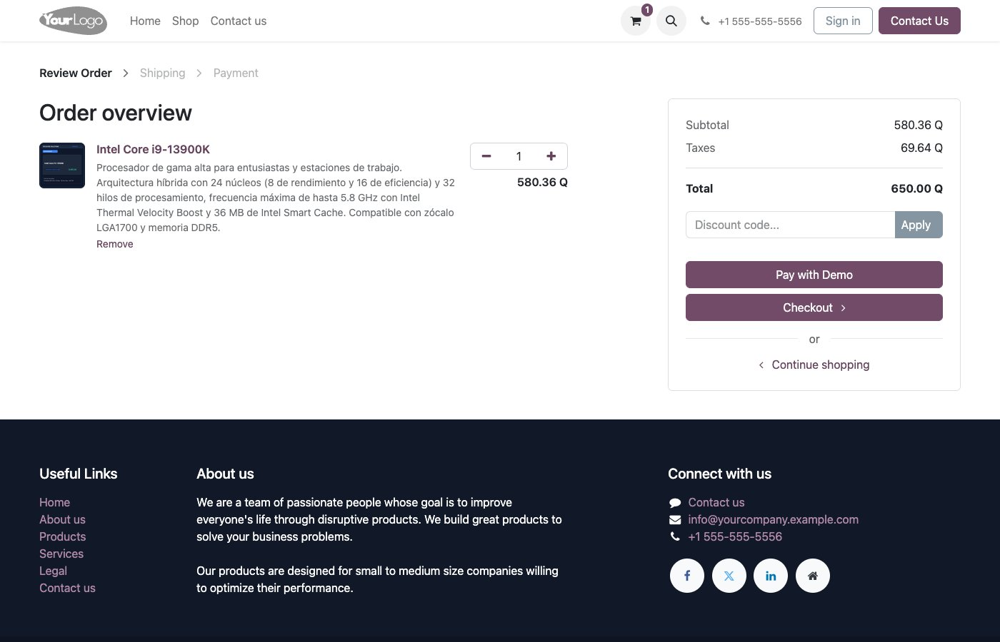
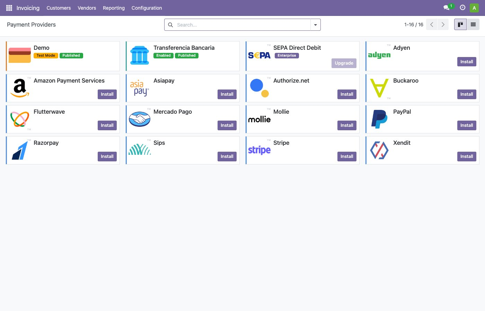
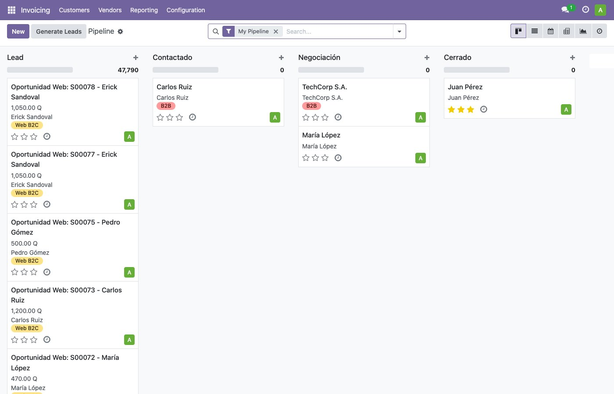
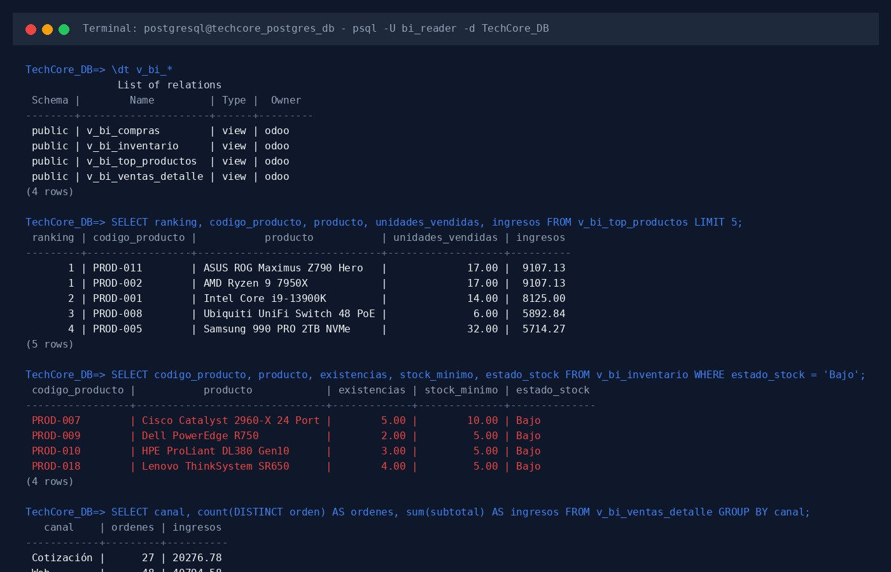

# Manual Técnico y Funcional: E-Commerce, Integración ERP/CRM y Business Intelligence

**Universidad de San Carlos de Guatemala**  
**Facultad de Ingeniería — Escuela de Ciencias y Sistemas**  
**Sistemas Organizacionales y Gerenciales 1 — Sección A**  
**Segundo Semestre 2026**  
**Grupo No. 7 — TechCore Solutions Guatemala**  

**Responsable:** Jonathan Eliud Jerónimo Salguero  
**Carnet:** 202300353  
**Rol:** Arquitectura de E-Commerce, Integración de Flujos ERP/CRM e Infraestructura Analítica de BI  

---

## 1. Introducción y Arquitectura Tecnológica

El presente documento detalla la implementación técnica y operativa correspondiente a la **Parte A de la Fase 3** para la empresa **TechCore Solutions Guatemala**. El objetivo central de esta fase consiste en transformar la infraestructura ERP/CRM previamente configurada en una plataforma omnicanal plenamente integrada, dotándola de una tienda electrónica (E-Commerce) B2C y B2B, automatización de facturación e inventarios, generación desatendida de oportunidades comerciales en el CRM y una capa analítica de datos en PostgreSQL optimizada para la ingestión en Microsoft Power BI.

### 1.1 Pila de Software y Entorno de Ejecución

La arquitectura se fundamenta en contenedores Docker sobre un sistema operativo Ubuntu Server 22.04 LTS (arquitectura ARM64 en máquina virtual UTM sobre Apple Silicon), garantizando portabilidad absoluta mediante scripts de orquestación compatibles tanto con entornos POSIX (`start.sh`) como con Windows PowerShell (`start.ps1`).

| Componente | Versión / Tecnología | Función Primaria |
|---|---|---|
| **Motor ERP** | Odoo 17.0 Community Edition | Gestión comercial, portal web, inventario, facturación y CRM. |
| **Motor de Base de Datos** | PostgreSQL 15 | Persistencia relacional, capas de valoración y vistas SQL analíticas. |
| **Contenedores** | Docker Compose v2 | Aislamiento de servicios, orquestación y comprobación de salud (*healthchecks*). |
| **Pila Web / Frontend** | QWeb, HTML5, CSS3, SVG | Interfaz responsiva del catálogo, carrito y portal de usuario. |
| **Herramienta de BI** | Microsoft Power BI Desktop | Tableros analíticos de evolución de ventas e inventario crítico. |

### 1.2 Módulos de Odoo Instalados y Configurados

Para garantizar la cobertura funcional exigida por el enunciado se instalaron y configuraron los siguientes módulos clave de Odoo 17:

1. `website_sale`: Motor principal de comercio electrónico, catálogo interactivo, carrito de compras y proceso de pago (*checkout*).
2. `website_sale_stock`: Control de existencias en tiempo real, bloqueo de compras en productos agotados y alertas visuales de inventario bajo.
3. `sale_management`: Administración integral de cotizaciones, órdenes de venta y plantillas de cotización.
4. `payment_demo`: Proveedor de pago simulado para transacciones en entorno de pruebas seguras.
5. `payment_custom`: Proveedor de métodos de pago personalizados (Transferencia Bancaria corporativa con instrucciones personalizadas).
6. `portal`: Portal de autoservicio para clientes registrados, con historial de pedidos y facturas descargables.
7. `account`: Motor de facturación en Quetzales (GTQ), diario de ventas y cálculo automatizado del 12% del Impuesto al Valor Agregado (IVA).
8. `base_automation`: Motor de acciones automatizadas del sistema para integración reactiva entre ventas web y el embudo CRM.
9. `crm` y `website_crm`: Captura de clientes potenciales, gestión de pipeline de ventas y trazabilidad omnicanal.

---

## 2. Catálogo de Productos y Fichas Técnicas

Se configuró un catálogo completo de **21 productos de hardware informático**, distribuidos en 8 categorías comerciales. Cada producto cuenta con descripción técnica formal en idioma español, precio fijado en Quetzales (GTQ), costo estándar, impuestos asignados y una tarjeta digital de alta resolución (800x800 px) generada con la identidad visual corporativa de TechCore Solutions.



### 2.1 Matriz Maestra del Catálogo de Hardware (21 Productos)

| Código | Producto | Categoría Pública | Precio Venta (GTQ) | Costo (GTQ) | Tipo | Existencias Iniciales |
|---|---|---|---|---|---|---|
| **PROD-001** | Intel Core i9-13900K | Procesador | Q 650.00 | Q 500.00 | Almacenable | 90 |
| **PROD-002** | AMD Ryzen 9 7950X | Procesador | Q 600.00 | Q 480.00 | Almacenable | 65 |
| **PROD-013** | Intel Core i5-13600K | Procesador | Q 320.00 | Q 250.00 | Almacenable | 85 |
| **PROD-014** | AMD Ryzen 5 7600X | Procesador | Q 280.00 | Q 220.00 | Almacenable | 60 |
| **PROD-003** | Corsair Vengeance 32GB DDR5 | Memoria RAM | Q 150.00 | Q 100.00 | Almacenable | 170 |
| **PROD-004** | Kingston Fury Beast 16GB DDR4 | Memoria RAM | Q 60.00 | Q 40.00 | Almacenable | 210 |
| **PROD-015** | G.Skill Trident Z5 RGB 64GB | Memoria RAM | Q 280.00 | Q 200.00 | Almacenable | 35 |
| **PROD-005** | Samsung 990 PRO 2TB NVMe | SSD | Q 200.00 | Q 140.00 | Almacenable | 115 |
| **PROD-006** | WD Black SN850X 1TB NVMe | SSD | Q 120.00 | Q 80.00 | Almacenable | 115 |
| **PROD-016** | Crucial P3 Plus 4TB NVMe | SSD | Q 250.00 | Q 190.00 | Almacenable | 45 |
| **PROD-020** | Seagate IronWolf Pro 18TB | Disco Duro | Q 350.00 | Q 260.00 | Almacenable | 75 |
| **PROD-007** | Cisco Catalyst 2960-X 24 Port | Switch | Q 800.00 | Q 600.00 | Almacenable | 5 (Stock Bajo) |
| **PROD-008** | Ubiquiti UniFi Switch 48 PoE | Switch | Q 1,100.00 | Q 850.00 | Almacenable | 24 |
| **PROD-017** | TP-Link TL-SG108E 8 Port | Switch | Q 40.00 | Q 25.00 | Almacenable | 150 |
| **PROD-009** | Dell PowerEdge R750 | Servidor | Q 4,500.00 | Q 3,500.00 | Almacenable | 2 (Stock Bajo) |
| **PROD-010** | HPE ProLiant DL380 Gen10 | Servidor | Q 4,200.00 | Q 3,200.00 | Almacenable | 3 (Stock Bajo) |
| **PROD-018** | Lenovo ThinkSystem SR650 | Servidor | Q 3,800.00 | Q 2,900.00 | Almacenable | 4 (Stock Bajo) |
| **PROD-011** | ASUS ROG Maximus Z790 Hero | Tarjeta Madre | Q 600.00 | Q 450.00 | Almacenable | 45 |
| **PROD-012** | MSI MAG B650 Tomahawk WiFi | Tarjeta Madre | Q 250.00 | Q 180.00 | Almacenable | 50 |
| **PROD-019** | Gigabyte X670E AORUS Master | Tarjeta Madre | Q 500.00 | Q 380.00 | Almacenable | 27 |
| **PROD-021** | Logitech MX Keys | Periféricos | Q 100.00 | Q 70.00 | Almacenable | 65 |



### 2.2 Configuración de Disponibilidad y Umbrales de Stock

Mediante el módulo `website_sale_stock`, cada ficha de producto en el sitio web opera bajo las siguientes restricciones automáticas:
- **`allow_out_of_stock_order = False`**: Si las existencias físicas en el almacén principal (`WH/Stock`) llegan a cero, el botón de compra queda deshabilitado y se muestra un mensaje informativo indicando que el producto se encuentra temporalmente agotado.
- **`show_availability = True`**: Se muestra al visitante la disponibilidad de unidades.
- **`available_threshold = 5.0`**: Cuando el inventario disponible de un producto es igual o menor a cinco unidades, la tienda despliega una advertencia en color naranja indicando *"Últimas unidades disponibles"*, incentivando la compra y alertando al usuario de la escasez.



---

## 3. Registro de Clientes y Portal de Autoservicio

El portal web de TechCore Solutions cuenta con la modalidad de **registro libre de clientes** (*Free sign up*), habilitada a través del parámetro de configuración global `auth_signup.invitation_scope = 'b2c'`. Esto permite que cualquier usuario nuevo cree su cuenta de acceso directamente desde `/web/signup` sin requerir una invitación administrativa previa.



Al autenticarse, el cliente tiene acceso inmediato a su portal personal (`/my`), el cual proporciona:
1. **Historial de Pedidos:** Listado de órdenes de compra confirmadas y cotizaciones activas con número de seguimiento, fecha, monto total e información de entrega.
2. **Facturas y Pagos:** Acceso a los comprobantes contables legalmente emitidos, con la opción de visualizar el desglose del IVA y descargar el documento en formato PDF de alta calidad.
3. **Gestión de Direcciones:** Administración de direcciones de facturación y despacho para agilizar compras recurrentes.



---

## 4. Carrito de Compras y Pasarelas de Pago

El flujo de compra (*checkout*) se estructuró para garantizar una experiencia fluida e intuitiva:
1. El usuario selecciona productos del catálogo y los agrega al carrito (`/shop/cart`), donde puede modificar cantidades o remover líneas en tiempo real.
2. El sistema calcula automáticamente el subtotal, los impuestos (12% IVA) y el total consolidado en Quetzales.



### 4.1 Pasarelas de Pago Habilitadas

Para completar el pedido en el entorno de evaluación se habilitaron dos pasarelas de pago oficiales, ambas operando en moneda nacional (GTQ):

1. **Simulación de Pago Inmediato (Proveedor Demo):**
   - Configurado en modo prueba (`state = 'test'`).
   - Permite validar la transacción bancaria de forma inmediata durante las demostraciones sin involucrar tarjetas de crédito reales. Al pulsar el botón de confirmación, Odoo marca la transacción como exitosa.
2. **Transferencia Bancaria Directa (Proveedor Transferencia Bancaria):**
   - Configurado en modo activo (`state = 'enabled'`).
   - Muestra las instrucciones bancarias oficiales de TechCore Solutions Guatemala en pantalla al momento de seleccionar la opción:
     * **Banco:** Banco Industrial
     * **Tipo de Cuenta:** Cuenta Monetaria en Quetzales
     * **Número de Cuenta:** `004-892104-1`
     * **Beneficiario:** TechCore Solutions Guatemala, S.A.
     * **Correo de Notificación:** `pagos@techcore.gt`



---

## 5. Facturación Automática en Quetzales

Con el propósito de cumplir con la trazabilidad total del ciclo comercial y eliminar tareas operativas redundantes, se configuró la **facturación desatendida automática**:
- **Política de Facturación:** Fijada en *"Cantidades Pedidas"* (`default_invoice_policy = 'order'`) para todos los productos de la tienda virtual.
- **Disparador de Facturación (`automatic_invoice = True`):** Al confirmarse el pago de una orden en línea (ya sea mediante el proveedor Demo o al conciliar la Transferencia Bancaria), Odoo invoca el motor de facturación (`_create_invoices()`), genera la factura de cliente, aplica la tasa tributaria de Guatemala (IVA 12%) y la publica formalmente en el diario de ventas en estado *Pagado* (*Paid*).
- El cliente recibe su notificación por correo electrónico y puede visualizar y descargar el PDF de la factura inmediatamente desde su portal de cliente en `/my/invoices`.

---

## 6. Integración Automática de E-Commerce con CRM

Uno de los requerimientos de mayor valor gerencial en la Fase 3 es conectar de forma nativa la tienda virtual con el módulo de CRM, asegurando que cada cliente que realiza una compra digital se convierta en una oportunidad de negocio prospectada para el equipo comercial (venta cruzada, soporte corporativo o actualización de garantías).

### 6.1 Acción Automatizada del Sistema (`base.automation`)

Se configuró una regla de automatización reactiva con las siguientes especificaciones técnicas:
- **Nombre de la Regla:** `Generar Lead CRM desde Pedido Web`
- **Modelo de Datos:** `sale.order` (Orden de Venta)
- **Disparador (*Trigger*):** `on_create` (Al crearse el registro en la base de datos)
- **Filtro de Aplicación (*Filter Domain*):** `[('website_id', '!=', False)]` (Aplica únicamente a órdenes originadas desde el canal E-Commerce).
- **Acción del Servidor (`ir.actions.server`):** Ejecuta código Python en el servidor para crear una oportunidad en `crm.lead` con:
  * **Nombre:** `Oportunidad Web: [Número de Orden] - [Nombre del Cliente]`
  * **Cliente Vinculado:** `order.partner_id`
  * **Ingreso Esperado (*Expected Revenue*):** Monto total de la orden (`order.amount_total`)
  * **Etapa Inicial:** `Lead` (primera fase del pipeline configurado en Fase 2)
  * **Etiqueta Comercial:** `Web B2C`
  * **Descripción:** Trazabilidad cruzada con el número del pedido web.



---

## 7. Infraestructura Analítica y Vistas de Business Intelligence

Para desacoplar el análisis gerencial de las tablas operativas complejas de Odoo y facilitar la construcción de tableros ejecutivos en Microsoft Power BI Desktop por parte de Francisco, se implementó una **capa de abstracción analítica** directamente en PostgreSQL.

### 7.1 Rol Analítico de Solo Lectura (`bi_reader`)

Por directriz de seguridad informática y rendimiento:
- Se creó el rol PostgreSQL `bi_reader` con la contraseña segura `bi_reader_techcore`.
- Se concedió privilegio de conexión a `TechCore_DB` y uso exclusivo del esquema `public`.
- Se revocaron accesos a tablas operativas del sistema y se concedió permiso `SELECT` **exclusivamente sobre las vistas analíticas `v_bi_*`**.
- La base de datos expone el puerto estándar `5432` hacia `127.0.0.1`, permitiendo que Power BI Desktop en la máquina local anfitriona (Windows) se conecte de forma directa.

### 7.2 Vistas SQL Implementadas (`vistas_bi.sql`)

Las cuatro vistas fueron diseñadas para responder exactamente a los requisitos de Business Intelligence del proyecto:

```
+-------------------------------------------------------------------------------+
|                       CAPA ANALÍTICA EN POSTGRESQL                            |
+-------------------------------------------------------------------------------+
|  v_bi_ventas_detalle   ->  Evolución temporal, clientes, canales y segmentos  |
|  v_bi_inventario       ->  Existencias, valoración, stock bajo y reorden      |
|  v_bi_top_productos    ->  Ranking denso de productos por volumen e ingresos  |
|  v_bi_compras          ->  Compras históricas, proveedores y recepciones      |
+-------------------------------------------------------------------------------+
                                        |  (Acceso de Solo Lectura: bi_reader)
                                        v
+-------------------------------------------------------------------------------+
|                    MICROSOFT POWER BI DESKTOP (WINDOWS)                       |
+-------------------------------------------------------------------------------+
```

1. **`v_bi_ventas_detalle`**: Cada fila representa una línea de venta formalmente cerrada (`sale` o `done`), desglosando fecha, año, mes, semana del año, cliente, segmento (B2B / B2C), canal (Web / Cotización), código de producto, categoría, cantidad, precio unitario y subtotal.
2. **`v_bi_inventario`**: Contiene las existencias consolidadas en `WH/Stock`, niveles mínimos y máximos de las reglas de reposición, estado de inventario (`Bajo`, `Normal` o `Sin regla`), costo estándar, precio de catálogo, valoración total del stock y mercancía pendiente de recibir.
3. **`v_bi_top_productos`**: Totaliza unidades vendidas e ingresos brutos por producto, calculando su ranking oficial mediante la función analítica `DENSE_RANK() OVER (ORDER BY sum(subtotal) DESC)`.
4. **`v_bi_compras`**: Registra las órdenes de compra emitidas a los proveedores (`Ingram Micro`, `Intcomex`, `PC Mayorista`, `Distribuidora Tecno S.A.`), con cantidades pactadas, recepciones efectivas y subtotales.



### 7.3 Siembra de Datos Históricos de Demostración (`sembrar_ventas_demo.py`)

Para que los reportes de Power BI cuenten con series de tiempo significativas que permitan evaluar la evolución diaria, semanal y mensual, se ejecutó una siembra histórica controlada:
- **16 Órdenes de Compra a Proveedores:** Distribuidas en los últimos 90 días, con recepción efectiva en almacén para garantizar existencias positivas.
- **75 Órdenes de Venta Confirmadas y Facturadas:** Distribuidas a lo largo de **13 semanas** continuas (del 13 de julio al 6 de octubre de 2026), con 48 órdenes canalizadas vía Web y 27 vía Cotización, sumando más de **Q 61,000.00** en ingresos.
- **Productos en Stock Bajo Preservados:** Cuatro productos clave se mantuvieron intencionalmente en inventario bajo (Dell PowerEdge R750 con 2 unidades, HPE ProLiant DL380 con 3 unidades, Lenovo ThinkSystem SR650 con 4 unidades y Cisco Catalyst 2960-X con 5 unidades) para alimentar las tarjetas de alerta de stock bajo del tablero de BI.

---

## 8. Verificación de Integridad y Pruebas End-to-End

Se ejecutó un caso de prueba integral para verificar la consistencia del sistema entre el frontend y el backend de base de datos:

1. **Paso 1 — Registro:** Se registró el cliente *Erick Sandoval* vía `/web/signup`.
2. **Paso 2 — Selección:** Se agregaron 1 unidad de `PROD-001` (Intel Core i9-13900K) y 2 unidades de `PROD-005` (Samsung 990 PRO 2TB NVMe).
3. **Paso 3 — Pago:** Se completó el pedido web con orden `S00078` por un monto total de **Q 1,050.00**.
4. **Paso 4 — Factura y Albarán:** Se generó automáticamente la factura `INV/2026/00077` en estado *Pagado* y el albarán de salida `WH/OUT/00078`.
5. **Paso 5 — Inventario:** El stock de `PROD-001` disminuyó de 89.0 a 88.0 unidades, y el de `PROD-005` de 113.0 a 111.0 unidades.
6. **Paso 6 — CRM:** Se generó inmediatamente la oportunidad en CRM titulada `Oportunidad Web: S00078 - Erick Sandoval`, con etiqueta `Web B2C`, ingreso estimado de Q 1,050.00 en la etapa `Lead`.
7. **Paso 7 — Capa de BI:** La transacción se reflejó de inmediato en la vista `v_bi_ventas_detalle` y actualizó el ranking en `v_bi_top_productos`.

---

## 9. Conclusiones Técnicas de la Parte A

1. **Integración Total sin Silos de Información:** Se eliminó la separación entre el canal digital y la administración central. Una venta realizada por un cliente en el navegador afecta de manera simultánea el inventario en almacén, emite la factura contable, registra el asiento de pago y alerta al equipo comercial en el CRM.
2. **Desacoplamiento Efectivo para Business Intelligence:** La creación de las vistas SQL y el rol de solo lectura `bi_reader` garantiza que la máquina Windows de Francisco pueda conectarse con Power BI sin sobrecargar el servidor web de Odoo ni requerir permisos administrativos en el motor de bases de datos.
3. **Portabilidad y Despliegue en Un Solo Paso:** Gracias a los scripts `start.sh` (POSIX) y `start.ps1` (PowerShell), el entorno completo con base de datos, filestore, configuraciones de eCommerce y vistas de BI puede levantarse de forma reproducible en cualquier máquina del equipo de trabajo.

---

## 10. Video Demostrativo

# [VIDEO 1 - Despliegue de E-Commerce, Portal Web y Trazabilidad ERP/CRM](https://drive.google.com/file/d/1Aic7k_oGkkwmFqVYoWFF8siOEHab441A/view?usp=sharing)

- **Responsable:** Jonathan Eliud Jerónimo Salguero
- **Carnet:** 202300353
- **Plataforma:** Google Drive (acceso público para visualización)
- **Enlace directo:** https://drive.google.com/file/d/1Aic7k_oGkkwmFqVYoWFF8siOEHab441A/view?usp=sharing
- **Descripción del contenido:** Recorrido guiado de la tienda virtual en `/shop`, navegación por categorías, ficha técnica de producto con precios en GTQ e IVA del 12%, flujo de compra y checkout con pasarela Demo, acceso al portal de cliente `/my` con consulta y descarga de factura en PDF, y comprobación de la trazabilidad desatendida en el backend de Odoo (generación automática de oportunidad con etiqueta `Web B2C` en el CRM y descuento de inventario en almacén).
