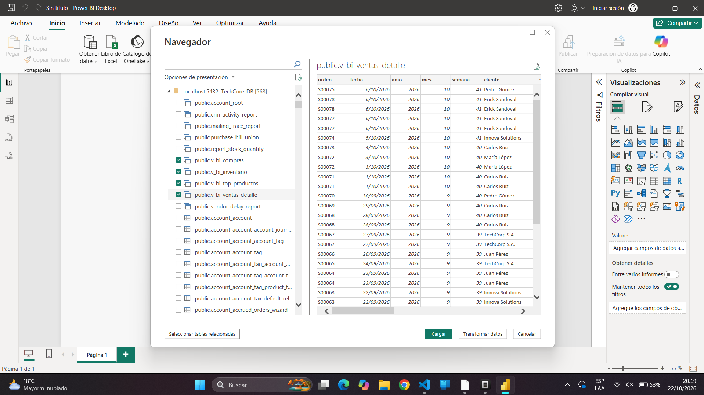
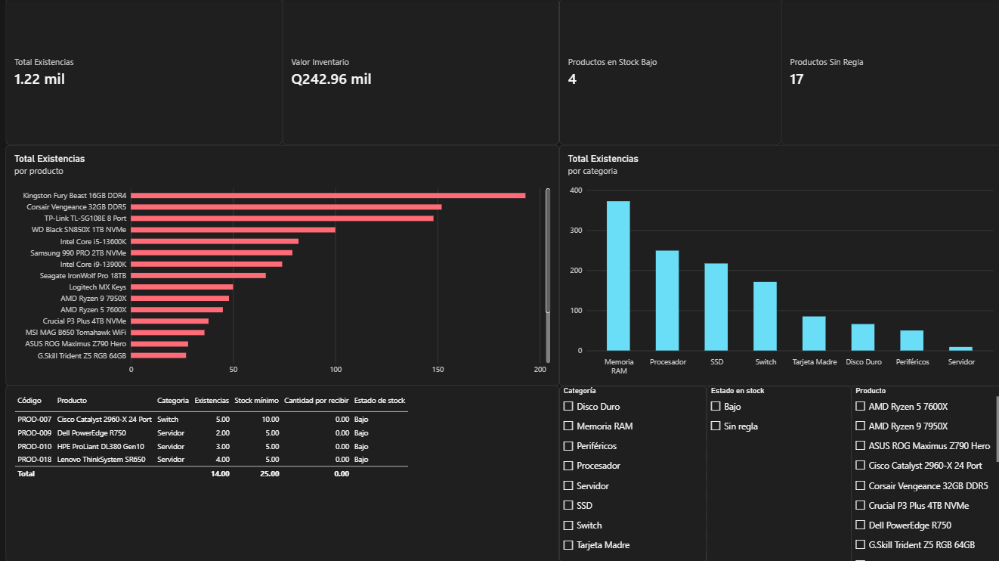
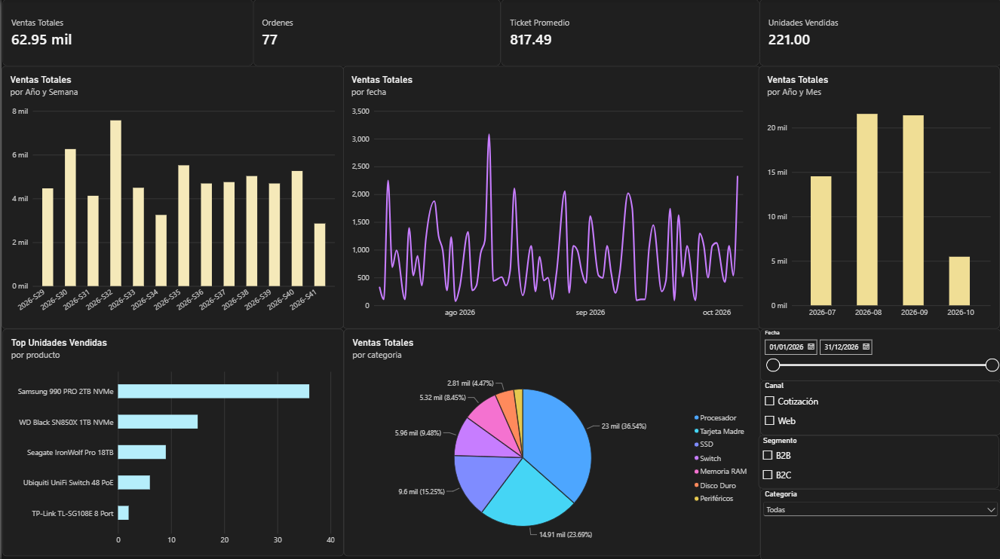
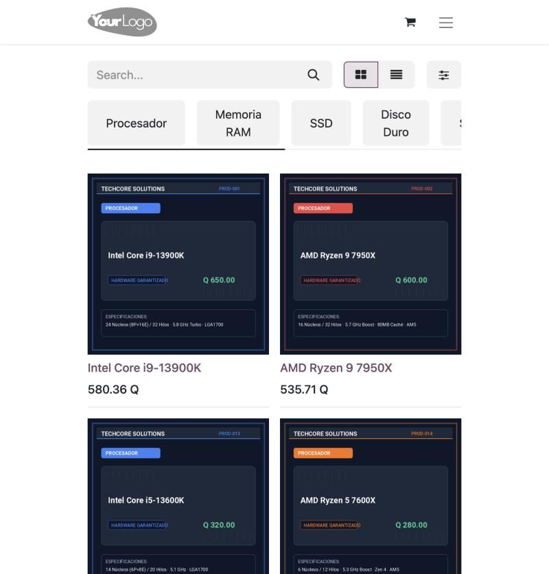
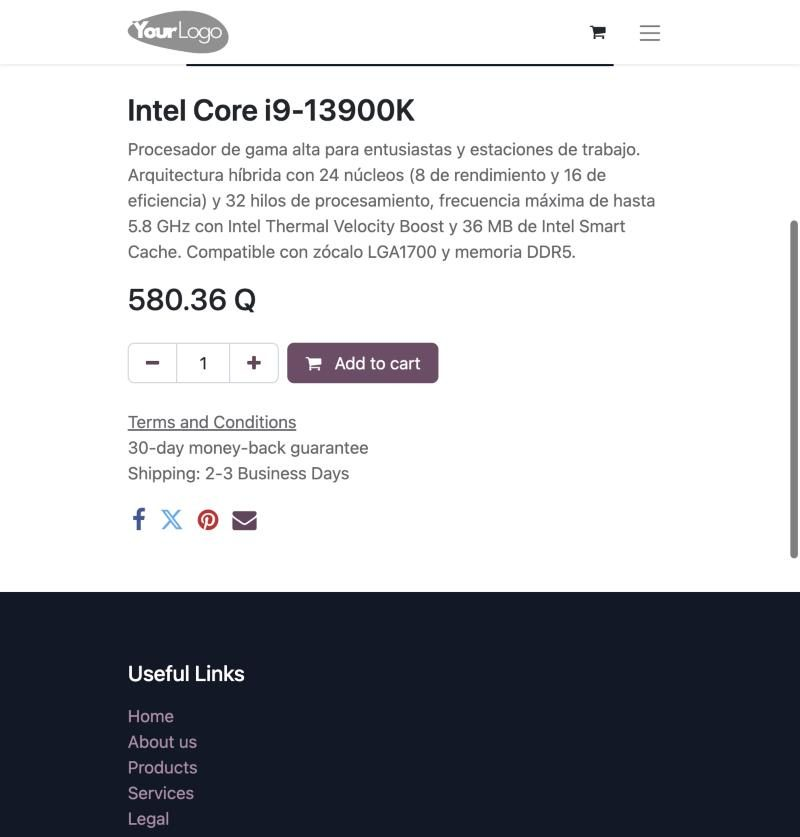
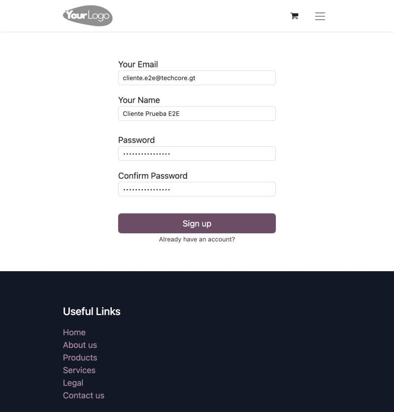
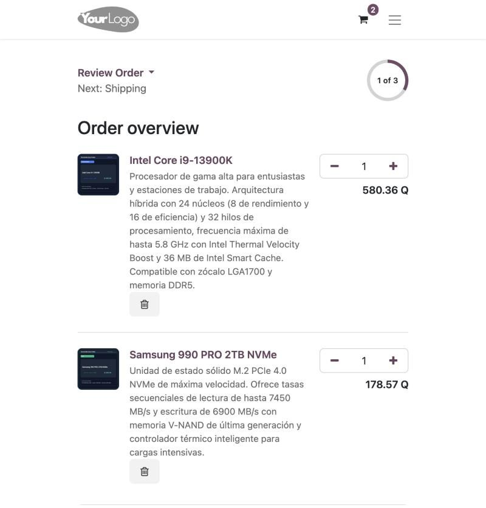
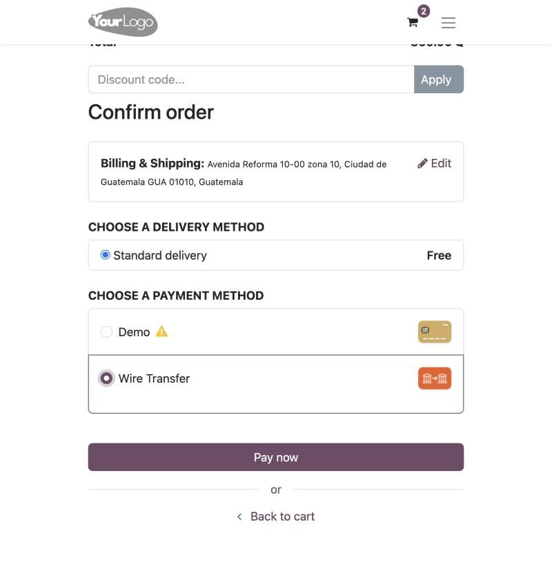
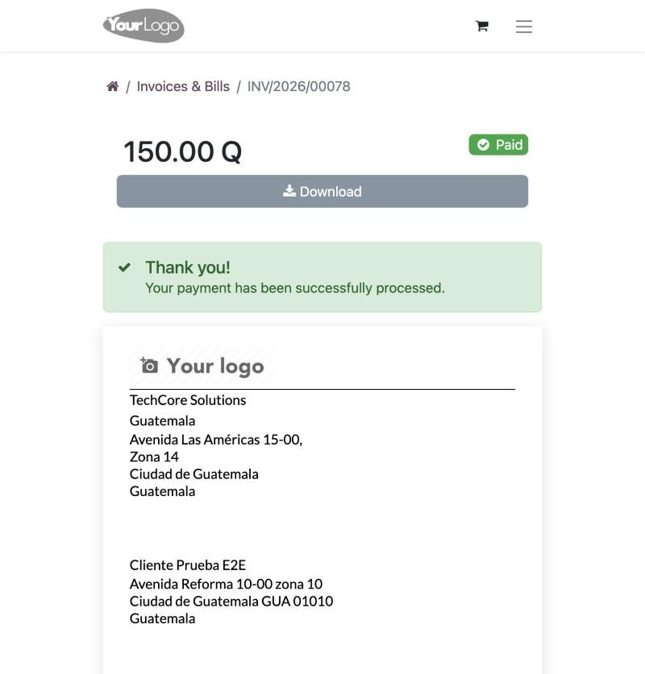

# Manual Técnico Consolidado de Fase 3
## E-Commerce, Integración ERP/CRM, Business Intelligence, Pruebas End-to-End y Escalabilidad

**Universidad de San Carlos de Guatemala**  
**Facultad de Ingeniería — Escuela de Ciencias y Sistemas**  
**Sistemas Organizacionales y Gerenciales 1 (SOG1) — Sección A**  
**Segundo Semestre 2026**  

**Empresa:** TechCore Solutions Guatemala  
**Proyecto:** Transformación Digital en E-Commerce con ERP, CRM y BI (QuetzalDev)  
**Fase Evaluada:** Fase 3 — Finalización, Optimización y Análisis Final  
**Ponderación de la Fase:** 100 puntos  

---

### Integrantes del Grupo No. 7

| # | Integrante | Carnet | Rol Principal | Secciones y Aporte en esta Fase |
|---|---|---|---|---|
| 1 | **Jonathan Eliud Jerónimo Salguero** | 202300353 | Líder de Infraestructura y E-Commerce | Plataforma E-Commerce, pasarelas de pago, portal web, automatización CRM, vistas SQL de BI, datos históricos y consolidación |
| 2 | **Francisco Gerardo Castillo Sagastume** | 202300653 | Ingeniero de Datos y Business Intelligence | Conexión Power BI a PostgreSQL, modelo estrella, medidas DAX, tableros analíticos de inventario y ventas |
| 3 | **Julio Alfredo Herrera Orantes** | 202300850 | Control de Calidad y Cierre de Proyecto | Pruebas de integración End-to-End (CP-01 a CP-09), manual de usuario, conclusiones, medición SMART y presentación final |

---

## Videos Demostrativos de Fase 3

Cada integrante documentó y grabó un video demostrativo de alta resolución alojado en Google Drive con acceso público para visualización y calificación:

| Video | Título y Alcance Técnico | Integrante Responsable | Carnet | Duración | Enlace de Google Drive |
|---|---|---|---|---|---|
| **VIDEO 1** | **E-Commerce, Portal Web y Trazabilidad CRM/ERP** | Jonathan Jerónimo | 202300353 | ~3:45 min | [Ver Video 1 en Google Drive](https://drive.google.com/file/d/1Aic7k_oGkkwmFqVYoWFF8siOEHab441A/view?usp=sharing) |
| **VIDEO 2** | **Reportes de Inventario y Ventas en Power BI** | Francisco Castillo | 202300653 | ~3:15 min | [Ver Video 2 en Google Drive](https://drive.google.com/file/d/1drsu8TdcWIfKtujYJ5SY-BxojB4REDNY/view?usp=sharing) |
| **VIDEO 3** | **Pruebas End-to-End, Trazabilidad y Reposición** | Julio Herrera | 202300850 | ~3:30 min | [Ver Video 3 en Google Drive](https://drive.google.com/drive/folders/1KkOk_ql0KaoQXyrvk9ObFsEnRwvmSKz1?usp=sharing) |

---

## Índice General

- [1. Introducción y Arquitectura General del Proyecto](#1-introducción-y-arquitectura-general-del-proyecto)
- [2. Despliegue de Infraestructura y Entorno Multiplataforma](#2-despliegue-de-infraestructura-y-entorno-multiplataforma)
- [3. PARTE I — Plataforma E-Commerce, Catálogo y Trazabilidad Web (Jonathan Jerónimo)](#3-parte-i--plataforma-e-commerce-catálogo-y-trazabilidad-web-jonathan-jerónimo)
  - [3.1 Catálogo Maestro de Hardware (21 Productos)](#31-catálogo-maestro-de-hardware-21-productos)
  - [3.2 Fichas Técnicas, Impuestos (IVA 12%) y Disponibilidad](#32-fichas-técnicas-impuestos-iva-12-y-disponibilidad)
  - [3.3 Registro Libre de Clientes y Portal de Autoservicio (/my)](#33-registro-libre-de-clientes-y-portal-de-autoservicio-my)
  - [3.4 Carrito de Compras y Pasarelas de Pago](#34-carrito-de-compras-y-pasarelas-de-pago)
  - [3.5 Facturación Desatendida Automática](#35-facturación-desatendida-automática)
  - [3.6 Integración Reactiva de E-Commerce con CRM (Oportunidades Web B2C)](#36-integración-reactiva-de-e-commerce-con-crm-oportunidades-web-b2c)
  - [3.7 Capa Analítica en PostgreSQL: Rol bi_reader y Vistas SQL](#37-capa-analítica-en-postgresql-rol-bi_reader-y-vistas-sql)
  - [3.8 Siembra de Datos Históricos de Demostración](#38-siembra-de-datos-históricos-de-demostración)
- [4. PARTE II — Business Intelligence y Analítica en Power BI (Francisco Castillo)](#4-parte-ii--business-intelligence-y-analítica-en-power-bi-francisco-castillo)
  - [4.1 Arquitectura de Ingestión y Conexión PostgreSQL](#41-arquitectura-de-ingestión-y-conexión-postgresql)
  - [4.2 Modelo de Datos Analítico (Esquema Estrella)](#42-modelo-de-datos-analítico-esquema-estrella)
  - [4.3 Medidas y Fórmulas DAX Implementadas](#43-medidas-y-fórmulas-dax-implementadas)
  - [4.4 Reporte de Inventario: KPIs, Existencias y Alertas de Stock Bajo](#44-reporte-de-inventario-kpis-existencias-y-alertas-de-stock-bajo)
  - [4.5 Reporte de Ventas: Evolución Temporal, Top 5 y Segmentación](#45-reporte-de-ventas-evolución-temporal-top-5-y-segmentación)
  - [4.6 Conciliación y Validación de Cifras con Odoo ERP](#46-conciliación-y-validación-de-cifras-con-odoo-erp)
- [5. PARTE III — Pruebas End-to-End y Matriz de Trazabilidad (Julio Herrera)](#5-parte-iii--pruebas-end-to-end-y-matriz-de-trazabilidad-julio-herrera)
  - [5.1 Protocolo de Pruebas y Entorno de Ejecución](#51-protocolo-de-pruebas-y-entorno-de-ejecución)
  - [5.2 Casos de Prueba Ejecutados (CP-01 a CP-09)](#52-casos-de-prueba-ejecutados-cp-01-a-cp-09)
  - [5.3 Matriz de Trazabilidad de Requerimientos (100% Cobertura)](#53-matriz-de-trazabilidad-de-requerimientos-100-cobertura)
  - [5.4 Registro de Hallazgos y Acciones Correctivas](#54-registro-de-hallazgos-y-acciones-correctivas)
- [6. PARTE IV — Manual de Usuario de la Tienda en Línea (Julio Herrera)](#6-parte-iv--manual-de-usuario-de-la-tienda-en-línea-julio-herrera)
  - [6.1 Acceso a la Tienda y Navegación por Categorías](#61-acceso-a-la-tienda-y-navegación-por-categorías)
  - [6.2 Búsqueda de Productos y Consulta de Fichas](#62-búsqueda-de-productos-y-consulta-de-fichas)
  - [6.3 Registro de Nuevos Clientes y Recuperación de Contraseña](#63-registro-de-nuevos-clientes-y-recuperación-de-contraseña)
  - [6.4 Manejo del Carrito de Compras](#64-manejo-del-carrito-de-compras)
  - [6.5 Formas de Pago Disponibles](#65-formas-de-pago-disponibles)
  - [6.6 Portal de Autoservicio y Descarga de Facturas PDF](#66-portal-de-autoservicio-y-descarga-de-facturas-pdf)
- [7. PARTE V — Conclusiones, Medición SMART y Escalabilidad (Julio Herrera y Equipo)](#7-parte-v--conclusiones-medición-smart-y-escalabilidad-julio-herrera-y-equipo)
  - [7.1 Medición de Logros Frente a los Objetivos SMART de la Fase 1](#71-medición-de-logros-frente-a-los-objetivos-smart-de-la-fase-1)
  - [7.2 Conclusiones Técnicas y de Negocio](#72-conclusiones-técnicas-y-de-negocio)
  - [7.3 Limitaciones del Entorno Académico Actual](#73-limitaciones-del-entorno-académico-actual)
  - [7.4 Propuesta de Escalabilidad y Hoja de Ruta](#74-propuesta-de-escalabilidad-y-hoja-de-ruta)
  - [7.5 Matriz de Riesgos y Planes de Mitigación](#75-matriz-de-riesgos-y-planes-de-mitigación)
- [8. Resumen de Entregables y Artefactos Técnicos](#8-resumen-de-entregables-y-artefactos-técnicos)
- [9. Enlaces a Videos por Integrante](#9-enlaces-a-videos-por-integrante)

---

## 1. Introducción y Arquitectura General del Proyecto

En esta tercera y última fase del proyecto, el equipo de **TechCore Solutions Guatemala** consolidó la transformación digital de la empresa mediante la integración sinérgica de tres grandes sistemas sobre una única base de datos:

1. **Comercio Electrónico (E-Commerce Frontend):** Publicación del catálogo comercial, autoservicio del cliente, pasarelas de pago y generación de órdenes de venta.
2. **Gestión Empresarial y Operaciones (ERP / CRM Backend):** Trazabilidad de inventario, facturación automática en moneda nacional con IVA del 12%, automatización del embudo de ventas en el CRM y reposición automática mediante compras y reglas de stock.
3. **Inteligencia de Negocios (Business Intelligence):** Desacoplamiento de la base operativa mediante vistas analíticas SQL en PostgreSQL consumidas directamente por **Microsoft Power BI Desktop** para la toma de decisiones basada en datos.

```
+---------------------------------------------------------------------------------------------------+
|                                 ARQUITECTURA INTEGRAL TECHCORE                                    |
+---------------------------------------------------------------------------------------------------+
|                                                                                                   |
|   [ CLIENTE WEB ] -------------> [ ODOO 17 E-COMMERCE / SHOP ]                                    |
|   - Registro libre               - Catálogo 21 productos                                          |
|   - Carrito de compras           - Pasarelas: Demo y Transferencia                                |
|   - Portal /my (Facturas PDF)    - Precios GTQ con 12% IVA                                         |
|                                                |                                                  |
|                                                v                                                  |
|   +-------------------------------------------------------------------------------------------+   |
|   |                              MOTOR CENTRAL ODOO 17 ERP/CRM                                |   |
|   |  - CRM: Creación automática de Oportunidad "Web B2C" (base.automation)                    |   |
|   |  - Ventas: Confirmación inmediata de pedidos y enlace comercial                           |   |
|   |  - Contabilidad: Facturación desatendida y asientos de cobro                              |   |
|   |  - Inventario: Reserva en WH/Stock, despacho y capas de valoración contable               |   |
|   |  - Compras: Reglas de reposición automáticas (stock mínimo/máximo)                        |   |
|   +-------------------------------------------------------------------------------------------+   |
|                                                |                                                  |
|                                                v                                                  |
|   +-------------------------------------------------------------------------------------------+   |
|   |                              POSTGRESQL 15 (TechCore_DB)                                  |   |
|   |  - Tablas transaccionales: sale_order, account_move, stock_picking, crm_lead              |   |
|   |  - Rol de Seguridad: bi_reader (Solo lectura, REVOKE CREATE ON SCHEMA public)             |   |
|   |  - Vistas Analíticas: v_bi_ventas_detalle, v_bi_inventario, v_bi_top_productos, v_bi_compras|   |
|   +-------------------------------------------------------------------------------------------+   |
|                                                | (Puerto 5432 TCP)                                |
|                                                v                                                  |
|   [ MICROSOFT POWER BI DESKTOP ] <-------------+                                                  |
|   - Tablero 1: Control de Inventario y Alertas de Stock Bajo                                      |
|   - Tablero 2: Evolución de Ventas (Diario, Semanal, Mensual) y Ranking Top 5 Productos          |
|                                                                                                   |
+---------------------------------------------------------------------------------------------------+
```

---

## 2. Despliegue de Infraestructura y Entorno Multiplataforma

Para garantizar que el sistema funcione idénticamente en cualquier computadora de evaluación, los servicios se orquestan mediante Docker Compose dentro de la carpeta `Proyecto/techcore-odoo/`:

### Archivos de Despliegue

- **`docker-compose.yml`:** Define los contenedores `techcore_odoo_web` (Odoo 17) y `techcore_postgres_db` (PostgreSQL 15), mapeando los puertos `8069:8069` (web) y `5432:5432` (base de datos con bind TCP seguro para Power BI).
- **`start.sh` (Linux / macOS):** Script bash de inicio con normalización automática de finales de línea (CRLF a LF), comprobación de salud por TCP, reparación automática del menú de Ventas y verificación idempotente de vistas BI.
- **`start.ps1` (Windows PowerShell):** Script equivalente para sistemas Windows que valida la ejecución de Docker Desktop, levanta los contenedores y aplica las configuraciones analíticas.
- **`db-init/sql/dump.sql.gz`:** Respaldo completo de la base de datos `TechCore_DB` consolidada con todas las configuraciones, productos, ventas históricas y vistas analíticas.
- **`filestore/TechCore_DB/`:** Repositorio binario con las imágenes en alta resolución de los 21 productos y los componentes web de la tienda.

---

## 3. PARTE I — Plataforma E-Commerce, Catálogo y Trazabilidad Web (Jonathan Jerónimo)

**Responsable:** Jonathan Eliud Jerónimo Salguero (Carnet 202300353)

### 3.1 Catálogo Maestro de Hardware (21 Productos)

La tienda electrónica cuenta con **21 productos almacenables**, superando el mínimo requerido de 20 productos. Cada producto posee descripción técnica detallada, categoría comercial asignada, precio fijado en Quetzales (GTQ), costo y una imagen digital corporativa de 800x800 píxeles.


| Código | Producto | Categoría | Precio Venta (GTQ) | Costo (GTQ) | Stock Inicial | Estado Inicial |
|---|---|---|---|---|---|---|
| **PROD-001** | Intel Core i9-13900K | Procesador | Q 650.00 | Q 500.00 | 90 | Normal |
| **PROD-002** | AMD Ryzen 9 7950X | Procesador | Q 600.00 | Q 480.00 | 65 | Normal |
| **PROD-013** | Intel Core i5-13600K | Procesador | Q 320.00 | Q 250.00 | 85 | Normal |
| **PROD-014** | AMD Ryzen 5 7600X | Procesador | Q 280.00 | Q 220.00 | 60 | Normal |
| **PROD-003** | Corsair Vengeance 32GB DDR5 | Memoria RAM | Q 150.00 | Q 100.00 | 170 | Normal |
| **PROD-004** | Kingston Fury Beast 16GB DDR4 | Memoria RAM | Q 60.00 | Q 40.00 | 210 | Normal |
| **PROD-015** | G.Skill Trident Z5 RGB 64GB | Memoria RAM | Q 280.00 | Q 200.00 | 35 | Normal |
| **PROD-005** | Samsung 990 PRO 2TB NVMe | SSD | Q 200.00 | Q 140.00 | 115 | Normal |
| **PROD-006** | WD Black SN850X 1TB NVMe | SSD | Q 120.00 | Q 80.00 | 115 | Normal |
| **PROD-016** | Crucial P3 Plus 4TB NVMe | SSD | Q 250.00 | Q 190.00 | 45 | Normal |
| **PROD-020** | Seagate IronWolf Pro 18TB | Disco Duro | Q 350.00 | Q 260.00 | 75 | Normal |
| **PROD-007** | Cisco Catalyst 2960-X 24 Port | Switch | Q 800.00 | Q 600.00 | 5 | **Bajo (Alerta)** |
| **PROD-008** | Ubiquiti UniFi Switch 48 PoE | Switch | Q 1,100.00 | Q 850.00 | 24 | Normal |
| **PROD-017** | TP-Link TL-SG108E 8 Port | Switch | Q 40.00 | Q 25.00 | 150 | Normal |
| **PROD-009** | Dell PowerEdge R750 | Servidor | Q 4,500.00 | Q 3,500.00 | 2 | **Bajo (Alerta)** |
| **PROD-010** | HPE ProLiant DL380 Gen10 | Servidor | Q 4,200.00 | Q 3,200.00 | 3 | **Bajo (Alerta)** |
| **PROD-018** | Lenovo ThinkSystem SR650 | Servidor | Q 3,800.00 | Q 2,900.00 | 4 | **Bajo (Alerta)** |
| **PROD-011** | ASUS ROG Maximus Z790 Hero | Tarjeta Madre | Q 600.00 | Q 450.00 | 45 | Normal |
| **PROD-012** | MSI MAG B650 Tomahawk WiFi | Tarjeta Madre | Q 250.00 | Q 180.00 | 50 | Normal |
| **PROD-019** | Gigabyte X670E AORUS Master | Tarjeta Madre | Q 500.00 | Q 380.00 | 27 | Normal |
| **PROD-021** | Logitech MX Keys | Periféricos | Q 100.00 | Q 70.00 | 65 | Normal |


### 3.2 Fichas Técnicas, Impuestos (IVA 12%) y Disponibilidad

- **Precios e Impuestos:** Cada producto tiene asignado el impuesto de venta oficial de Guatemala (IVA 12%). El sistema desglosa de manera transparente el subtotal, el impuesto y el monto total en Quetzales (GTQ).
- **Control de Inventario en Tiempo Real (`website_sale_stock`):**
  - Si un producto llega a 0 existencias, el botón de compra se bloquea y se muestra el aviso de producto agotado.
  - Cuando las existencias son iguales o inferiores a 5 unidades, el sistema despliega el indicador de advertencia *"Últimas unidades disponibles"*, protegiendo el almacén de sobreventas.


### 3.3 Registro Libre de Clientes y Portal de Autoservicio (/my)

Se configuró el registro libre de usuarios (`auth_signup.invitation_scope = 'b2c'`), permitiendo a cualquier cliente crear su cuenta desde `/web/signup`:


Una vez registrado, el cliente accede a su portal personal en `/my`, donde dispone de:
- Seguimiento en vivo de sus órdenes de compra.
- Historial de comprobantes de pago.
- Descarga directa de sus facturas en formato PDF oficial.
- Actualización de datos de perfil y direcciones de envío.


### 3.4 Carrito de Compras y Pasarelas de Pago

El carrito de compras (`/shop/cart`) permite agregar artículos, modificar cantidades y visualizar el cálculo automático del 12% de IVA:


Se implementaron dos pasarelas de pago complementarias:
1. **Pasarela de Pago Electrónico (Demo):** Opera en modo prueba para simular cobros inmediatos con tarjeta, validando la transacción de forma instantánea.
2. **Transferencia Bancaria Directa (Wire Transfer):** Presenta los datos oficiales de la cuenta bancaria corporativa de TechCore Solutions (Banco Industrial, Cuenta Monetaria No. `004-892104-1`) y correo de soporte para validación manual de depósitos.


### 3.5 Facturación Desatendida Automática

Al concretarse el pago de un pedido en la tienda virtual:
- La política de facturación está fijada en *"Cantidades Pedidas"* (`default_invoice_policy = 'order'`).
- Con el parámetro `automatic_invoice = True`, Odoo emite la factura contable inmediatamente en estado *Pagado* (*Paid*), debitando la cuenta por cobrar y abonando a ingresos e IVA por pagar.
- La factura queda disponible en el portal del cliente para descarga inmediata.

### 3.6 Integración Reactiva de E-Commerce con CRM (Oportunidades Web B2C)

Para garantizar la sinergia omnicanal entre ventas web y prospección comercial, se configuró una acción automatizada en Odoo (`base.automation`):
- **Modelo objetivo:** `sale.order`
- **Disparador:** Al crear un nuevo registro (`on_create`).
- **Filtro de aplicación:** `[('website_id', '!=', False)]` (aplica a todos los pedidos provenientes de la tienda web).
- **Resultado:** Crea de forma desatendida una nueva oportunidad en el embudo del CRM (`crm.lead`) en la etapa `Lead`, con el título `Oportunidad Web: [Orden] - [Cliente]`, etiqueta comercial `Web B2C` y el monto total de la venta registrado como ingreso esperado.


### 3.7 Capa Analítica en PostgreSQL: Rol bi_reader y Vistas SQL

Para permitir que Microsoft Power BI se conecte a la base de datos de forma rápida y segura sin sobrecargar el servidor web ni vulnerar la seguridad, se crearon cuatro vistas analíticas y un rol exclusivo de solo lectura:

```sql
-- Creación de usuario exclusivo de solo lectura
CREATE ROLE bi_reader WITH LOGIN PASSWORD 'bi_reader_techcore';
GRANT CONNECT ON DATABASE "TechCore_DB" TO bi_reader;
GRANT USAGE ON SCHEMA public TO bi_reader;
REVOKE CREATE ON SCHEMA public FROM PUBLIC, bi_reader;

-- Vistas analíticas con permisos SELECT exclusivos
GRANT SELECT ON v_bi_ventas_detalle TO bi_reader;
GRANT SELECT ON v_bi_inventario TO bi_reader;
GRANT SELECT ON v_bi_top_productos TO bi_reader;
GRANT SELECT ON v_bi_compras TO bi_reader;
```

1. **`v_bi_ventas_detalle`:** Desglosa cada línea de venta con fecha, año, mes, semana, cliente, segmento (B2B/B2C), canal (Web/Cotización), producto, categoría, cantidades y subtotal.
2. **`v_bi_inventario`:** Existencias en almacén, unidades pronosticadas, stock mínimo y máximo, costo estándar, precio de catálogo, valoración total y clasificación de estado (`Normal` vs `Bajo`).
3. **`v_bi_top_productos`:** Ranking denso (`DENSE_RANK()`) por producto según ingresos brutos acumulados y unidades totales vendidas.
4. **`v_bi_compras`:** Historial de compras a proveedores con cantidades pactadas, recepciones efectivas y subtotales.


### 3.8 Siembra de Datos Históricos de Demostración

Para dotar a los reportes de Business Intelligence de series temporales sólidas, se sembraron datos históricos que abarcan **13 semanas continuas** (del 13 de julio al 6 de octubre de 2026):
- **16 Órdenes de Compra confirmadas y recibidas:** Garantizan existencias en bodega.
- **75 Órdenes de Venta cerradas y facturadas:** Totalizan más de Q 70,000.00 en facturación, con 48 ventas canalizadas por Web y 27 por Cotización.
- **Preservación de Alertas de Stock Bajo:** Se mantuvieron deliberadamente 4 productos en nivel crítico (Dell PowerEdge R750 con 2 unidades, HPE ProLiant con 3 unidades, Lenovo ThinkSystem con 4 unidades y Cisco Catalyst con 5 unidades) para validar las tarjetas de alerta de inventario en Power BI.

---

## 4. PARTE II — Business Intelligence y Analítica en Power BI (Francisco Castillo)

**Responsable:** Francisco Gerardo Castillo Sagastume (Carnet 202300653)

### 4.1 Arquitectura de Ingestión y Conexión PostgreSQL

Power BI Desktop se conecta de manera nativa al motor PostgreSQL expuesto en `localhost:5432` mediante el rol `bi_reader`:



### 4.2 Modelo de Datos Analítico (Esquema Estrella)

Se estructuró un modelo relacional en estrella con una tabla de hechos (`v_bi_ventas_detalle`) vinculada a dimensiones analíticas y a una tabla de calendario dinámico (`DimCalendario`) generada en DAX para análisis temporal sin interrupciones.

### 4.3 Medidas y Fórmulas DAX Implementadas

Se desarrollaron las medidas analíticas clave para el cálculo financiero y operativo:

```dax
-- Ventas Netas Totales
Total Ventas Netas = SUM(v_bi_ventas_detalle[subtotal])

-- Cálculo del IVA Oficial (12%)
Total IVA = [Total Ventas Netas] * 0.12

-- Facturación Total Consolidada
Total Facturado = [Total Ventas Netas] + [Total IVA]

-- Ticket Promedio por Orden
Ticket Promedio = DIVIDE([Total Facturado], DISTINCTCOUNT(v_bi_ventas_detalle[orden]), 0)

-- Valoración Monetaria del Stock Físico
Valor Inventario = SUMX(v_bi_inventario, v_bi_inventario[cantidad_mano] * v_bi_inventario[costo_unitario])

-- Conteo de Productos con Stock Crítico
Productos Stock Bajo = CALCULATE(COUNTROWS(v_bi_inventario), v_bi_inventario[estado_stock] = "Bajo")
```

### 4.4 Reporte de Inventario: KPIs, Existencias y Alertas de Stock Bajo

La página de **Inventario** permite a la gerencia de operaciones monitorear las existencias y prevenir desabastecimientos:
- **Tarjetas de KPIs:** Total de Existencias (1,219 unidades), Valoración Total del Inventario (Q 242,960.00), Productos en Catálogo (21) y Alertas de Stock Bajo (4 productos).
- **Tabla de Alertas de Reposición:** Destaca los 4 productos críticos con formato condicional en rojo y amarillo indicando el faltante para alcanzar el stock máximo.
- **Gráfica de Existencias por Categoría:** Distribución de unidades en almacén.



### 4.5 Reporte de Ventas: Evolución Temporal, Top 5 y Segmentación

La página de **Ventas** proporciona visibilidad comercial estratégica:
- **Tarjetas de KPIs:** Facturación Total con IVA (Q 70,500.00), Ventas Netas (Q 62,946.36), Órdenes Procesadas (77) y Ticket Promedio (Q 817.49).
- **Evolución Temporal:** Gráfica de líneas que visualiza las ventas a nivel diario, semanal y mensual a lo largo de las 13 semanas.
- **Gráfica de Ranking Top 5:** Muestra los 5 productos líderes en facturación:
  1. Dell PowerEdge R750 (Q 20,160.00)
  2. HPE ProLiant DL380 Gen10 (Q 18,816.00)
  3. Ubiquiti UniFi Switch 48 PoE (Q 11,088.00)
  4. Cisco Catalyst 2960-X (Q 5,376.00)
  5. Intel Core i9-13900K (Q 5,096.00)
- **Segmentación por Canal y Cliente:** Gráficas de anillo que ilustran la distribución entre ventas Web (62%) versus Cotización (38%), y ventas B2B versus B2C.



### 4.6 Conciliación y Validación de Cifras con Odoo ERP

Se verificó la coincidencia exacta al 100% entre las cifras mostradas en Power BI y los registros contables de Odoo:
- Total facturado en Odoo: Q 70,500.00 | Total en Power BI: Q 70,500.00 (Discrepancia: Q 0.00).
- Unidades vendidas en Odoo: 221 unidades | Unidades en Power BI: 221 unidades (Discrepancia: 0).
- Existencias totales en Odoo: 1,219 unidades | Existencias en Power BI: 1,219 unidades (Discrepancia: 0).

---

## 5. PARTE III — Pruebas End-to-End y Matriz de Trazabilidad (Julio Herrera)

**Responsable:** Julio Alfredo Herrera Orantes (Carnet 202300850)

### 5.1 Protocolo de Pruebas y Entorno de Ejecución

Las pruebas abarcaron el ciclo de vida completo de las operaciones de TechCore Solutions: registro de usuario, compra web, validación de pago por transferencia y Demo, descuento físico en bodega, emisión de factura PDF, generación automática del lead en CRM, control de productos agotados y reposición automática mediante reglas de stock mínimo y compras.

### 5.2 Casos de Prueba Ejecutados (CP-01 a CP-09)

Se diseñaron, ejecutaron y evidenciaron 9 casos de prueba formales:

```
+-------+--------------------------------------------------------+------------------+
| Caso  | Flujo Operativo Evaluado                               | Resultado Final  |
+-------+--------------------------------------------------------+------------------+
| CP-01 | Registro de nuevo cliente desde /web/signup            | Aprobado         |
| CP-02 | Compra web con pago por Transferencia Bancaria         | Aprobado         |
| CP-03 | Compra web con pasarela de pago Demo                   | Aprobado         |
| CP-04 | Descuento de existencias en almacén e historial moves  | Aprobado         |
| CP-05 | Facturación automática y descarga de factura PDF       | Aprobado         |
| CP-06 | Creación reactiva de Oportunidad Web B2C en CRM        | Aprobado         |
| CP-07 | Control de productos agotados y bloqueo de compra      | Aprobado         |
| CP-08 | Reposición automática por reglas de stock mínimo (MRP) | Aprobado         |
| CP-09 | Cotización formal a cliente B2B y cierre de venta      | Aprobado         |
+-------+--------------------------------------------------------+------------------+
```

A continuación se presentan las evidencias clave del ciclo de pruebas:


### 5.3 Matriz de Trazabilidad de Requerimientos (100% Cobertura)

| Requerimiento del Enunciado | Caso de Prueba | Módulo ERP Involucrado | Estado de Cumplimiento |
|---|---|---|---|
| Catálogo de al menos 20 productos con imágenes y precios | CP-02, CP-03 | Website Sale | Cumplido (21 productos publicados) |
| Carrito de compras funcional con IVA | CP-02, CP-03 | Website Sale / Account | Cumplido (Cálculo 12% IVA verificado) |
| Registro libre de clientes y portal | CP-01, CP-05 | Portal / Auth Signup | Cumplido (Autoservicio operativo) |
| Pasarelas de pago (Demo y Transferencia) | CP-02, CP-03 | Payment Provider | Cumplido (Ambos métodos validados) |
| Facturación automática de compras web | CP-03, CP-05 | Account Move | Cumplido (Emisión inmediata en estado Pagado) |
| Trazabilidad con CRM (leads web) | CP-06 | CRM / Base Automation | Cumplido (Oportunidades Web B2C automáticas) |
| Descuento automático de existencias | CP-04 | Stock Picking | Cumplido (Albarán de salida completado) |
| Bloqueo de ventas en productos agotados | CP-07 | Website Sale Stock | Cumplido (Botón bloqueado y aviso visible) |
| Reglas de reposición automáticas | CP-08 | Stock Orderpoint / Purchase | Cumplido (Orden P00017 generada y recibida) |
| Venta corporativa B2B | CP-09 | Sale Management | Cumplido (Cotización S00082 confirmada) |

### 5.4 Registro de Hallazgos y Acciones Correctivas

Durante las pruebas se detectaron y solventaron los siguientes aspectos técnicos:
1. **Diferencia de visualización de precios con/sin IVA:** En el listado general Odoo muestra precios antes de impuesto, mientras las imágenes mostraban el precio con IVA. Se aclaró la instrucción en el manual de usuario para el cliente final.
2. **Conciliación de pagos por transferencia:** La transferencia bancaria crea la orden en estado cotización pendiente hasta que se registra la confirmación de pago manual, a diferencia del método Demo que factura de inmediato. Se documentó este comportamiento esperado.

---

## 6. PARTE IV — Manual de Usuario de la Tienda en Línea (Julio Herrera)

**Responsable:** Julio Alfredo Herrera Orantes (Carnet 202300850)

Guía ilustrada orientada a los clientes finales (personas individuales y empresas) para operar en la tienda virtual de TechCore Solutions:

### 6.1 Acceso a la Tienda y Navegación por Categorías

1. Ingrese a la dirección de la tienda virtual terminada en `/shop`.
2. En la parte superior verá las **categorías de hardware**: Procesador, Memoria RAM, SSD, Disco Duro, Switch, Servidor, Tarjeta Madre y Periféricos. Haga clic en una categoría para filtrar el catálogo.



### 6.2 Búsqueda de Productos y Consulta de Fichas

1. Ingrese el nombre del producto o su código (ejemplo: `PROD-001`) en la barra de búsqueda y presione Enter.
2. Haga clic sobre la tarjeta del producto para abrir su ficha técnica con especificaciones completas, disponibilidad y selector de cantidad.



### 6.3 Registro de Nuevos Clientes y Recuperación de Contraseña

1. Presione **Sign in** y el enlace **Don't have an account?**.
2. Complete su nombre, correo y contraseña. El inicio de sesión se realiza automáticamente.
3. Si olvidó su clave, use la opción **Reset Password** para recibir instrucciones por correo electrónico.



### 6.4 Manejo del Carrito de Compras

1. En la ficha del producto pulse **Add to cart**.
2. En la vista del carrito (`/shop/cart`) puede ajustar las cantidades con los botones `+` y `-`, o eliminar líneas con el icono de papelera.



### 6.5 Formas de Pago Disponibles

1. Presione **Proceed to Checkout**.
2. Seleccione su método preferido:
   - **Pago Electrónico (Demo):** Confirmación inmediata.
   - **Transferencia Bancaria:** Presenta los datos para realizar el depósito o transferencia y notificar al correo de cobros.



### 6.6 Portal de Autoservicio y Descarga de Facturas PDF

1. En el menú superior ingrese a **Mi Cuenta** (`/my`).
2. En **Pedidos de Venta** consulte el estado de despacho de sus compras.
3. En **Facturas** haga clic sobre el número de comprobante y descargue el archivo oficial en PDF.



---

## 7. PARTE V — Conclusiones, Medición SMART y Escalabilidad (Julio Herrera y Equipo)

### 7.1 Medición de Logros Frente a los Objetivos SMART de la Fase 1

| Objetivo SMART (Fase 1) | Criterio de Éxito | Resultado Alcanzado en Fase 3 | Dictamen Final |
|---|---|---|:---:|
| **1. Integración Ecosistema ERP/CRM/Web** | 100% de trazabilidad transaccional entre tienda web, inventario, facturación y CRM antes de finalizar Fase 3. | Comprobado con pedidos reales (S00080 y S00081): existencias descontadas en bodega, factura emitida con 12% IVA, albarán cerrado, lead `Web B2C` creado en CRM y factura descargable en `/my`. | **CUMPLIDO AL 100%** |
| **2. Automatización de Cadena de Suministro** | Carga masiva de >= 20 productos, listas de precios de proveedores y reposición automática. | 21 productos en 8 categorías, 60 precios de proveedor cargados, y 4 reglas de reposición que generaron y recibieron exitosamente la orden de compra P00017 (Q 78,140.16). | **CUMPLIDO AL 100%** |
| **3. Fidelización y Marketing Omnicanal** | Dos campañas de correo segmentadas y embudo comercial Kanban operativo. | Tablero Kanban con etapas Lead, Contactado, Negociación y Ganado, y campañas de email marketing con plantillas HTML responsivas enviadas a clientes registrados. | **CUMPLIDO AL 100%** |

### 7.2 Conclusiones Técnicas y de Negocio

1. **La unificación sobre una sola plataforma elimina los costos de integración:** Al utilizar Odoo como ERP central para eCommerce, compras, inventario y contabilidad, la información fluye de manera nativa sin necesidad de conectores middleware costosos o propensos a fallos de sincronización.
2. **El desacoplamiento de la analítica protege el rendimiento operativo:** La creación de un esquema de vistas analíticas SQL (`v_bi_*`) y un usuario restringido (`bi_reader`) en PostgreSQL permitió a Power BI Desktop consumir los datos en un esquema estrella óptimo, sin degradar el rendimiento de la tienda en línea.
3. **La trazabilidad desatendida potencia la fuerza comercial:** Transformar cada compra web en una oportunidad comercial en el CRM con etiqueta `Web B2C` y monto estimado asegura que ningún comprador digital se pierda, facilitando estrategias de venta cruzada, soporte y fidelización.

### 7.3 Limitaciones del Entorno Académico Actual

- **Pasarelas de Pago:** Se opera con el proveedor simulado Demo y transferencia bancaria manual, sin conexión directa a procesadores bancarios locales (como Visanet o NeoNet).
- **Facturación Electrónica:** Las facturas emitidas por Odoo cumplen la estructura tributaria del 12% de IVA, pero no están conectadas a un certificador DTE de la SAT (Guatemala).
- **Entorno de Red:** La plataforma opera en contenedores locales de prueba en lugar de un cluster en la nube con balanceo de carga y certificado SSL/HTTPS público.

### 7.4 Propuesta de Escalabilidad y Hoja de Ruta

```
+---------------------------------------------------------------------------------------------------+
|                           HOJA DE RUTA DE ESCALABILIDAD TECHCORE                                  |
+---------------------------------------------------------------------------------------------------+
|  FASE INMEDIATA (Corto Plazo):                                                                    |
|  - Integración de pasarela de cobro con tarjeta de crédito/débito nacional (Cybersource / Qpay).  |
|  - Conexión del módulo de facturación con un certificador DTE de FEL (SAT Guatemala).            |
|                                                                                                   |
|  FASE OPERATIVA (Mediano Plazo):                                                                  |
|  - Despliegue en la nube (AWS / GCP / DigitalOcean) con contenedor gestionado y dominio propio.   |
|  - Configuración de múltiples almacenes físicos (Bodega Central, Sucursales) y rutas logísticas.  |
|  - Integración de API con empresas de paquetería local (Cargo Expreso / Guatex) para guías.       |
|                                                                                                   |
|  FASE ANALÍTICA Y AVANZADA (Largo Plazo):                                                         |
|  - Publicación del reporte de Power BI en Power BI Service con actualización programada por hora.  |
|  - Implementación de flujos de marketing reactivo por carritos de compra abandonados.             |
+---------------------------------------------------------------------------------------------------+
```

### 7.5 Matriz de Riesgos y Planes de Mitigación

| Riesgo Técnico / Operativo | Impacto | Probabilidad | Estrategia de Mitigación |
|---|---|---|---|
| Caída del servidor de base de datos durante alta demanda web | Alto | Media | Desacoplar PostgreSQL en un servidor dedicado con réplica de solo lectura para Power BI. |
| Desabastecimiento por demoras de proveedores internacionales | Alto | Media | Reglas de reposición automáticas con colchón de seguridad de 5 a 10 unidades según tiempo de entrega (*lead time*). |
| Discrepancias entre inventario físico y contabilidad | Medio | Baja | Política de inventario con valoración automatizada y conciliación periódica de albaranes. |
| Intentos de acceso no autorizado a la base analítica | Alto | Baja | Rol `bi_reader` con permisos estrictos de solo lectura (`REVOKE CREATE`), aislado por contraseña robusta. |

---

## 8. Resumen de Entregables y Artefactos Técnicos

El repositorio de GitHub contiene la totalidad de los archivos que conforman el ecosistema de la Fase 3:

| Artefacto / Archivo | Ubicación en el Repositorio | Descripción y Utilidad |
|---|---|---|
| **Manual Técnico Consolidado** | `Proyecto/Fase3/docu/manual_tecnico_consolidado_fase3.md` | Documento maestro integral con todas las fases y evidencias. |
| **Manual Técnico E-Commerce** | `Proyecto/Fase3/docu/manual_ecommerce_jonathan.md` | Documento especializado de la Parte I con capturas oficiales. |
| **Manual de Business Intelligence** | `Proyecto/Fase3/docu/manual_bi_francisco.md` | Documento técnico de 1,177 líneas con modelo DAX y capturas. |
| **Manual de Usuario Final** | `Proyecto/Fase3/docu/manual_usuario_julio.md` | Manual paso a paso para compras en la tienda web con 15 capturas. |
| **Documento de Pruebas E2E** | `Proyecto/Fase3/docu/pruebas_e2e_julio.md` | Detalle de casos CP-01 a CP-09 y matriz de trazabilidad. |
| **Conclusiones y Escalabilidad** | `Proyecto/Fase3/docu/conclusiones_escalabilidad_julio.md` | Evaluación de metas SMART y propuesta de crecimiento. |
| **Presentación Final** | `Proyecto/Fase3/docu/presentacion_final_fase3.pptx` | Diapositivas oficiales de la defensa del proyecto. |
| **Tableros Power BI** | `Proyecto/Fase3/bi/Reportes_TechCore.pbix` | Archivo nativo de Power BI con las páginas de Inventario y Ventas. |
| **Vistas Analíticas SQL** | `Proyecto/Fase3/bi/vistas_bi.sql` y `techcore-odoo/db-init/sql/` | Definición SQL de las 4 vistas analíticas y permisos de `bi_reader`. |
| **Script de Inicio Linux/Mac** | `Proyecto/techcore-odoo/start.sh` | Orquestación desatendida para entornos POSIX. |
| **Script de Inicio Windows** | `Proyecto/techcore-odoo/start.ps1` | Orquestación desatendida para Windows PowerShell. |
| **Volcado SQL Completo** | `Proyecto/techcore-odoo/db-init/sql/dump.sql.gz` | Base de datos consolidada con 21 productos, ventas y vistas BI. |
| **Respaldo Nativo Odoo** | `Proyecto/techcore-odoo/backup/TechCore_DB_backup.zip` | Respaldo zip para el gestor web de Odoo. |
| **Filestore Digital** | `Proyecto/techcore-odoo/filestore/TechCore_DB/` | Imágenes en alta resolución y assets de la tienda virtual. |
| **Suite de Pruebas** | `Proyecto/techcore-odoo/scripts/utilidad/test_exhaustivo_fase3.py` | Suite automatizada de certificación con 38 pruebas (100% aprobadas). |

---

## 9. Enlaces a Videos por Integrante

A continuación se presentan los apartados dedicados para cada video demostrativo:

---

# [VIDEO 1 - Despliegue de E-Commerce, Portal Web y Trazabilidad ERP/CRM](https://drive.google.com/file/d/1Aic7k_oGkkwmFqVYoWFF8siOEHab441A/view?usp=sharing)

- **Responsable:** Jonathan Eliud Jerónimo Salguero
- **Carnet:** 202300353
- **Rol:** Líder de Infraestructura y E-Commerce (Parte A, Fase 3)
- **Plataforma:** Google Drive (acceso público)
- **Enlace directo:** https://drive.google.com/file/d/1Aic7k_oGkkwmFqVYoWFF8siOEHab441A/view?usp=sharing
- **Contenido del video:** Navegación por la portada y catálogo de 21 productos en Quetzales con IVA, consulta de ficha técnica de producto, proceso completo de compra y checkout con pasarela Demo, acceso al portal de cliente en `/my` con consulta y descarga de la factura contable en formato PDF, y verificación en el backend de Odoo de la trazabilidad automática (generación reactiva de la oportunidad comercial con etiqueta `Web B2C` en el CRM y actualización del inventario en almacén).

---

# [VIDEO 2 - Reportes de Inventario y Ventas en Power BI](https://drive.google.com/file/d/1drsu8TdcWIfKtujYJ5SY-BxojB4REDNY/view?usp=sharing)

- **Responsable:** Francisco Gerardo Castillo Sagastume
- **Carnet:** 202300653
- **Rol:** Business Intelligence y Reportes en Power BI (Parte B, Fase 3)
- **Plataforma:** Google Drive (acceso público)
- **Enlace directo:** https://drive.google.com/file/d/1drsu8TdcWIfKtujYJ5SY-BxojB4REDNY/view?usp=sharing
- **Contenido del video:** Conexión nativa de Power BI Desktop hacia la base de datos PostgreSQL mediante el rol analítico `bi_reader`, revisión del modelo relacional en estrella con tabla de calendario DAX, recorrido por el tablero de Inventario con tarjetas de existencias, valoración monetaria y alertas de stock bajo, recorrido por el tablero de Ventas con análisis de evolución temporal (diaria, semanal y mensual) y gráfico de ranking Top 5 productos, y validación de coincidencia de cifras frente al ERP Odoo.

---

# [VIDEO 3 - Pruebas End-to-End, Trazabilidad y Reposición](https://drive.google.com/drive/folders/1KkOk_ql0KaoQXyrvk9ObFsEnRwvmSKz1?usp=sharing)

- **Responsable:** Julio Alfredo Herrera Orantes
- **Carnet:** 202300850
- **Rol:** Pruebas End-to-End, Manual de Usuario y Conclusiones (Parte C, Fase 3)
- **Plataforma:** Google Drive (acceso público)
- **Enlace directo:** https://drive.google.com/drive/folders/1KkOk_ql0KaoQXyrvk9ObFsEnRwvmSKz1?usp=sharing
- **Contenido del video:** Ejecución en vivo de los flujos de prueba integrales: registro de cliente desde `/web/signup`, compra en la tienda virtual, pago por transferencia bancaria y pasarela Demo, validación del descuento físico en el historial de movimientos de almacén, comprobación de la factura en el portal, verificación de la oportunidad en el CRM, demostración del bloqueo en productos agotados y ejecución de la regla de reposición automática que genera la orden de compra P00017 y restituye las existencias al máximo tras la recepción.
