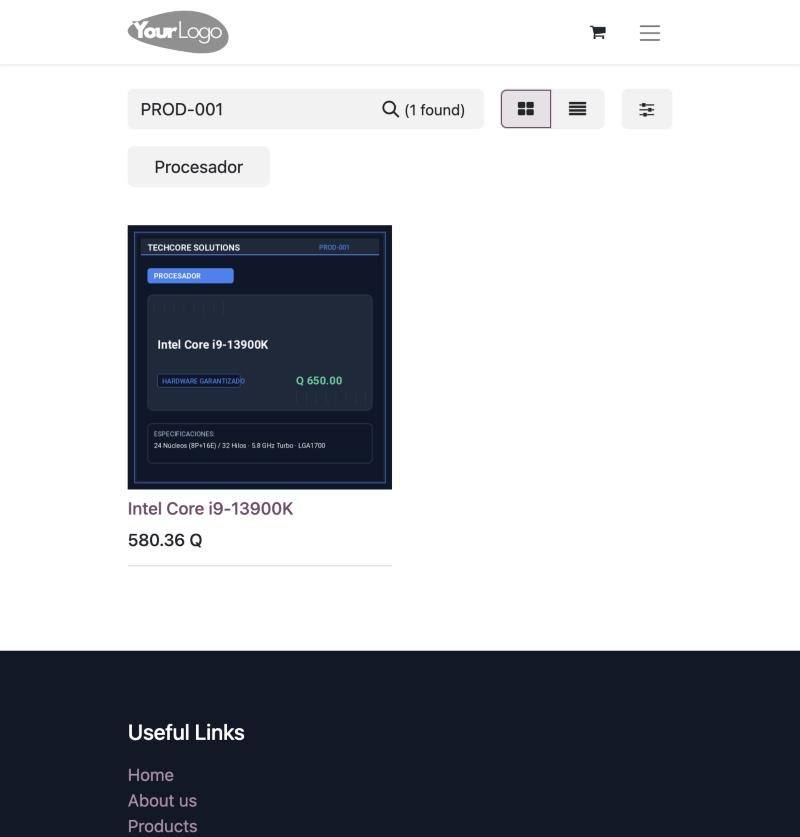
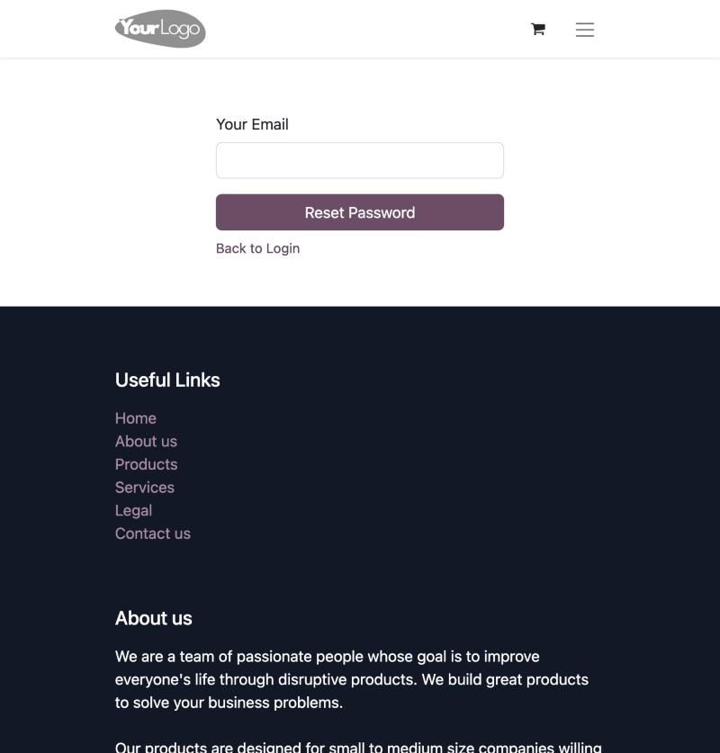
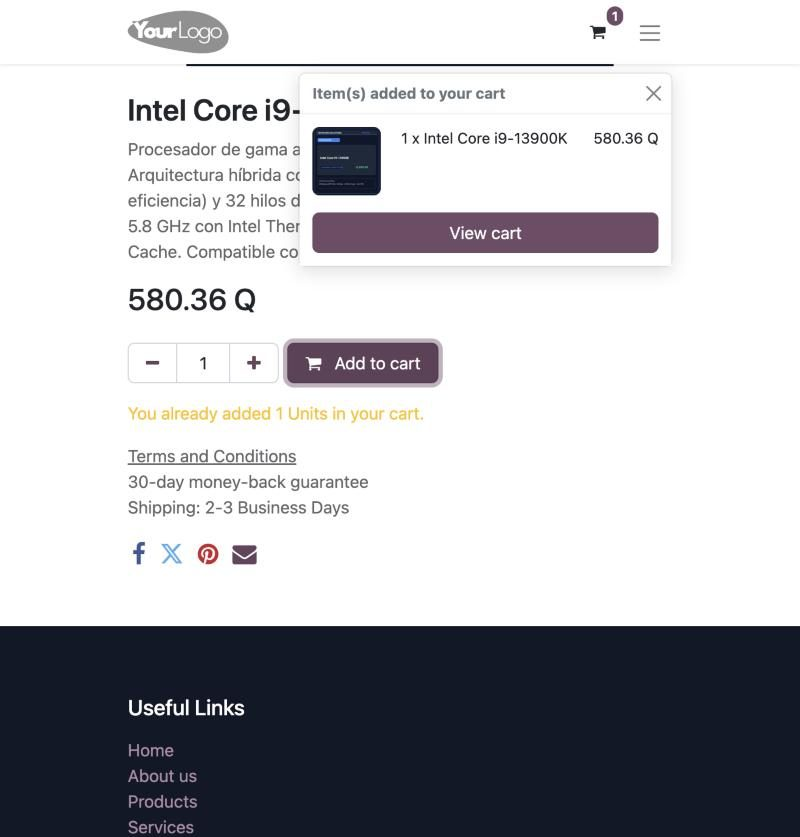
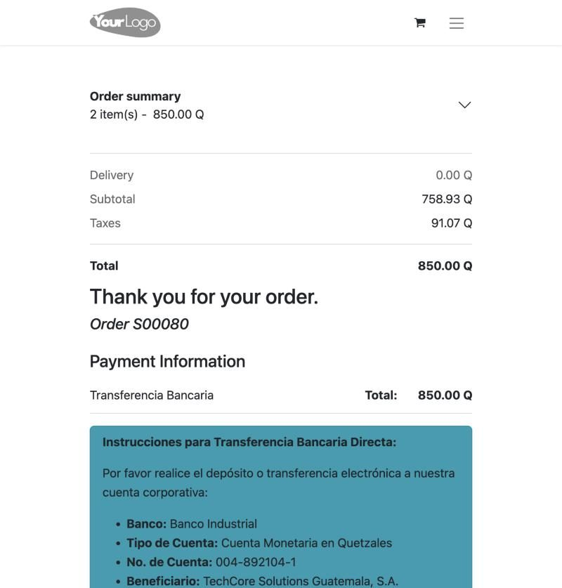
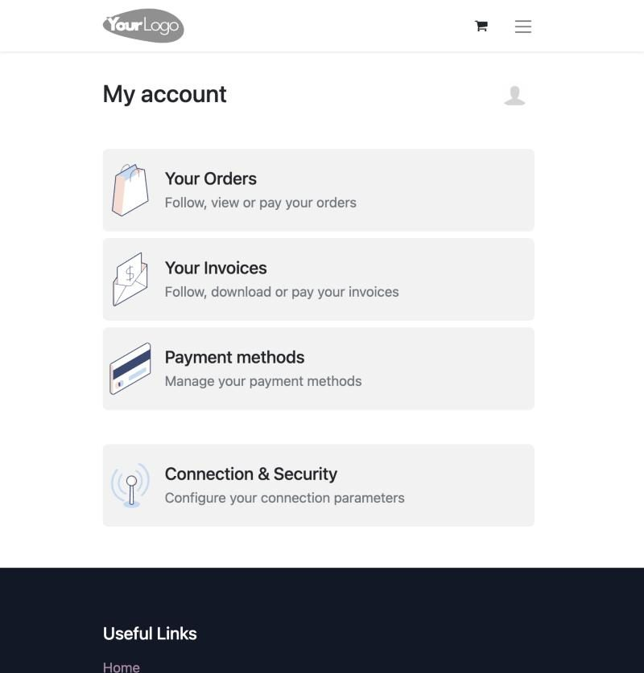
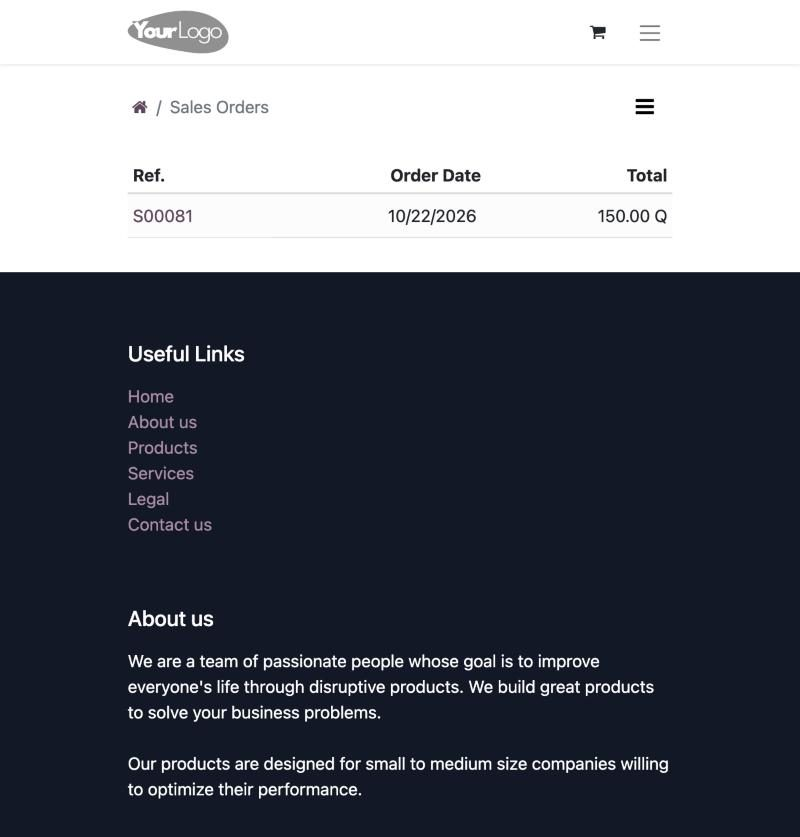
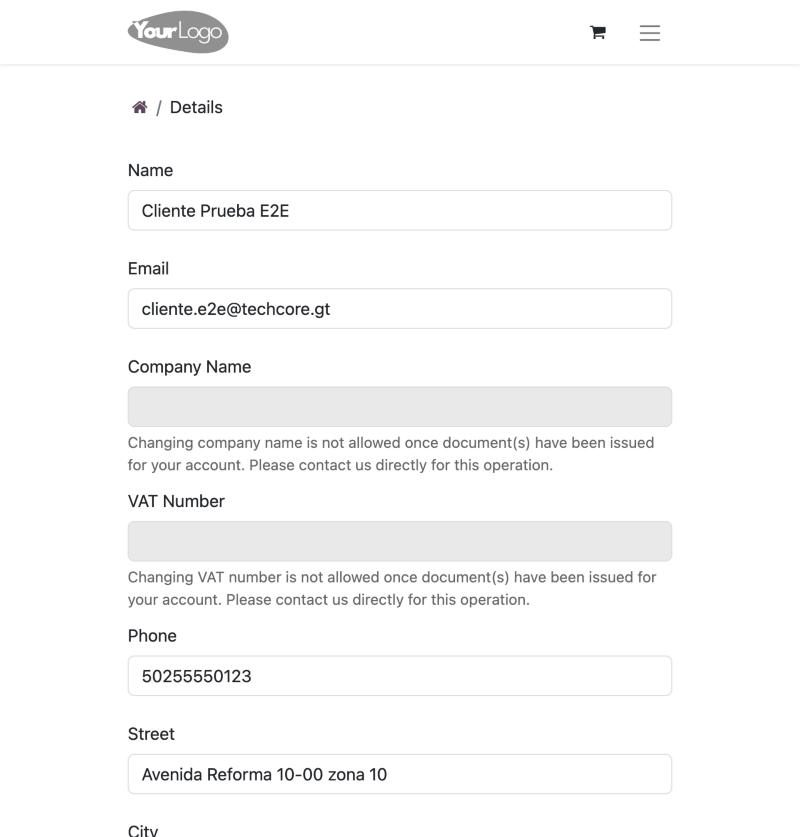
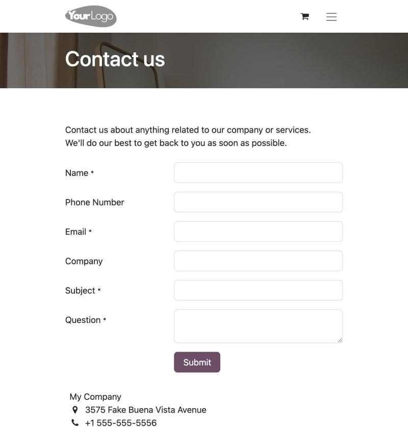
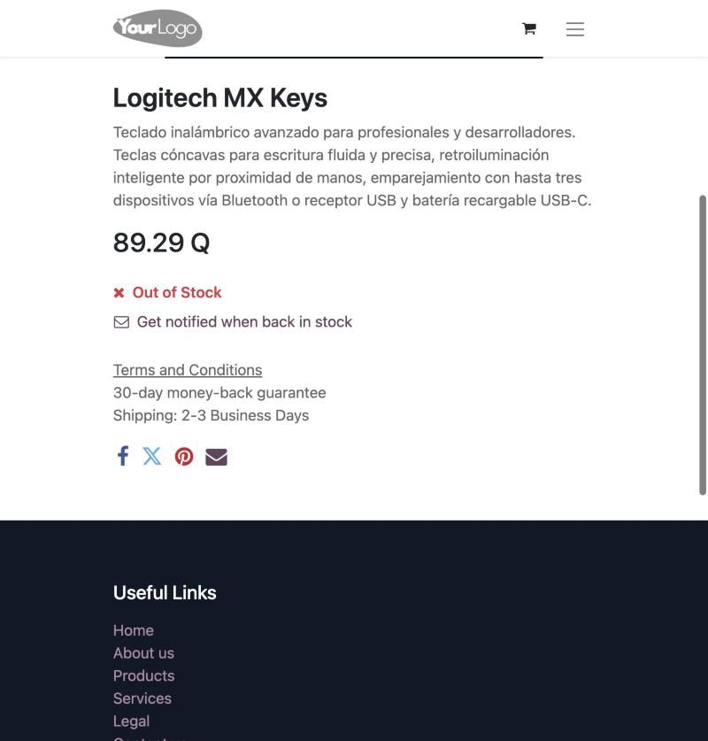

# Manual de Usuario: Tienda en Línea TechCore Solutions Guatemala

**Integrante:** Julio Alfredo Herrera Orantes
**Carnet:** 202300850
**Dirigido a:** clientes finales (personas y empresas)

Esta guía explica, paso a paso, cómo comprar hardware en la tienda en línea de TechCore Solutions Guatemala, cómo pagar y cómo consultar sus pedidos y facturas. La tienda se muestra en inglés; en cada paso se indica el nombre del botón tal como aparece en pantalla.

---

## 1. Cómo entrar a la tienda

1. Abra su navegador e ingrese a la dirección de la tienda de TechCore, terminada en `/shop`.
2. En la parte superior verá las **categorías**: Procesador, Memoria RAM, SSD, Disco Duro, Switch, Servidor, Tarjeta Madre y Periféricos. Pulse una categoría para ver solo sus productos.
3. Debajo se muestran los productos con su imagen y su precio.

**Importante sobre los precios:** el precio que aparece bajo el nombre del producto en la lista (por ejemplo 580.36 Q) no incluye el IVA. La imagen del producto muestra el precio con IVA incluido (650.00 Q). El total que usted paga siempre incluye el IVA del 12%.

## 2. Buscar un producto y ver su ficha

1. Escriba el nombre o parte del nombre del producto (o su código, como `PROD-001`) en el cuadro **Search** y pulse Enter.
2. Pulse sobre el producto para abrir su **ficha**.
3. En la ficha encontrará la descripción técnica, el precio en quetzales y la cantidad que desea comprar.

## 3. Crear una cuenta y recuperar la contraseña

**Crear una cuenta**

1. Pulse el ícono del menú, luego **Sign in** y el enlace **Don't have an account?**.
2. Escriba su nombre, correo electrónico y una contraseña, y confírmela.
3. Pulse el botón de registro. Su sesión se inicia automáticamente y entra a su cuenta.

**Recuperar la contraseña**

1. En la pantalla de inicio de sesión pulse **Reset Password**.
2. Escriba su correo y pulse **Reset Password** para recibir las instrucciones.

## 4. Agregar al carrito y modificar cantidades

1. En la ficha del producto, elija la cantidad y pulse **Add to cart**.
2. Aparece un aviso con el producto agregado. Pulse **View cart** o el ícono del carrito para revisarlo.
3. Para cambiar una cantidad use los botones de menos y más. Para quitar un producto, pulse el ícono de la papelera.
4. Revise el producto, la cantidad y el precio de cada línea.

## 5. Pagar su pedido

1. En el carrito pulse **Checkout**.
2. Escriba o confirme su dirección de facturación y envío (nombre, correo, teléfono, calle, ciudad, código postal, país y departamento) y pulse **Save address**; luego pulse **Confirm**.
3. En la pantalla de pago verá el resumen con el subtotal, el IVA y el total. Elija el método de pago:
   - **Wire Transfer (transferencia bancaria):** al finalizar, el sistema le muestra los datos de la cuenta de TechCore a la que debe depositar. Conserve su comprobante.
   - **Demo (pago simulado):** sirve para probar la compra; el pago se registra de inmediato sin cobrar dinero real.
4. Pulse **Pay now** para finalizar.

## 6. Confirmación del pedido y datos de la transferencia

1. Al terminar verá una pantalla con el mensaje **Thank you for your order**, el número de su pedido (por ejemplo `S00080`) y el resumen con el subtotal, el IVA y el total.
2. Si eligió transferencia, en la misma pantalla aparecen los datos de la cuenta de TechCore: banco, tipo y número de cuenta, y beneficiario. Indique el número de su pedido como referencia y envíe el comprobante a `pagos@techcore.gt`.
3. Con transferencia, su pedido queda pendiente hasta que TechCore confirme su pago; con el pago Demo se confirma al instante.

## 7. Mi cuenta: pedidos, facturas y datos

Después de iniciar sesión, abra el menú con su nombre y elija **My Account** (dirección `/my`). Allí puede:

- Ver sus **pedidos** (**Sales Orders**) y su total.
- Abrir sus **facturas** (**Invoices**), ver si están pagadas y **descargarlas en PDF** con el botón **Download**.
- **Actualizar sus datos** (nombre, correo, teléfono y dirección) desde **Details**. El nombre de empresa y el NIT no se pueden cambiar una vez emitido un documento; en ese caso comuníquese con TechCore.

## 8. Cómo solicitar una cotización (clientes empresariales)

Las empresas pueden pedir una cotización formal en lugar de pagar en línea. Pulse **Contact us** en la parte inferior de la tienda, llene el formulario (nombre, teléfono, correo, empresa, asunto y pregunta) e indique en la pregunta los productos y cantidades que necesita. TechCore le responderá con la cotización, la confirmará cuando usted la acepte y le emitirá su factura.

## 9. Preguntas frecuentes

**¿Qué pasa si un producto está agotado?** La ficha muestra **Out of Stock** y no aparece el botón para comprarlo. Puede pulsar **Get notified when back in stock** para recibir un aviso cuando haya existencias.

**¿Cómo se factura mi compra?** Con el pago Demo la factura se genera automáticamente en quetzales, con el IVA del 12% incluido, y queda disponible en Mi cuenta. Con transferencia, la factura se emite después de que TechCore confirma su pago.

**¿Cuánto tarda el despacho?** La ficha de cada producto indica un envío de 2 a 3 días hábiles.

**¿Puedo cambiar mis datos después de comprar?** Sí, desde Mi cuenta, en **Details**.

**¿Qué hago si olvidé mi contraseña?** Use **Reset Password** en la pantalla de inicio de sesión.
