# Pruebas End-to-End del Ecosistema TechCore

**Universidad de San Carlos de Guatemala**
**Facultad de Ingeniería, Escuela de Ciencias y Sistemas**
**Sistemas Organizacionales y Gerenciales 1, Sección A, Segundo Semestre 2026**
**Grupo No. 7, TechCore Solutions Guatemala**

**Integrante:** Julio Alfredo Herrera Orantes
**Carnet:** 202300850
**Rol:** Pruebas end-to-end, manual de usuario, conclusiones y presentación final

---

## 1. Introducción y Alcance

Este documento registra las pruebas de flujo completo (end-to-end) del ecosistema TechCore: tienda en línea, inventario, facturación, portal del cliente, CRM y reposición de mercancía. El objetivo es demostrar la **trazabilidad del 100%** planteada como objetivo SMART en la Fase 1: cada venta realizada en la web debe verse reflejada en el inventario, en la factura, en el portal del cliente y en el CRM.

Alcance de las pruebas:

- Registro de clientes y compra en la tienda (`/web/signup`, `/shop`).
- Pago por transferencia bancaria y con el proveedor de pago simulado (Demo).
- Descuento de inventario, facturación automática y portal del cliente (`/my`).
- Generación automática de la oportunidad `Web B2C` en el CRM.
- Control de productos agotados.
- Reposición de inventario mediante reglas de stock mínimo y orden de compra.
- Cotización a un cliente B2B (caso adicional).

## 2. Entorno de Pruebas

| Elemento | Valor |
|---|---|
| Sistema | Odoo 17.0 Community Edition con PostgreSQL 15, en Docker |
| Arranque | `./start.sh` en `Proyecto/techcore-odoo/` |
| URL | `http://localhost:8069` (tienda en `/shop`, portal en `/my`) |
| Base de datos | `TechCore_DB`, restaurada desde el dump oficial de la Fase 3 |
| Usuario administrador | `admin@techcore.gt` |
| Moneda e impuesto | Quetzal (GTQ), IVA 12% |
| Navegador | Navegador integrado de la aplicación de escritorio (Chromium) |
| Cliente de prueba | `cliente.e2e@techcore.gt`, registrado en CP-01 (distinto de los clientes sembrados); contraseña de prueba: `CliE2E-Test#2026` |

Nota: las ventas históricas sembradas llevan la referencia `DEMO-SEED` y son datos de demostración para el análisis de Business Intelligence. Las pruebas de este documento se ejecutan con pedidos nuevos, hechos durante la prueba.

## 3. Casos de Prueba

Estado de cada caso: *aprobado*, *aprobado con observaciones*, *parcial* o *fallido*, según el resultado real y su evidencia.

### CP-01: Registro de un cliente nuevo

**Objetivo:** verificar que un visitante puede crear su cuenta desde `/web/signup` y acceder al portal.

**Precondiciones:** sistema levantado y registro libre habilitado; el correo de prueba no existe en el sistema.

**Pasos:**

1. Abrir `http://localhost:8069/web/signup` en una ventana sin sesión iniciada.
2. Completar nombre, correo y contraseña, y pulsar el botón de registro.
3. Comprobar que se inicia sesión y que se puede abrir `http://localhost:8069/my`.
4. En Odoo (usuario administrador), buscar al cliente en **Contacts** para confirmar que existe.

**Resultado esperado:** la cuenta se crea sin pedir invitación, se puede iniciar sesión y el cliente entra al portal `/my`.

**Resultado real:** se abrió `/web/signup` sin sesión, se completó el formulario con el nombre `Cliente Prueba E2E`, el correo `cliente.e2e@techcore.gt` y una contraseña, y al pulsar el botón de registro el sistema creó la cuenta sin pedir invitación ni verificación por correo, inició la sesión y redirigió a `/my`. En Odoo, el contacto existe como persona (*Individual*) con el correo indicado y, a partir de la primera compra, con la dirección y el teléfono capturados en el pago.

**Estado:** aprobado.

**Evidencia:**

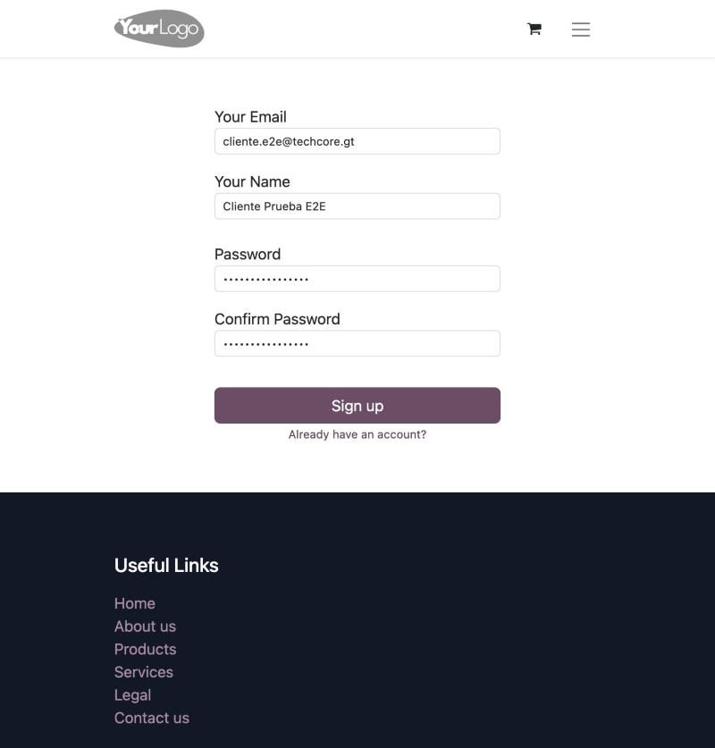

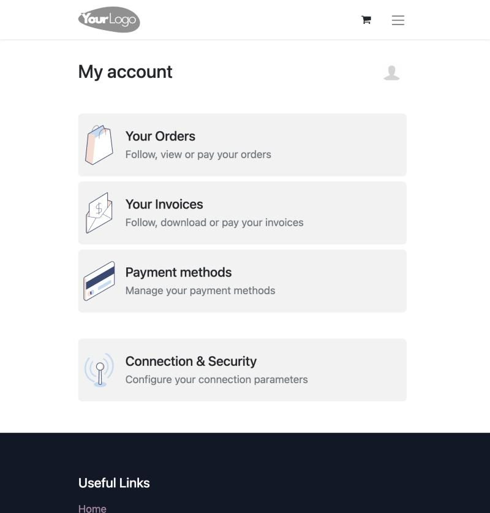

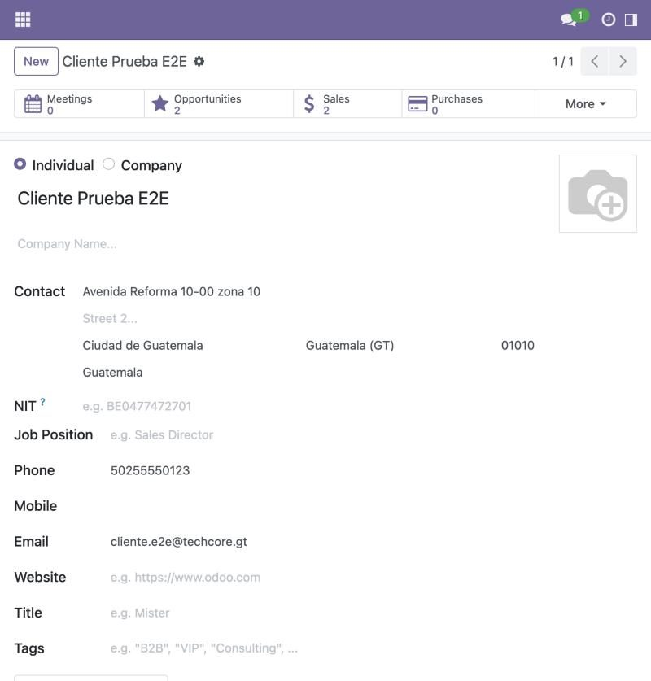

**Observaciones:** el registro es libre y no exige confirmar el correo; para un entorno productivo conviene valorar esa verificación.

### CP-02: Compra con transferencia bancaria

**Objetivo:** verificar el flujo de compra completo con el método de pago por transferencia.

**Precondiciones:** CP-01 aprobado (cliente con sesión iniciada); los dos productos elegidos tienen existencias.

**Pasos:**

1. Anotar las existencias de los dos productos antes de comprar (ver tabla de CP-04).
2. En `/shop`, buscar un producto por nombre y abrir su ficha.
3. Agregar al carrito dos productos distintos (por ejemplo `PROD-001` y `PROD-005`) y revisar el carrito.
4. Avanzar al pago, confirmar dirección y elegir **Transferencia bancaria**.
5. Confirmar el pedido y anotar el número de orden (S000xx).
6. En Odoo, abrir **Sales > Orders** y verificar el pedido.

**Resultado esperado:** el pedido se crea y queda confirmado, con el total correcto (subtotal más IVA 12%).

**Resultado real:** con la sesión del cliente iniciada se buscó `PROD-001` en `/shop`, se abrió su ficha y se agregó al carrito; luego se hizo lo mismo con `PROD-005`. En el carrito aparecieron los dos productos (580.36 Q y 178.57 Q, precios sin IVA). Al avanzar, el cliente completó la dirección de facturación y envío (con datos ficticios en Guatemala), se eligió **Wire Transfer** (en Odoo, *Transferencia Bancaria*) y **Pay now**. La página de confirmación mostró la orden **S00080** con subtotal 758.93 Q, IVA 91.07 Q y total **850.00 Q**, junto con las instrucciones de transferencia (Banco Industrial, cuenta `004-892104-1`, beneficiario TechCore Solutions Guatemala, S.A.).

En Odoo el pedido S00080 quedó en estado **Quotation Sent** (cotización enviada), con una transacción de pago en estado *pending*, sin factura y sin entrega: la transferencia no confirma el pedido por sí sola. Después de simular la recepción del comprobante, se confirmó el pedido desde Odoo (estado *Sales Order*) y se generó la entrega `WH/OUT/00080`.

**Estado:** aprobado.

**Evidencia:**

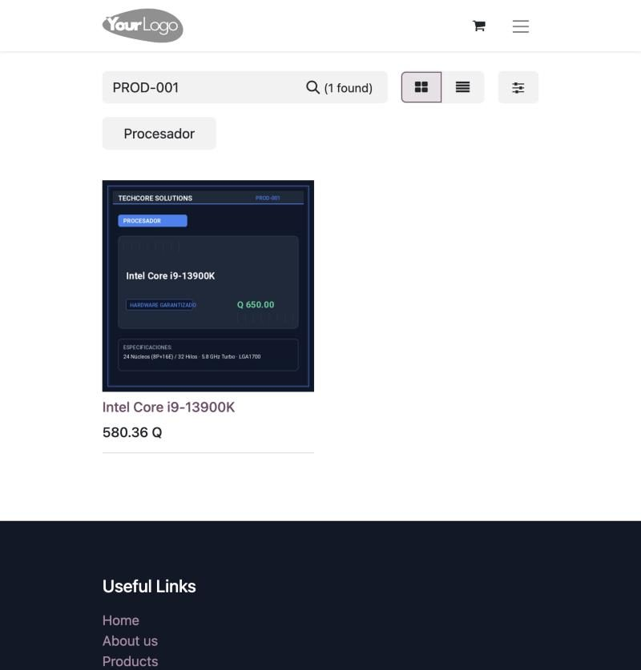

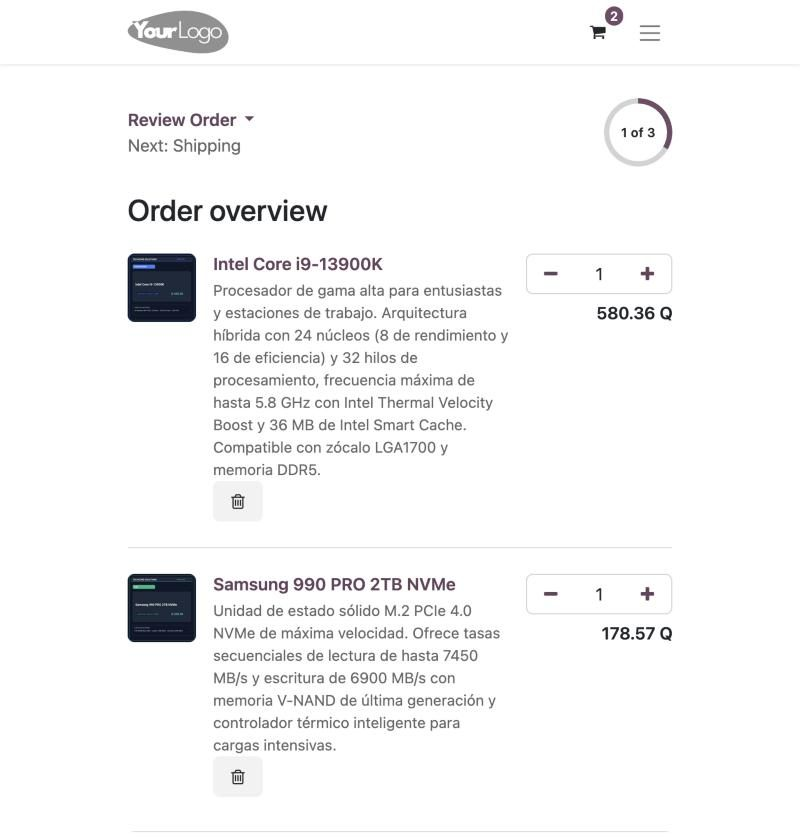

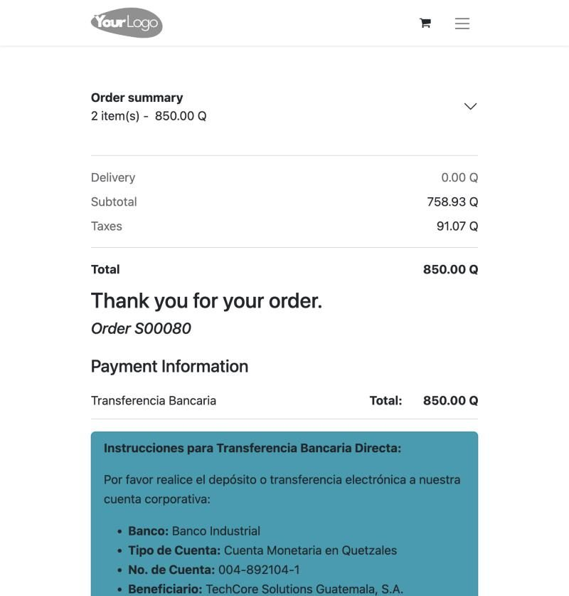

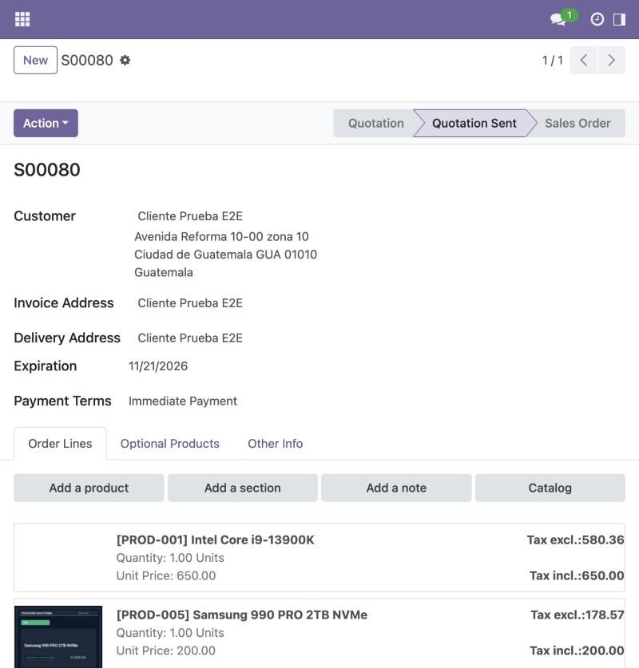

**Observaciones:** (1) el pedido por transferencia queda pendiente de pago hasta que alguien lo confirma en Odoo; no reserva existencias ni se factura de forma automática (tras confirmarlo, el estado de facturación es *To Invoice*). (2) La tienda muestra los precios sin IVA (por ejemplo 580.36 Q), mientras que la imagen de cada producto y la lista de precios dicen 650.00 Q con IVA incluido; el total del pago sí incluye el 12% (850.00 Q). Es una inconsistencia visual que conviene explicar al cliente o unificar.

### CP-03: Compra con el proveedor de pago Demo

**Objetivo:** verificar que el pago simulado se registra y deja el pedido pagado.

**Precondiciones:** cliente con sesión iniciada; productos con existencias.

**Pasos:**

1. Anotar las existencias de los productos antes de comprar.
2. Agregar uno o dos productos al carrito y avanzar al pago.
3. Elegir el proveedor **Demo** y completar el pago simulado.
4. Anotar el número de orden y revisar en Odoo el pago registrado.

**Resultado esperado:** el pago se registra y el pedido queda pagado.

**Resultado real:** se agregó `PROD-003` (Corsair Vengeance 32GB DDR5) al carrito y se avanzó al pago. En **Demo** se dejó el estado *Successful* y se pulsó **Pay now**; el sistema mostró la pantalla de procesamiento y confirmó el pago. En Odoo se creó el pedido **S00081** por **150.00 Q** en estado *Sales Order*, con la transacción de pago `S00081` en estado *done* (proveedor `demo`), la factura `INV/2026/00078` ya pagada y la entrega `WH/OUT/00079` lista. El cliente ve el pedido en `/my/orders` con su total.

**Estado:** aprobado.

**Evidencia:**

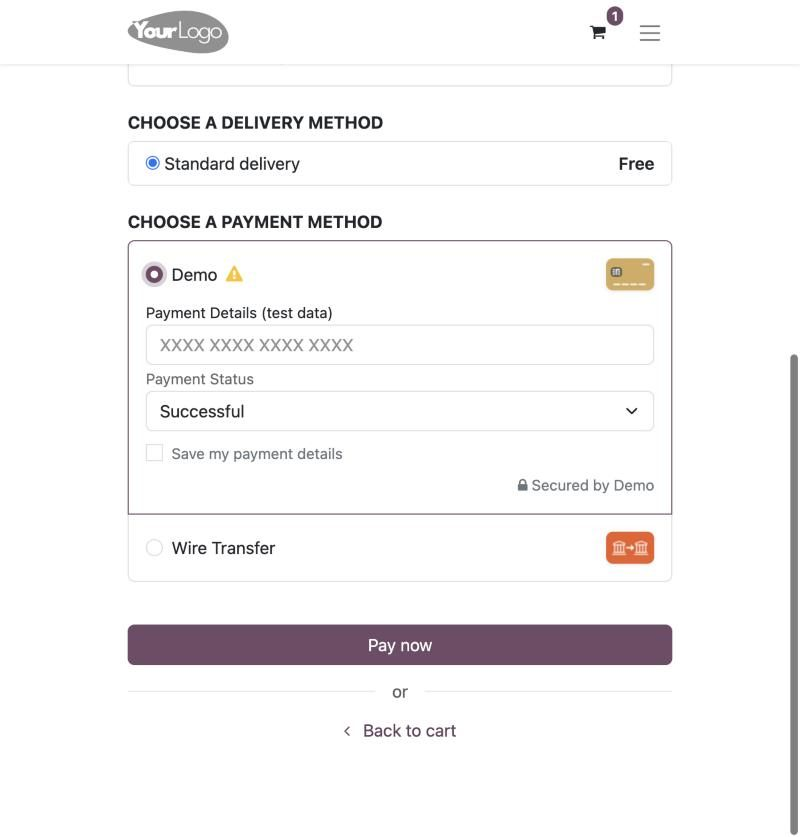

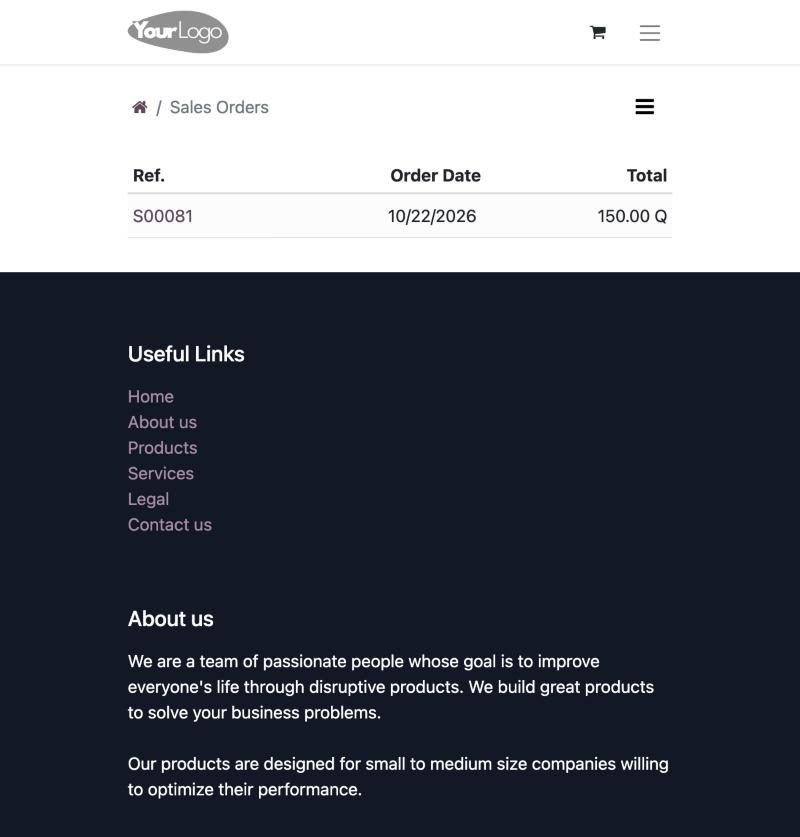

**Observaciones:** después de pagar con Demo, la página de confirmación mostró el resumen de la orden anterior (S00080) en lugar de S00081, aunque el pedido correcto sí se creó y se pagó. Parece un comportamiento de sesión al comprar dos veces seguidas; se debe reportar a Jonathan para revisarlo.

### CP-04: Inventario después de la venta

**Objetivo:** comprobar que las existencias bajan exactamente lo vendido.

**Precondiciones:** CP-02 y CP-03 ejecutados, con las existencias anotadas antes de cada compra.

**Pasos:**

1. En **Inventory > Products**, abrir cada producto comprado y leer *On Hand*.
2. Revisar **Inventory > Reporting > Moves History** y localizar las salidas de los pedidos.
3. Completar la tabla de comparación.

| Producto | Existencias antes | Cantidad vendida | Existencias después | Diferencia correcta |
|---|---|---|---|---|
| `PROD-001` Intel Core i9-13900K (S00080) | 74 | 1 | 73 | Sí |
| `PROD-005` Samsung 990 PRO 2TB NVMe (S00080) | 79 | 1 | 78 | Sí |
| `PROD-003` Corsair Vengeance 32GB DDR5 (S00081) | 152 | 1 | 151 | Sí |

**Resultado esperado:** las existencias después son iguales a las de antes menos la cantidad vendida.

**Resultado real:** con las dos entregas validadas (`WH/OUT/00079` de S00081 y `WH/OUT/00080` de S00080), las existencias bajaron exactamente lo vendido en los tres productos, según la tabla anterior. **Moves History** muestra tres salidas *Done* de 1.00 unidad cada una, con la referencia de cada entrega.

**Estado:** aprobado.

**Evidencia:**

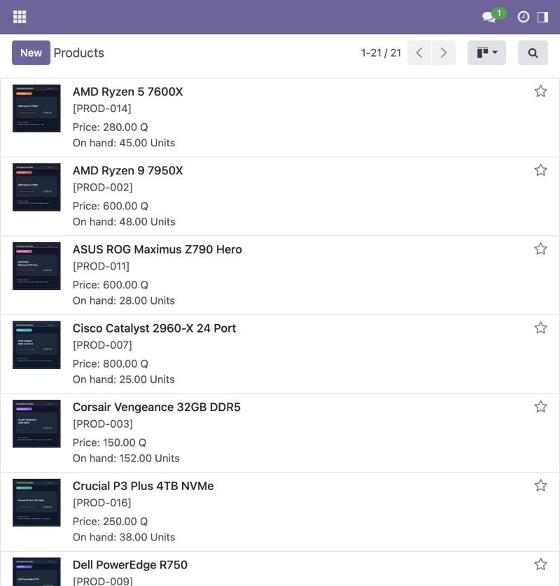

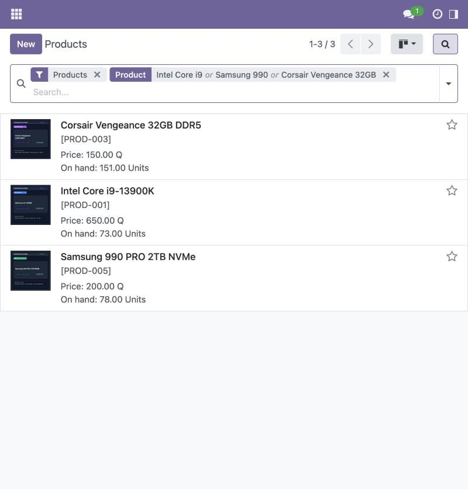

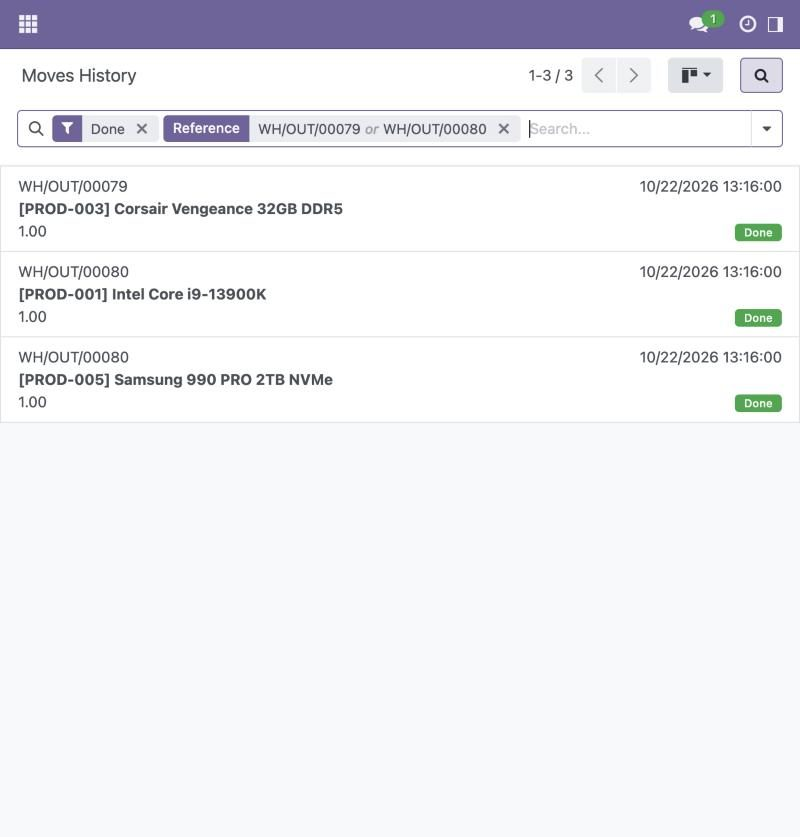

**Observaciones:** el pedido pagado reserva la mercancía de inmediato (el pronóstico baja al confirmarse la venta), pero las existencias *On hand* solo bajan cuando se valida la entrega. Antes de validar, `PROD-003` mostraba 152 en mano y 151 de pronóstico. Al validar las entregas se omitió el aviso de confirmación por SMS de Odoo para no enviar mensajes de texto reales al teléfono de prueba.

### CP-05: Factura y portal del cliente

**Objetivo:** verificar que cada venta genera su factura y que el cliente la ve y la descarga.

**Precondiciones:** pedidos de CP-02 o CP-03 confirmados.

**Pasos:**

1. En Odoo, abrir **Accounting > Customers > Invoices** y ubicar la factura del pedido.
2. Verificar que está publicada (*Posted*) y revisar el IVA 12%.
3. Iniciar sesión como el cliente de prueba y abrir `/my`.
4. Entrar a las facturas, abrir la del pedido y descargar el PDF.

**Resultado esperado:** existe la factura, está publicada, aparece en `/my` y se descarga en PDF.

**Resultado real:** la venta pagada con Demo generó la factura `INV/2026/00078` por 150.00 Q (base 133.93 Q más IVA de 16.07 Q), en estado *Posted* y *Paid*. El cliente la ve en `/my/invoices` con estado pagado y monto pendiente de 0.00 Q, al abrirla aparece el botón **Download** y la solicitud del PDF responde correctamente (tipo `application/pdf`, 43,380 bytes, archivo `INV-2026-00078.pdf`).

**Estado:** aprobado.

**Evidencia:**

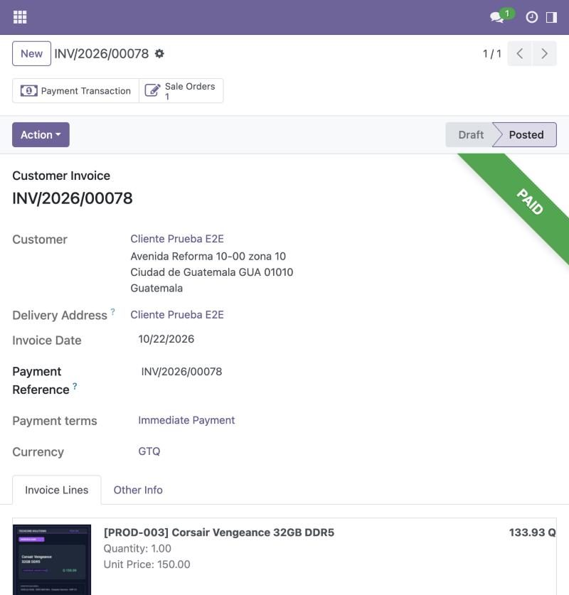

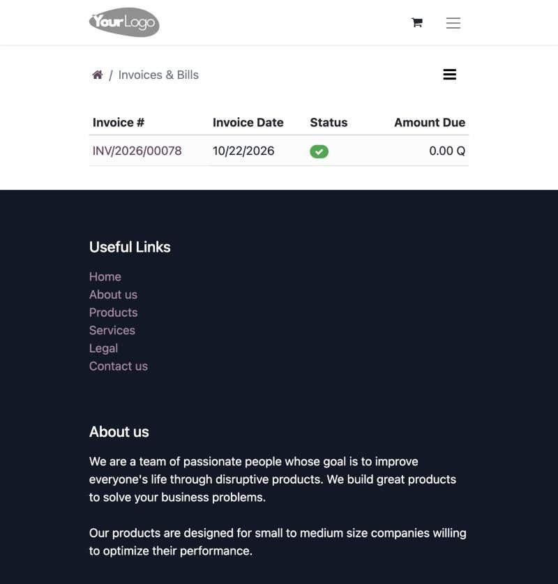

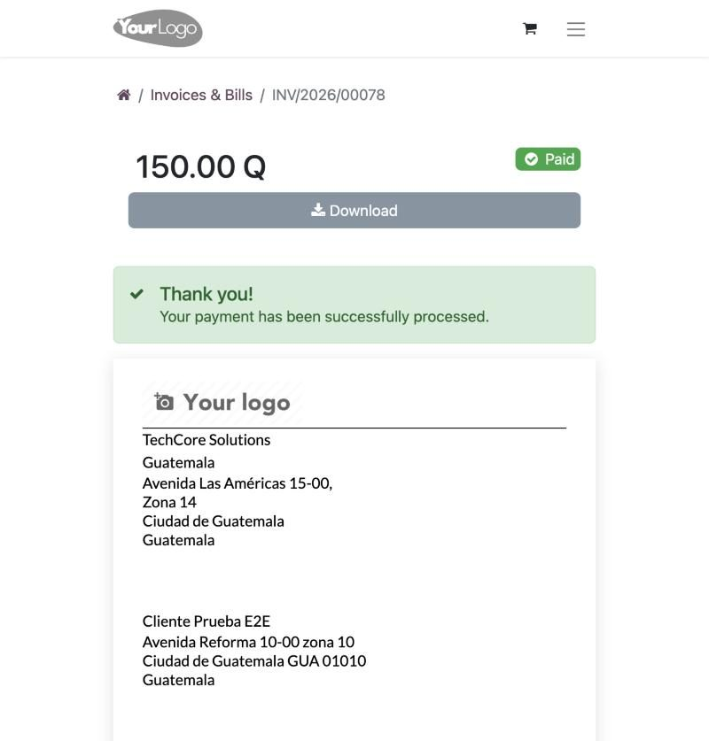

**Observaciones:** el pedido pagado con Demo se factura de forma automática; el pedido por transferencia (S00080) no genera factura hasta que se factura manualmente, por lo que en el portal solo aparece la factura del pago con Demo. El PDF se verificó solicitándolo al sistema; no se guardó en disco.

### CP-06: Oportunidad en el CRM

**Objetivo:** verificar que una compra web crea una oportunidad en el CRM.

**Precondiciones:** pedido web confirmado (CP-02 o CP-03).

**Pasos:**

1. En Odoo, abrir **CRM > Pipeline**.
2. Ubicar la oportunidad creada por el pedido.
3. Abrirla y verificar etiqueta `Web B2C`, etapa Lead, cliente y pedido relacionado.

**Resultado esperado:** existe una oportunidad con la etiqueta `Web B2C` en la etapa Lead, ligada al cliente y al pedido.

**Resultado real:** cada pedido web creó una oportunidad en **CRM > Pipeline**: `Oportunidad Web: S00080 - Cliente Prueba E2E` y `Oportunidad Web: S00081 - Cliente Prueba E2E`. Ambas tienen la etiqueta `Web B2C`, están en la etapa **Lead**, ligadas al cliente (correo y teléfono completos) y con la nota «Generado automáticamente desde orden eCommerce S0008x».

**Estado:** aprobado con observaciones.

**Evidencia:**

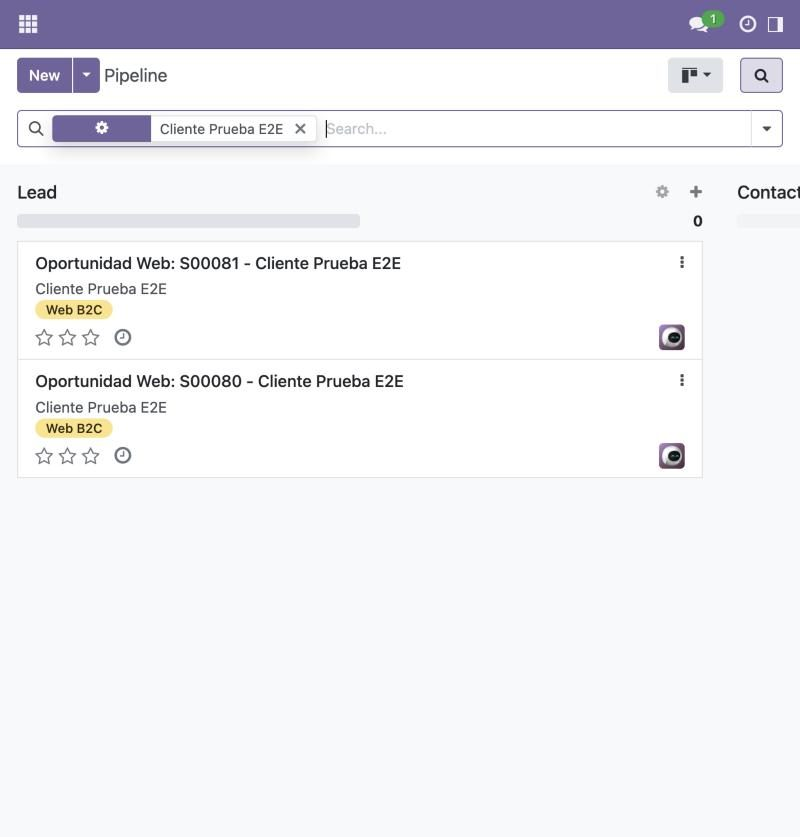

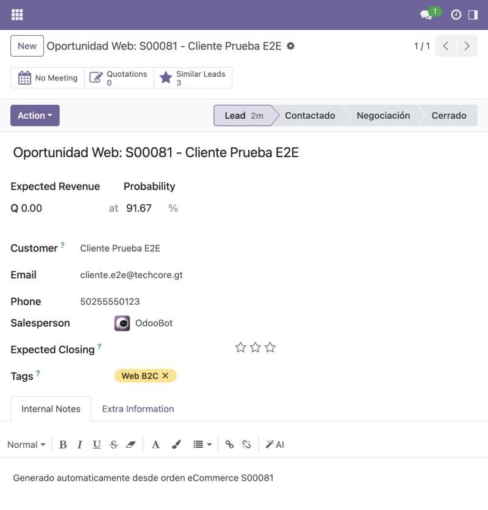

**Observaciones:** (1) el ingreso esperado de estas oportunidades es 0.00 Q; el monto del pedido no se traslada (las oportunidades históricas de otros clientes sí muestran monto, por ejemplo 1,050.00 Q). (2) La relación con el pedido es solo el nombre y la nota: el contador *Quotations* de la oportunidad marca 0. (3) El vendedor asignado es OdooBot, por lo que estas oportunidades no aparecen con el filtro predeterminado *My Pipeline*; hay que quitarlo para verlas. Se recomienda a Jonathan trasladar el monto del pedido y ligar el pedido a la oportunidad.

### CP-07: Producto sin existencias

**Objetivo:** verificar que un producto agotado se muestra como tal y no se puede comprar.

**Precondiciones:** un producto con existencias en cero (se deja en cero con un ajuste en **Inventory > Operations > Physical Inventory**, o se usa uno que ya esté agotado).

**Pasos:**

1. Dejar el producto elegido con *On Hand* en 0 y aplicar el ajuste.
2. En `/shop`, abrir la ficha del producto.
3. Intentar agregarlo al carrito.

**Resultado esperado:** la ficha indica que está agotado y no se puede agregar al carrito ni comprar.

**Resultado real:** se dejó `PROD-021` (Logitech MX Keys) en 0 unidades con un ajuste de inventario (de 50 a 0) y el producto muestra *On hand* 0.00 en Inventory. En la tienda, la ficha del producto muestra **Out of Stock** y el enlace *Get notified when back in stock*, y no aparece el botón **Add to cart**, por lo que no se puede comprar. El producto está configurado para no vender sin existencias.

**Estado:** aprobado.

**Evidencia:**

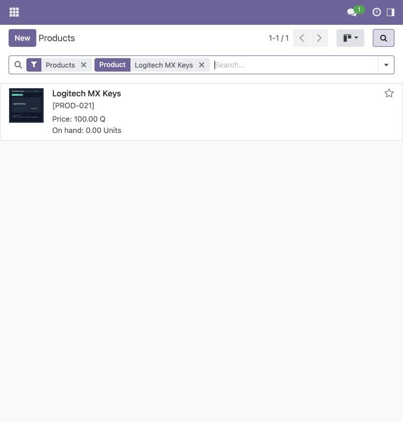

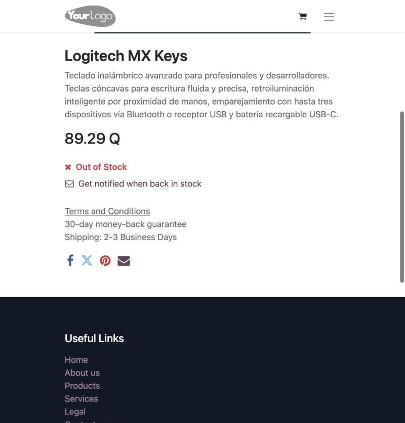

**Observaciones:** en el listado `/shop` el producto agotado sigue apareciendo sin etiqueta de agotado; el aviso se ve al abrir la ficha. Al terminar la prueba se devolvieron las 50 unidades de `PROD-021` con un nuevo ajuste de inventario.

### CP-08: Reposición de inventario

**Objetivo:** verificar el ciclo reglas de stock mínimo, orden de compra, recepción y aumento de existencias.

**Precondiciones:** cuatro reglas de reposición activas (`PROD-009`, `PROD-010`, `PROD-018` y `PROD-007`) con *Trigger* en Auto, y proveedores con precio registrado para esos productos.

**Pasos:**

1. Abrir **Inventory > Operations > Replenishment** y anotar el estado inicial: existencias por debajo del mínimo en los cuatro productos.
2. Abrir **Purchase > Orders > Requests for Quotation** y localizar la solicitud de cotización generada automáticamente por las reglas.
3. Confirmar la solicitud (**Confirm Order**) y verificar que pasa a *Purchase Order*.
4. Abrir **Inventory > Receipts**, ubicar la recepción asociada y validarla (**Validate**).
5. Volver a **Replenishment** y comparar las existencias con el estado inicial.

**Resultado esperado:** se genera la orden de compra, se recibe la mercancía y las existencias suben hasta el máximo de cada regla.

**Resultado real:** al iniciar el sistema, el planificador automático (reglas con *Trigger* Auto) generó la solicitud de cotización **P00017** al proveedor Intcomex, por 78,140.16 Q, con origen `OP/00001`, `OP/00002`, `OP/00003` y `OP/00004` (las cuatro reglas) y sin comprador asignado. Esa solicitud explica que el pronóstico de cada regla ya estuviera en su máximo y que *To Order* marcara 0. Se confirmó la orden (estado *Purchase Order*) y se validó la recepción `WH/IN/00017` (estado *Done*). Las existencias cambiaron así:

| Producto | Existencias antes | Mínimo | Máximo | Existencias después |
|---|---|---|---|---|
| `PROD-009` Dell PowerEdge R750 | 2 | 5 | 10 | 10 |
| `PROD-010` HPE ProLiant DL380 Gen10 | 3 | 5 | 10 | 10 |
| `PROD-018` Lenovo ThinkSystem SR650 | 4 | 5 | 10 | 10 |
| `PROD-007` Cisco Catalyst 2960-X 24 Port | 5 | 10 | 25 | 25 |

**Estado:** aprobado.

**Evidencia:**

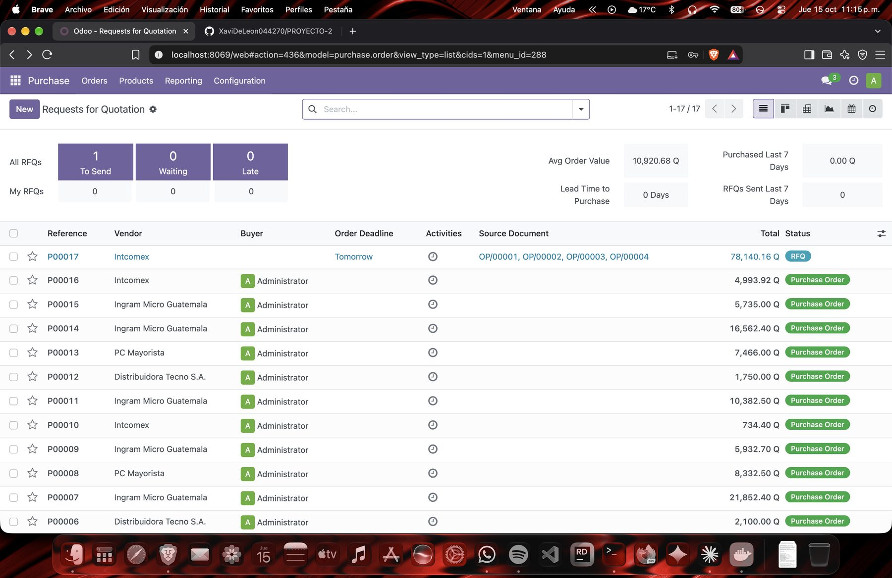

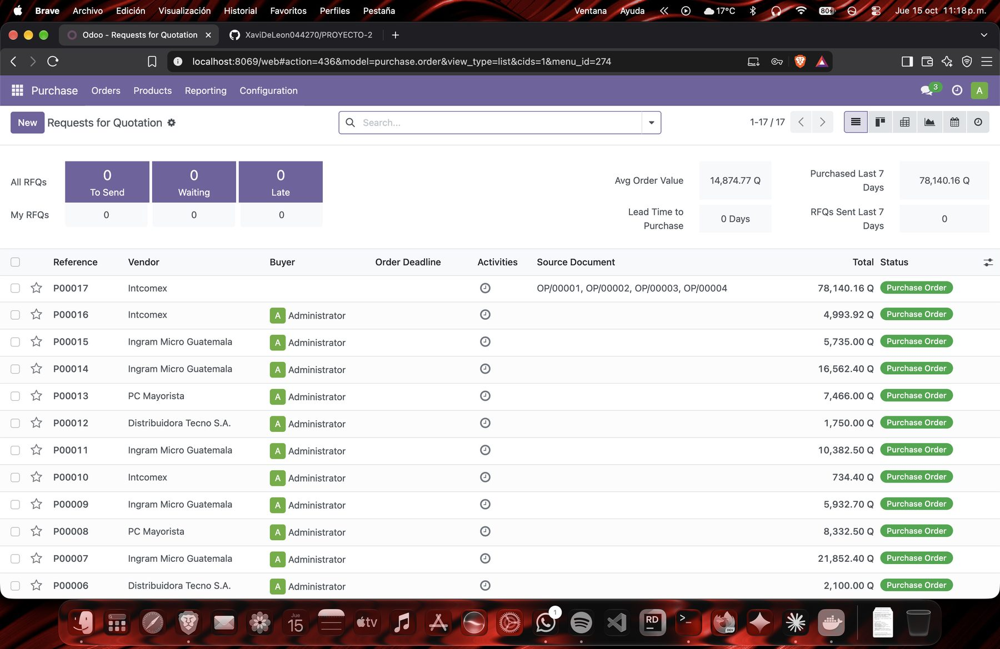

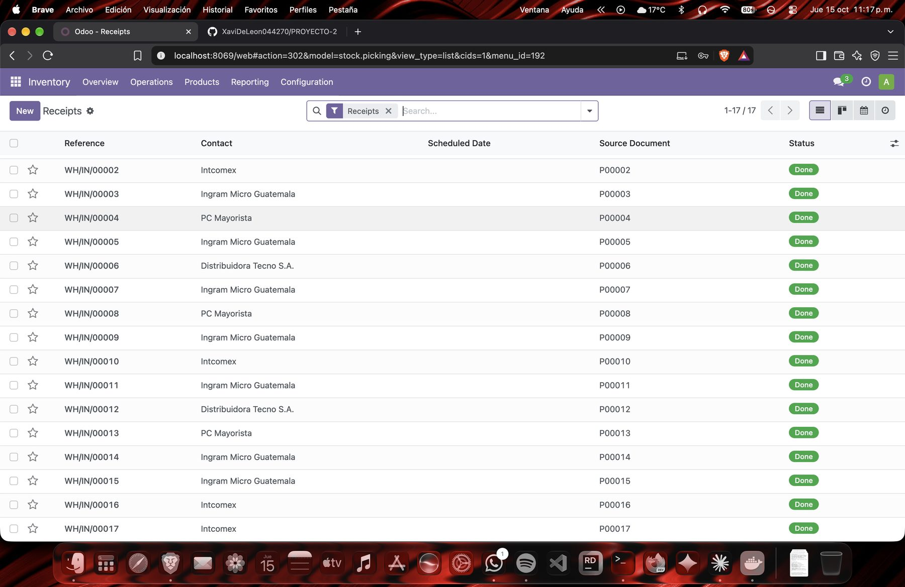

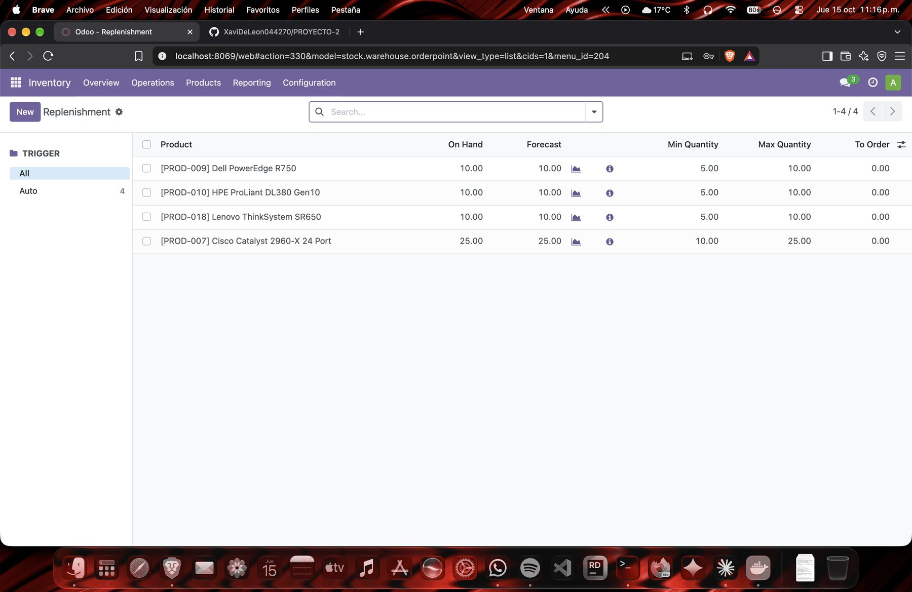

**Observaciones:** la orden de compra no la creó una persona, sino la reposición automática de Odoo; por eso no fue necesario ejecutar **Order Once** de forma manual. La recepción se validó manualmente desde **Inventory > Receipts**. El estado inicial se tomó con una captura previa a la confirmación de la orden.

### CP-09 (adicional): Cotización B2B

**Objetivo:** verificar el flujo cotización, confirmación, factura y portal para un cliente B2B.

**Precondiciones:** cliente `TechCorp S.A.` existente; módulo de cotizaciones instalado.

**Pasos:**

1. En **Sales > Orders > Quotations**, crear una cotización para `TechCorp S.A.` con dos productos.
2. Enviarla (**Send by Email**) y confirmarla.
3. Crear la factura desde el pedido y publicarla.
4. Verificar que la cotización o el pedido y la factura aparecen en el portal del cliente B2B.

**Resultado esperado:** la cotización se confirma, se factura y es visible en el portal del cliente.

**Resultado real:** se creó la cotización **S00082** para `TechCorp S.A.` con `PROD-002` (2 unidades a 600.00 Q) y `PROD-014` (3 unidades a 280.00 Q): base 1,821.43 Q, IVA 218.57 Q, total **2,040.00 Q**. Se confirmó el pedido (estado *Sales Order*, con la entrega y la factura vinculadas) y se generó y publicó la factura `INV/2026/00079` por 2,040.00 Q, pendiente de pago.

**Estado:** parcial. No se ejecutaron dos pasos: el envío por correo (**Send by Email**), para no generar correos reales desde la prueba, y la verificación en el portal, porque `TechCorp S.A.` no tiene un usuario de portal y otorgarlo implica enviar una invitación.

**Evidencia:**

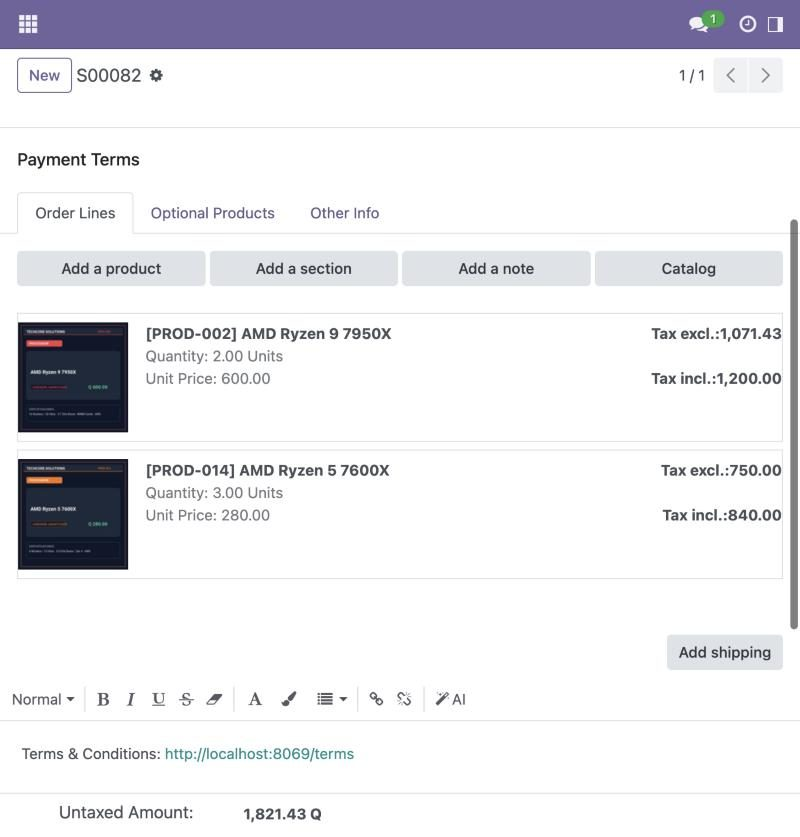

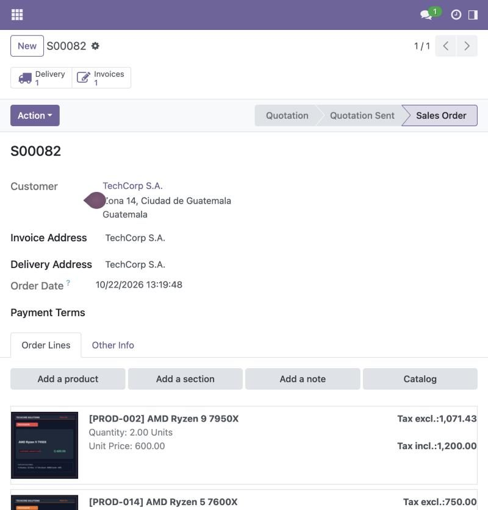

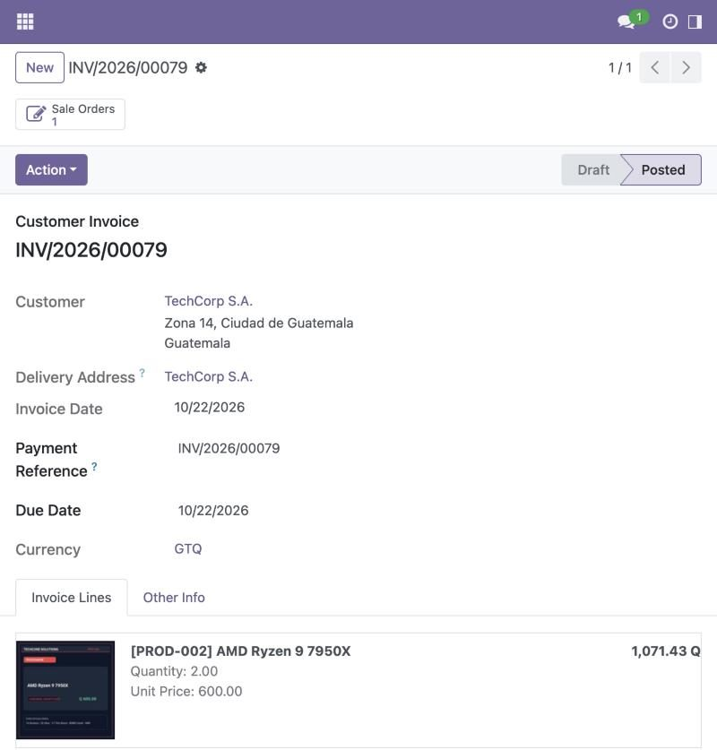

**Observaciones:** para completar el caso hay que otorgar acceso al portal a un contacto de `TechCorp S.A.` (con un correo de prueba) y comprobar ahí la cotización y la factura.

## 4. Matriz de Trazabilidad

Se completa con los pedidos reales de las pruebas.

| Pedido | Cliente | Productos | Existencias antes y después | Factura | Visible en portal | Oportunidad CRM |
|---|---|---|---|---|---|---|
| S00080 (transferencia, 850.00 Q) | Cliente Prueba E2E | `PROD-001`, `PROD-005` | 74 a 73 y 79 a 78 (tras confirmar y validar la entrega) | Pendiente de facturar | Pedido pendiente hasta confirmarse | `Web B2C`, etapa Lead |
| S00081 (Demo, 150.00 Q) | Cliente Prueba E2E | `PROD-003` | 152 a 151 | `INV/2026/00078`, pagada | Sí (`/my/orders` y `/my/invoices`) | `Web B2C`, etapa Lead |
| S00082 (cotización B2B, 2,040.00 Q) | TechCorp S.A. | `PROD-002`, `PROD-014` | Entrega creada, sin validar | `INV/2026/00079`, pendiente de pago | No probado | No aplica (no es pedido web) |

## 5. Resumen de Resultados

| Total de casos | Aprobados | Parciales | Fallidos | Fallos corregidos |
|---|---|---|---|---|
| 9 | 8 (CP-01 a CP-08; CP-06 con observaciones) | 1 (CP-09) | 0 | 0 |

La trazabilidad de la venta web se cumplió de extremo a extremo: cada pedido genera su oportunidad `Web B2C` en el CRM, el pago con Demo se factura de forma automática y la factura se ve y se descarga en el portal, y las existencias bajan exactamente lo vendido cuando se valida la entrega. La reposición automática repuso los cuatro productos hasta su máximo. No hubo fallos bloqueantes.

Hallazgos para mejorar y reportar a Jonathan:

1. El pedido por transferencia no se factura ni reserva existencias hasta confirmarse manualmente (CP-02, CP-05).
2. La tienda muestra precios sin IVA y las imágenes de producto muestran el precio con IVA (CP-02).
3. La oportunidad del CRM se crea con ingreso esperado 0.00 Q, sin ligar el pedido y asignada a OdooBot (CP-06).
4. Tras pagar con Demo, la página de confirmación mostró el resumen del pedido anterior (CP-03).
5. El registro libre no exige verificar el correo (CP-01).

## 6. Video Demostrativo

**Enlace de Google Drive:** https://drive.google.com/drive/folders/1KkOk_ql0KaoQXyrvk9ObFsEnRwvmSKz1?usp=sharing

**Descripción del contenido del video:** registro de un cliente nuevo y compra en la tienda, pago, confirmación y factura en el portal, verificación del descuento de inventario, oportunidad `Web B2C` en el CRM, reposición con orden de compra y recepción, y cierre con los resultados de las pruebas.
