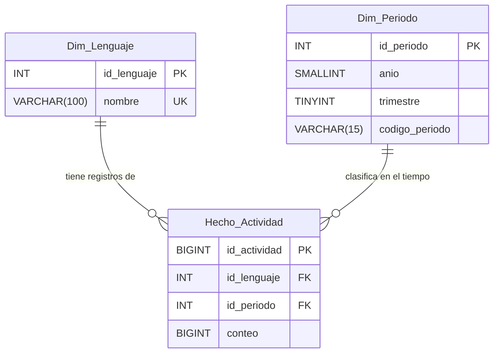

# INFORME EJECUTIVO - MODELADO DE DATOS (PARTE A)
**Responsable:** Jonathan (Arquitectura y Modelado BD)  
**Proyecto:** Práctica 1 - Análisis de Lenguajes de Programación ("MayaCode")

---

## 1. Introducción al Caso MayaCode

El crecimiento global del desarrollo de software obliga a las empresas tecnológicas a seleccionar estratégicamente sus lenguajes de programación para optimizar costos, escalabilidad y mantenimiento. 

Ante este reto, la empresa emergente **"MayaCode"** nos ha contratado para analizar la evolución histórica de uso de los lenguajes de programación (periodo 2011–2022). Este informe presenta el diseño de la base de datos relacional y las visualizaciones en Inteligencia de Negocios (Power BI) orientadas a respaldar, con datos objetivos, las decisiones de adopción tecnológica de la directiva de MayaCode.

---

## 2. Diagrama Entidad-Relación (ERD)

