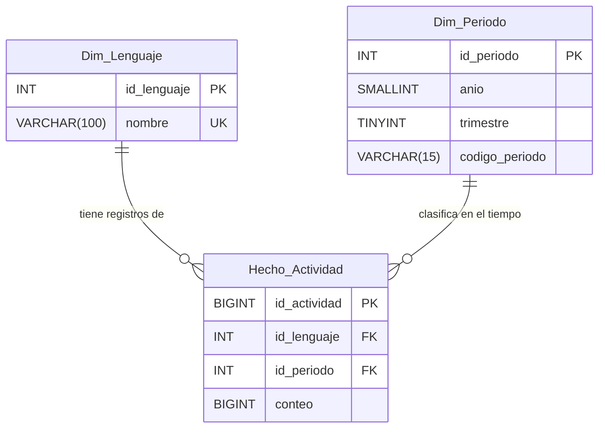

# INFORME EJECUTIVO - MODELADO DE DATOS (PARTE A)
**Responsable:** Jonathan (Arquitectura y Modelado BD)  
**Proyecto:** Práctica 1 - Análisis de Lenguajes de Programación ("MayaCode")

---

## 1. Introducción al Caso MayaCode

El crecimiento global del desarrollo de software obliga a las empresas tecnológicas a seleccionar estratégicamente sus lenguajes de programación para optimizar costos, escalabilidad y mantenimiento. 

Ante este reto, la empresa emergente **"MayaCode"** nos ha contratado para analizar la evolución histórica de uso de los lenguajes de programación (periodo 2011–2022). Este informe presenta el diseño de la base de datos relacional y las visualizaciones en Inteligencia de Negocios (Power BI) orientadas a respaldar, con datos objetivos, las decisiones de adopción tecnológica de la directiva de MayaCode.

---

## 2. Análisis y Estructura del Modelo

El archivo fuente `practica1.csv` contiene miles de registros dispersos en 4 columnas (`name`, `year`, `quarter`, `count`). Para evitar la redundancia masiva de textos y optimizar consultas, se dividió la información en un **Esquema de Estrella (Star Schema)** normalizado en **Tercera Forma Normal (3NF)**:

### Diccionario de Entidades

| Entidad | Tipo | Atributos Principales | Tipo de Dato (SQL Server) | Descripción |
| :--- | :--- | :--- | :--- | :--- |
| **Dim_Lenguaje** | Dimensión | `id_lenguaje` (PK) `nombre` (UK) | `INT` `VARCHAR(100)` | Almacena el nombre único de cada tecnología. |
| **Dim_Periodo** | Dimensión | `id_periodo` (PK) `anio`, `trimestre` `codigo_periodo` | `INT` `SMALLINT`, `TINYINT` `VARCHAR(15)` | Dimensión temporal (ej. 2011, Q3). Genera de forma automática el texto persistido "Q3-2011". |
| **Hecho_Actividad**| Hechos | `id_actividad` (PK) `id_lenguaje` (FK), `id_periodo` (FK) `conteo` | `BIGINT` `INT` `BIGINT` | Tabla central que vincula el lenguaje, el periodo temporal y el volumen de uso reportado. |

*Nota: El script DDL contempla además la tabla **Staging_Actividad** como área transitoria para recibir sin restricciones la carga de datos masiva desde el CSV antes de poblar las tablas normalizadas.*

---

## 3. Criterios de Normalización

El diseño propuesto se justifica mediante los siguientes criterios de ingeniería y Business Intelligence:

1. **Eliminación de Redundancia (1NF y 2NF):** Se aisló el nombre de los lenguajes en una tabla de dimensión. Esto reemplaza cadenas de texto repetitivas en miles de filas por un identificador numérico ágil e indexado.
2. **Aislamiento Temporal (3NF):** Las fechas (año y trimestre) representan conceptos independientes del lenguaje de programación. Separarlos permite imponer reglas de validación (como trimestres limitados de 1 a 4) sin afectar la tabla transaccional.
3. **Optimización para Power BI (Esquema Estrella):** La estructura central conectada a tablas de dimensiones relacionales es ideal para motores analíticos. Permite generar reportes interactivos veloces sin sobrecargar la base de datos ni requerir fórmulas complejas en DAX.

---

## 4. Diagrama Entidad-Relación (ERD)

